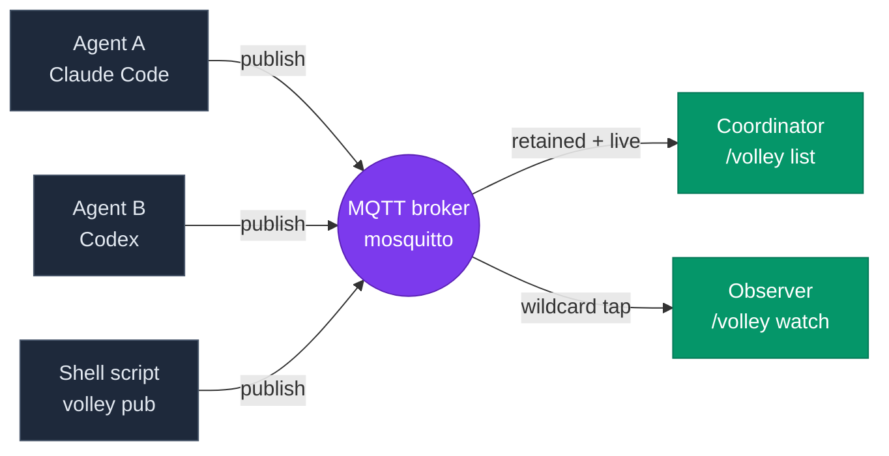

<div align="center">

```
██╗   ██╗ ██████╗ ██╗     ██╗     ███████╗██╗   ██╗
██║   ██║██╔═══██╗██║     ██║     ██╔════╝╚██╗ ██╔╝
██║   ██║██║   ██║██║     ██║     █████╗   ╚████╔╝
╚██╗ ██╔╝██║   ██║██║     ██║     ██╔══╝    ╚██╔╝
 ╚████╔╝ ╚██████╔╝███████╗███████╗███████╗   ██║
  ╚═══╝   ╚═════╝ ╚══════╝╚══════╝╚══════╝   ╚═╝
       ▓▒░  agent coordination over MQTT  ░▒▓
```

**A messaging protocol for AI agents that need to talk to each other, watch each other, or just know whether the others are still alive.**

[](LICENSE)
[](spec/SPEC.md)
[](#license)
[](https://bun.sh)

</div>

---

## Contents

- [What is Volley?](#what-is-volley) — the backstory and the gap it fills
  - [The story](#the-story)
  - [What gap does it fill?](#what-gap-does-it-fill)
  - [Why would *you* need it?](#why-would-you-need-it)
- [The 60-second mental model](#the-60-second-mental-model) — three ideas, one diagram
- [See it running](#see-it-running) — the dashboard, in one screenshot
- [Quickstart](#quickstart) — one command, on macOS or Ubuntu/Debian
  - [Reach it from anywhere](#reach-it-from-anywhere)
  - [See everything in one view](#see-everything-in-one-view)
- [Use cases](#use-cases) — five concrete scenarios
  - [1. Dispatch long-running work to autonomous agents](#1-dispatch-long-running-work-to-autonomous-agents)
  - [2. One pane of glass across machines](#2-one-pane-of-glass-across-machines)
  - [3. Cross-vendor coordination](#3-cross-vendor-coordination)
  - [4. Wait for external events without polling](#4-wait-for-external-events-without-polling)
  - [5. Get notified when agents need attention](#5-get-notified-when-agents-need-attention)
- [What ships in this repo](#what-ships-in-this-repo)
- [Why MQTT?](#why-mqtt) — the tradeoff comparison
- [Contributing](#contributing)
- [License](#license)

---

## What is Volley?

Volley is a thin protocol — an MQTT topic convention plus a JSON envelope — that lets autonomous agents coordinate.

It exists because **agent-to-agent coordination is a real, recurring problem and nobody had standardized it.** Every team building with LLM agents ends up writing the same plumbing: file-based mailboxes, polling loops, custom HTTP endpoints, ad-hoc Slack DMs. None of those interop. None of them detect crashes. None of them surface "who's alive right now?" without you cobbling together a status page.

Volley is what you'd build if you sat down to solve this once, on top of a 30-year-old battle-tested transport, and stopped.

### The story

This started as a yak-shave inside a single repo: dispatch a batch of GitHub issues to autonomous Claude Code instances, each in its own git worktree, and have one coordinator agent wake up the moment any of them finishes.

The legacy approach used a polling loop with `ScheduleWakeup` callbacks every few seconds. It worked, sort of. But:

- The coordinator woke up **4 seconds after** an agent finished, on average — not catastrophic, but felt sluggish, and the per-poll cost added up across long-running batches.
- If an agent's process died (OOM, `kill -9`, network drop), the coordinator had **no way to know**. It would poll forever against a dead agent.
- There was no "show me everything happening right now" view. To see what the dispatched agents were doing, you'd open each cmux workspace by hand.

These aren't novel problems. MQTT solved them in 1999. So Volley is the smallest possible adapter that lets LLM agents speak MQTT and get retained registries, wildcard subscriptions, and Last-Will-and-Testament crash detection for free.

### What gap does it fill?

| | Without Volley | With Volley |
|---|---|---|
| Wake on agent terminal status | Poll every 3–5s | Sub-2s, event-driven |
| Detect crashed agent | Never (poll loops forever) | ~60s via MQTT LWT |
| "Who's alive right now?" | Build a status page | `/volley list` |
| Cross-vendor agent coordination | Build a custom protocol | Both speak Volley's JSON envelope |
| Cross-machine coordination | VPN + custom RPC | Point at the same broker |
| Watch any agent's progress live | SSH + tail -f | `/volley watch <agent>` |

### Why would *you* need it?

Four concrete situations:

1. **You're dispatching long-running work to autonomous agents.** Maybe it's GitHub issues, maybe it's data pipelines, maybe it's overnight test runs. You need to know the moment each finishes, distinguish "done" from "blocked" from "crashed," and not have to babysit them.

2. **You want one pane of glass across all your agents.** Your Claude Code session on this laptop, the Codex session on your desktop, the shell script running on your VPS — you want to see them all, in one list, with their status, in real time.

3. **You're building tools that should compose with other people's agents.** Volley is vendor-neutral. If your tool publishes to and subscribes from the topic conventions in [`SPEC.md`](spec/SPEC.md), it interoperates with any other Volley-aware agent — Claude Code, Codex, future things, plain bash.

4. **You want your Claude Code session to react to external events without polling.** A CI run finishes, a deploy lands, a webhook fires — your conversation resumes within ~1s instead of waking on a sleep timer.

If none of those describe you, you probably don't need Volley. That's fine.

---

## The 60-second mental model



Three ideas do all the work:

1. **Topics**: every message lives at `volley/<namespace>/<agent_id>/<channel>`. Channels are things like `status`, `progress`, `mailbox`, `result`. The `_system/registry/<id>` topic carries each agent's discovery record.
2. **Envelopes**: every message body is a JSON object with `schema_version`, `agent_id`, `wall_time`, `channel`, `type`, `payload`. Forward-compatible by design.
3. **Lifecycle**: agents transition `spawning → registered → working → (done | blocked | failed) → reaped`. The retained value at `<id>/status` always reflects current state.

That's it. Everything else in the spec is a refinement.

---

## See it running


`volley dash` opens a browser view of every registered agent — live status, progress, retained envelopes, full event feed. No Volley-side backend; the browser connects directly to your broker over WebSocket. More in [See everything in one view](#see-everything-in-one-view).

---

## Quickstart

One command, on a Mac or on Ubuntu/Debian:

```sh
curl -fsSL https://raw.githubusercontent.com/kryptek/volley/main/install.sh | sh
```

It installs what is missing, Volley at the latest release tag, and then runs `volley setup`,
which ends with a 1-issue test wave merged on a scratch repository: proof the whole path works.

| | macOS | Ubuntu / Debian |
| --- | --- | --- |
| Prerequisites | Homebrew (its installer asks for your password: the only sudo), then bun, mosquitto, gh, git, tmux and Claude Code | one sudo prompt, reasons printed first: apt packages, bun, gh, mosquitto 2.1 (the snap) and Claude Code |
| Volley | `~/.volley/src` (or the Homebrew formula), commands in `~/.volley/bin` | `~/.volley/src`, commands in `~/.volley/bin` |
| `PATH` | one line in your shell's startup file (zsh, bash; fish is told the line) | the same |
| Services | launchd | `systemd --user` |

**What setup asks.** Three questions, each answered by Enter:

1. *Let devices on your network reach the Desk?* (Enter: yes, so your phone can sign in.)
2. `Coordinator name [coord-<this machine>]:` (the name your waves belong to.)
3. `Run a 1-issue test wave now?` (Enter: yes.)

and two sign-ins in your browser, **Claude Code** and **GitHub**, each only when you are signed
out. Before it changes anything, each step shows what it will change and asks
`Apply these <n> changes (…)? [y/N]`: type `y`, because Enter answers no and setup stops
without changing anything (`volley setup --yes` applies every step without asking). You copy no
password: setup wires the logins itself.

**When it finishes** it prints `Setup complete in <m> m <s> s (…)` with the test wave's PR, and:

- **The Desk.** Open the `http://localhost:5199/#signin=…` link it printed under *One-time admin
  token* (single use, 10 minutes; `volley auth token` prints another). Scan the QR to sign in
  your phone too.
- **Claude Code.** Open a new terminal (for `PATH`) and start `claude`; a session that was
  already open needs a restart once. `/volley list` shows your session; `/volley-issues` runs a
  wave.
- **Getting started.** The admin link opens the Desk on **Getting started**, its first-launch
  wizard: Welcome → This computer → Your machines → Repos → People → Access → You're good to go!.
  It shows this machine's checks, pairs your other computers, adds repositories, invites people,
  chooses how you reach the cluster from away (Tailscale, your own VPN, or this network only) and
  which always-on machine keeps your coordinator running. Each step shows what it will change
  before it applies it; Settings › Setup & Security reopens it
  ([the Desk's README](packages/volley-desk/README.md#getting-started)).

`volley setup --check` says what is missing without changing anything; rerunning the one command
or `volley setup` changes nothing that is in place. **What the installer does**, every flag,
`--uninstall`, the Linux notes, the Homebrew path (`brew install kryptek/volley/volley`, then
`volley setup`), adding a second machine (`volley machine add you@box`) and setup from a clone:
[`docs/INSTALL.md`](docs/INSTALL.md).

### Reach it from anywhere

Volley never opens a public listener. Away from home you reach it over a private network you set
up once: **Tailscale** (the default: `volley setup --network tailscale`, or Getting started ›
Access, then the Tailscale app on your phone) or **your own VPN** (`--network manual
--network-address <host-or-ip>`). With Tailscale, setup serves the Desk over HTTPS at the
machine's name (`https://<name>.example.ts.net`, `volley desk install --tailscale` on a machine
that serves only the Desk), so the phone opens it from Wi-Fi or cellular, signs in with a link
and gets browser notifications. Pick an always-on machine for the **coordinator** and volleyd
keeps a Claude Code Remote Control session alive there: open it from the Claude app on your
phone, or the Desk's **Open coordinator**, and run `/volley-issues` from anywhere with your
laptop's lid closed. Details: [`docs/INSTALL.md`](docs/INSTALL.md#reach-it-from-outside-your-network)
(the Network step and its flags), the Desk's
[On your private network](packages/volley-desk/README.md#on-your-private-network), and volleyd's
[coordinator role](packages/volleyd/README.md#the-coordinator-role).

### See everything in one view

The [Volley Desk](packages/volley-desk/README.md) at `http://localhost:5199` (and at
`http://<this machine's LAN address>:5199` for your phone, with LAN access on) is an infinite
canvas of wave and agent windows that works on a phone, without WebGL and from the keyboard. To
work on the Desk itself, launch it from a checkout with `volley dash` (`http://localhost:5174`).

The classic dashboard stays available as `volley dash --legacy` until its removal in a later
release: a Vite dev server on `http://localhost:5173` that subscribes directly to the broker over
WebSocket (port `9001`); there is no Volley-side backend, the page is the client. On first load
it asks you to sign in with the `desk` login setup created (stored in that browser's
localStorage).


Every registered agent shows up as a card with live status, progress, and capability tags. The top bar surfaces working/stuck counts, a namespace filter, broker connection state, and a notification bell (`/` focuses the agent filter). The right rail is a live event feed across all topics — status, progress, mailbox, result.

Click any card to open the inspector drawer:


The drawer shows the retained status envelope verbatim, the agent's recent progress messages, and the topic subscriptions it's holding — useful when you're debugging a misbehaving publisher and want to see what the broker actually has.

Flags worth knowing:

```sh
volley dash --no-open                     # don't auto-open the browser
volley dash --build                       # production build + preview server
volley dash --broker-url ws://host:9001   # point at a non-default broker
volley dash --legacy                      # the classic dashboard (deprecated)
```

See [`packages/volley-cli/README.md#volley-dash`](packages/volley-cli/README.md#volley-dash) for the full flag set and [`packages/volley-dash/README.md`](packages/volley-dash/README.md) for the dashboard's own architecture notes (browser notifications, keyboard shortcuts, theming).

---

## Use cases

### 1. Dispatch long-running work to autonomous agents

You point `/volley-issues` at ten GitHub issue numbers, say go, and walk away. The session that submitted the wave can end: the wave belongs to your coordinator name (`VOLLEY_COORDINATOR`), not to the session.

What happens next is automated, by the `volleyd` supervisor under **autopilot**:

- The skill turns the issues into a wave file (`Depends on: #N` lines become task order), with `merge: auto` and `branch_update: merge`, and submits it with `volleyd run <wave.yaml> --owner "$VOLLEY_COORDINATOR"` on a release branch.
- volleyd gives each task its own git worktree and Claude Code session, runs the implement → two reviews → fixup pipeline, and gates each PR on CI at exactly the reviewed head.
- It answers the routine decisions itself (a relaunch, a disputed P1, a spawn-budget raise) from a policy table, within per-wave budgets; fixes flaky CI; keeps branches current by merging the release branch in (no force-push); squash-merges each gated PR in dependency order; and starts dependents once what they depend on is merged.
- When every task is merged and the repository has a release playbook (`.volley/release.yaml`), the release train runs its stages (version bump, changelog, staging, smoke) one at a time; production and the final go/no-go stay yours.
- If a session crashes hard (OOM, `kill -9`), the broker's LWT fires within ~60s; volleyd sees the agent go and relaunches it once.
- What it must not or could not answer (owner-only decisions such as a plan change or the release's go/no-go, and escalations whose budget is spent) waits in the Desk's **Needs-you** window and rings your phone once. Answer it there, from the phone, with `volleyd inbox answer`, or in a terminal; the first answer wins.
- In the morning, one **digest** per wave (one push; `volleyd digest <wave>`, the Desk's digest card) says what shipped, what autopilot handled and what is waiting for you.

You go from "ten issues sitting in the backlog" to "ten merged PRs on a release branch ready for release" with a single command and a few answers along the way. The owner's guide, [`docs/AUTOPILOT.md`](docs/AUTOPILOT.md), says what runs unattended, what still asks you, how to opt a wave out and how to read the digest; the owner's real unattended run is [`SMOKE.md`](SMOKE.md) Plan 13. Want to drive a wave yourself? `--autopilot off` makes every decision wait for you, and the skill's hand-driven loop takes over; without volleyd, the skill's legacy path launches each agent from the session and wakes on each one's terminal status.

### 2. One pane of glass across machines

You have a Mac and a Linux box under the desk. volleyd runs on the Mac; you want a wave's agents
on both, wherever there is room, without deciding by hand.

1. **Pair it.** In the Desk, Settings › Machines › **+ Add a machine** shows a one-time
   `volley peer join <code> --to <you@mac>` to run on the box. The box gets its own broker
   account, an ssh tunnel to the broker and a heartbeat, and shows up as a card.
2. **Doctor and Repair.** The card lists the box's checks (tools, the PATH an agent gets over
   ssh, the volley checkout, the repo, GitHub, Claude, memory and disk), each with its fix.
   **Repair…** shows what it would change, then runs `volley peer doctor --fix` there; the rest
   it gives you as commands to copy. From a terminal: `volley peer doctor` on the box.
3. **Sign it in to Claude from the Mac.** **Sign in on box-a** runs Claude Code's own login on
   the box and opens the sign-in in the Mac's browser; from a phone, type the code into a
   terminal on the box. Volley never sees a credential.
4. **Let the wave place itself.** `placement: auto` in the wave file:

   ```
   $ volleyd run fleet.yaml
   if admitted now: T1 → box-a (0.85), T2 → mac (0.58)
   $ volleyd status
     T1  #101   implement
       on box-a (auto, 0.81)
         box-a    0.81  load 3.2 on 16 cores · 1/4 agents · 71% mem · usage 34%
         mac      0.63  load 6.0 on 8 cores · 2/12 agents · 40% mem · usage 34%
   ```

   The Desk shows the same "why here" lines on each task's host chip.
5. **When a machine goes away.** Its spawns park; after 5 minutes the Desk asks whether to wait,
   re-place the queued tasks elsewhere, or cancel. An overloaded machine takes no new agents
   until it calms down. `volley peer remove box-a --drain` lets its agents finish first. A
   running agent is never moved.
6. **Move a role.** The broker, the supervisor and the Desk start on the Mac, and you can move
   the broker, the supervisor or the Desk to the box from the Desk: the box's card › **Move a
   role here…** shows every step and the machine it runs on before anything changes, and a done
   move is undone within 7 days (**Undo this move**, or `volley role rollback <move_id>`).
   `volley role status` says where each runs.

The details: the volleyd README's [Fleet](packages/volleyd/README.md#fleet) and
[Machine roles](packages/volleyd/README.md#machine-roles) sections, and the owner's runs on real
hardware, [`SMOKE.md`](SMOKE.md) Plan 12 and [`docs/SMOKE-v0.11.md`](docs/SMOKE-v0.11.md) part B.

Agents that volleyd does not supervise join the same view by pointing at the same broker: your
Claude Code here, a Codex job on the desktop, a nightly script on a VPS. `/volley list
--all-namespaces` from any machine lists them all, and if one dies hard, MQTT's
Last-Will-and-Testament flips it to `reaped` within 60–90 seconds.

### 3. Cross-vendor coordination

Volley doesn't care what's publishing or subscribing. If your tool can speak MQTT v5 and emit a JSON envelope per `spec/SPEC.md`, it participates. Claude Code can dispatch to Codex agents that publish their own progress; a CI job can be a one-shot Volley agent that announces its result; a long-lived background watcher can be a non-LLM Python script.

The protocol is the contract. The implementations don't need to know about each other.

### 4. Wait for external events without polling

You push a branch and want your Claude Code session to react the moment CI finishes — not on the next `gh run watch` refresh, not after `sleep 60; gh run view` wakes up. Drop one line into your GitHub Actions workflow (see [`examples/bridges/github-actions/`](examples/bridges/github-actions/)) and the runner publishes a Volley status envelope when the job flips state. In your Claude Code session, run `/wait gh-<owner>-<repo>-<run-id> --namespace ci` and the conversation blocks until that topic fires. When CI lands, the session wakes within ~1s with a single summary line.

The same pattern works for anything that can shell out: a deploy script, a webhook receiver, a cron job, a long-running data pipeline. The bridge is a few lines that compute a deterministic `agent_id` from whatever stable identifiers the source system exposes, then publish to `volley/<ns>/<agent_id>/status`. The waiter computes the same id and targets the same topic. Neither side has to know the other exists.

The [`/wait`](packages/volley-wait/SKILL.md) skill and the [bridge pattern](examples/bridges/) are the two pieces. `volley setup` installs the skill; the bridges are copy-paste shell snippets you adapt to your source system.

### 5. Get notified when agents need attention

v0.1.3 adds two surfaces for surfacing agent state transitions to the human, on whichever channel you're already paying attention to:

- **[`volley notify`](packages/volley-cli/README.md#volley-notify)** — a long-lived CLI subscriber that fires the terminal bell + macOS desktop banners + arbitrary HTTP webhooks on matching agent transitions. Default trigger set is "attention-needed only" (`blocked,failed,reaped,digest`, `digest` being volleyd's one push per wave digest). Run one per terminal tab; pipe its JSON output to `jq` for live tail. Webhook lets you bridge to ntfy.sh, Slack, Discord, or anything else that takes a POST.
- **[Dashboard "Browser notifications"](packages/volley-dash/README.md#browser-notifications)** — a bell-icon Settings popover in the [`volley dash`](packages/volley-cli/README.md#volley-dash) top bar that fires the browser Notification API + a short bundled chime for the same trigger events. Respects `prefers-reduced-motion`. Per-origin localStorage. The Desk goes further: twelve [sound themes](packages/volley-desk/README.md#sounds) for 28 events, with per-event switches, quiet hours and an audition row per theme in Settings › Sound.

Both surfaces are pure clients of the existing `status` channel (and, for `digest`, volleyd's `progress` channel: `--pattern 'volley/+/volleyd/progress'`) — no new envelope fields, no new topics, no new MCP tools. They observe the same protocol any other Volley client does; the protocol is unaffected by their presence.

---

## What ships in this repo

```
spec/                     The protocol — wire format, conformance, error codes
  SPEC.md                 Normative spec (read this if you're implementing Volley)
  schemas/*.json          JSON Schema for every envelope shape
  examples/               Valid + invalid example envelopes (used for testing)

packages/volley-mcp/      Reference MCP server. The seven vol_* tools.
packages/volley-cli/      CLI for shell-script agents and broker debugging, and the machine's setup: `volley setup` (first-run wizard),
                          `volley auth` (broker accounts, sign-in links), `volley peer` (pairing), `volley claude` (Claude accounts),
                          `volley dash` / `volley desk serve`, `volley notify`.
packages/volley-dash/     Classic browser dashboard (deprecated; `volley dash --legacy`). Subscribes via WebSocket; no backend.
packages/volley-desk/     The Desk: infinite canvas of live wave and agent windows (Vite + React 19 + React Bits); `volley dash` opens it, `?demo=1` runs it on sample data.
packages/volley-skill/    The /volley Claude Code slash command.
packages/volley-wait/     The /wait Claude Code slash command (event-driven block on a topic).
packages/volley-issues/   The /volley-issues dispatch skill.
packages/volley-hooks/    Claude Code hooks: real model in the registry, mailbox drain + inject + ack, idle / awaiting-input, heartbeats.
packages/volleyd/         Wave supervisor daemon (pre-release): wave files, durable journal, DAG scheduler,
                          authority fence, runtime-tunable config, launchd / systemd service, paired machines,
                          several Claude accounts, the Desk's setup wizard, autopilot (policy table, self-healing
                          CI, merge queue, release train, needs-you inbox, morning digest). `volleyd --help`.

examples/bridges/         Adapters that publish external events (CI, webhooks, ...) onto Volley topics.
  github-actions/         GitHub Actions → mosquitto bridge script.
```

Each `packages/*/` has its own README with install, usage, and architecture notes. `examples/bridges/` has an index README explaining the bridge pattern and how to add a new one.

---

## Why MQTT?

The honest answer: because the alternatives were worse.

| Option | Why we didn't pick it |
|---|---|
| **HTTP webhooks** | Every agent needs a publicly reachable endpoint. NAT punching, port forwarding, ngrok-style tunnels. No retained state. No discovery. |
| **WebSockets** | Solves bidirectional, but you still have to design retained-state, discovery, crash-detection on top. |
| **gRPC streams** | Tight coupling. Schema-bound. No retained state. No wildcards. Heavy. |
| **A custom binary protocol** | One more thing to maintain. Nobody else can plug in. |
| **Redis pub/sub** | No retained messages. No LWT. No wildcards in the message bus sense. |
| **MQTT v5** | Has all four primitives (retained, wildcard, QoS, LWT) baked in. Brokers are commodity (mosquitto is `brew install` away). 30 years of production hardening. Cross-language. |

MQTT's main downside is unfamiliarity in the LLM-tooling crowd. That's a docs problem, not a protocol problem.

---

## Contributing

Volley is pre-1.0 and the wire format can still change: open an issue before a large change, so it can be discussed against `spec/SPEC.md` first. Pull requests are welcome; keep `bun run lint`, `bun run typecheck` and `bun run test` green, and follow the scoped Conventional Commits style in `git log`.

---

## License

Apache 2.0. See [`LICENSE`](LICENSE). Exception: the vendored React Bits components in `packages/volley-desk/src/rb/` keep their upstream licence (MIT + Commons Clause); see [`packages/volley-desk/THIRD_PARTY_NOTICES.md`](packages/volley-desk/THIRD_PARTY_NOTICES.md).

---

<div align="center">

*Volley is built on the assumption that the right primitive is messaging,*
*not RPC, not files, not polling. If that resonates, it should fit.*

</div>
