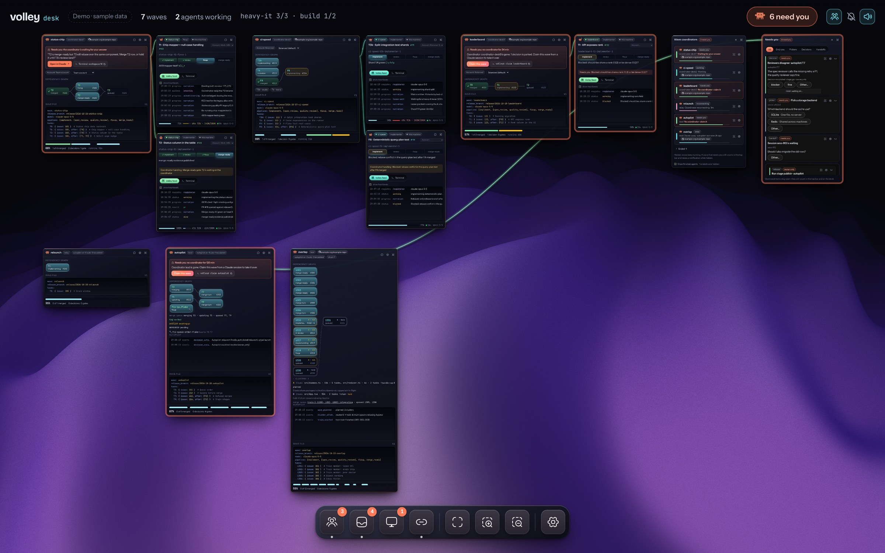
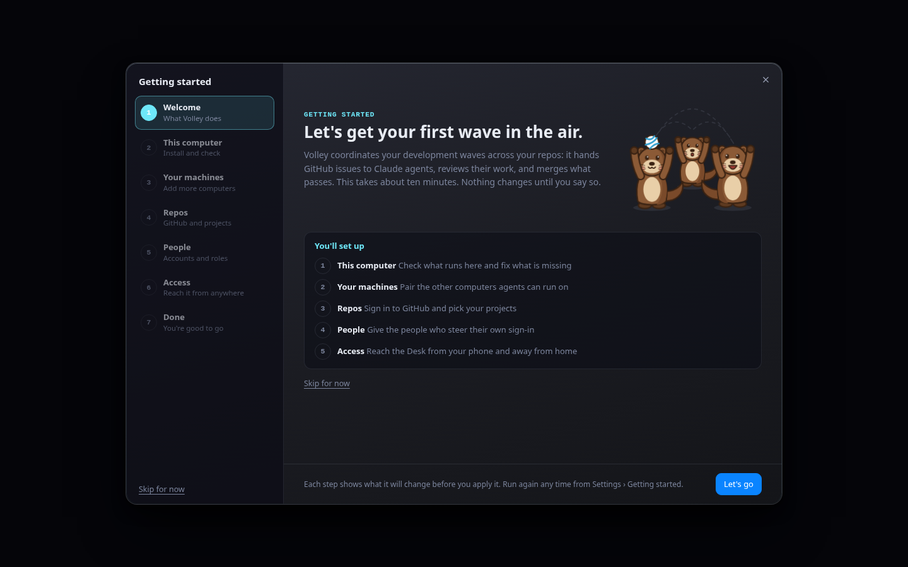
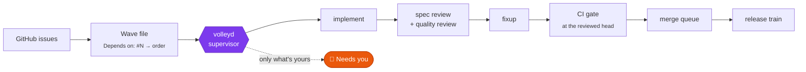
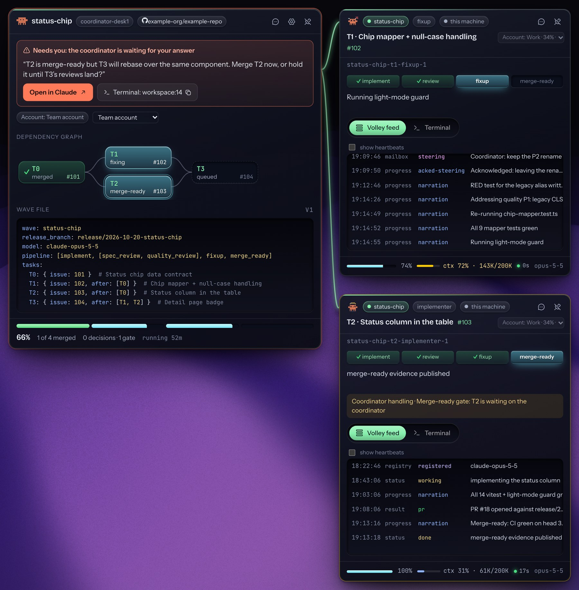
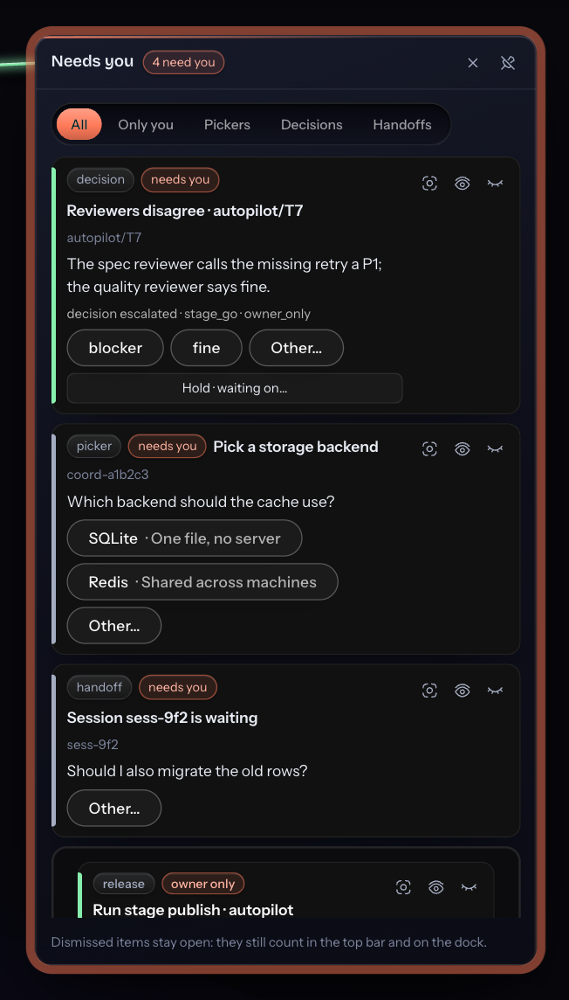
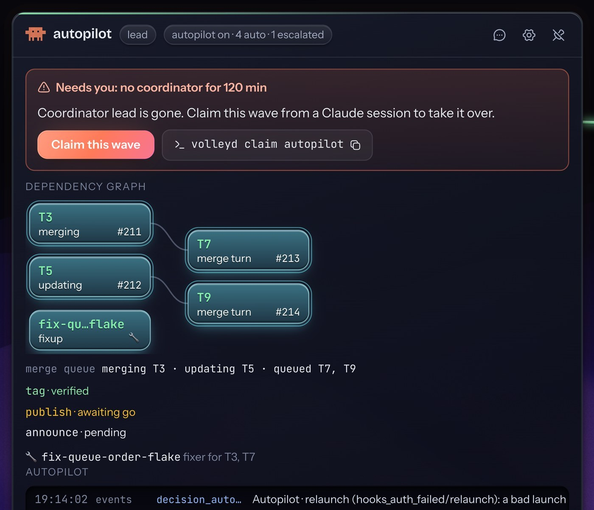
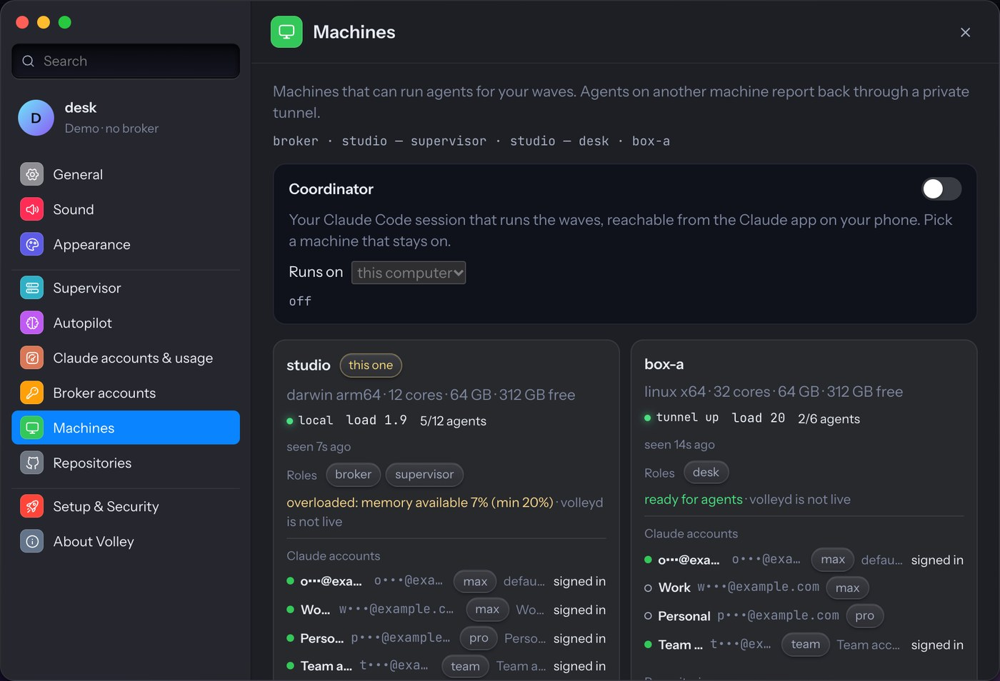
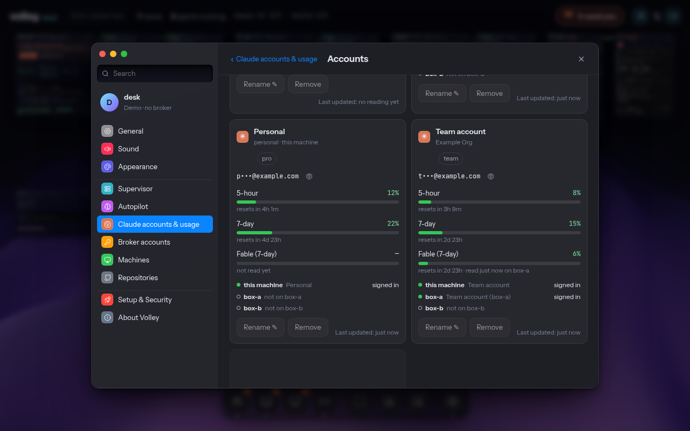

<div align="center">

# 🏐 Volley

### Hand Claude Code a stack of GitHub issues. Come back to merged PRs.

Volley runs a team of Claude Code agents on your repository. Each issue gets its own agent, worktree
and branch, then two independent reviews, a fixup and a CI gate, and lands in a merge queue. You
watch it all on one live canvas, from your laptop or your phone. You only step in for the calls
that are yours to make.

[](LICENSE)
[](CHANGELOG.md)
[](docs/INSTALL.md)
[](https://bun.sh)

[Quickstart](#quickstart) · [How a wave works](#how-a-wave-works) · [The Desk](#the-desk) · [Under the hood](#under-the-hood) · [Docs](docs/)

<br>



</div>

---

## Why Volley

One Claude Code session is a great pair programmer. **Ten at once is a team, and a team needs
someone to run it.** Without that, you end up babysitting terminals: checking which agent
finished, which one is stuck, which one quietly died, and whose PR broke CI.

Volley does that job:

- 🧵 **One command dispatches a wave.** `/volley-issues 101 102 103 …` turns issues into a
  dependency-ordered plan and hands it to a supervisor, `volleyd`. You can close your laptop.
- 🔁 **Every task goes through the full pipeline.** An agent implements the task, a spec reviewer
  and a code-quality reviewer each read it with a fresh context, then a fixup agent applies their
  findings. CI has to pass at exactly the reviewed commit.
- 🤖 **Autopilot handles the routine.** It relaunches a crashed agent, settles a disputed review,
  re-runs flaky CI, keeps branches current and merges in dependency order, all within budgets you
  set.
- 🙋 **You make only the calls that are yours.** Plan changes and release go/no-go wait in one
  inbox, and your phone rings once. In the morning, a digest says what shipped.

> **Without Volley:** ten issues in the backlog, ten terminals to babysit.
> **With Volley:** one command, a few answers from your phone, ten merged PRs on a release branch.

---

## Quickstart

One command, on macOS or Linux (Ubuntu/Debian):

```sh
curl -fsSL https://raw.githubusercontent.com/kryptek/volley/main/install.sh | sh
```

The command installs anything that's missing (bun, mosquitto, gh, Claude Code) and Volley itself.
Then `volley setup` asks three questions, each answered with Enter. Before each step changes
anything, it shows what it will change and asks `Apply these <n> changes (…)? [y/N]`; type `y`, because
Enter answers no. Setup finishes by running a **1-issue test wave on a scratch repository and
merging it**, so you know the whole path works before you point Volley at real code.

**When it finishes**, two things are waiting:

- **Claude Code.** Open a new terminal and start `claude`. `/volley list` shows your session,
  and `/volley-issues 101 102 103` runs a wave.
- **Getting started.** The one-time link setup prints opens the Desk on its first-launch wizard.
  It connects your other machines, your repositories, the people you work with, and how you reach
  everything when you're away from home. Each step shows what it will change before it changes it.



Every flag, the Homebrew path (`brew install kryptek/volley/volley`), adding a second machine and
uninstalling are covered in **[docs/INSTALL.md](docs/INSTALL.md)**.

---

## How a wave works



A **wave** is a batch of issues with their dependency order. volleyd gives each task its own git
worktree and Claude Code session, runs it through the pipeline, gates it on CI, and squash-merges
it into a release branch. Tasks that depend on it start once it has merged. When every task has
merged and your repository has a release playbook (`.volley/release.yaml`), the **release train**
runs the version bump, changelog, staging and smoke stages. Production and the final go stay yours.



Each wave window shows its dependency graph, its wave file and its progress. Each agent window
shows its pipeline stage, what it's doing right now, its context and token use, and a live feed
of everything it published. Click **Terminal** to see the agent's actual screen.

---

## The Desk

The Desk is an infinite canvas of live wave and agent windows. It's served on port `5199`, runs on
a phone, and works from the keyboard.

<table>
<tr>
<td width="38%" valign="top">



</td>
<td valign="top">

### 🙋 Needs you

Everything that needs a person lands in one inbox:

- **Decisions** autopilot can't or mustn't make (owner-only calls, spent budgets)
- **Pickers**, where an agent asks you to choose between options
- **Handoffs**, from a session that's waiting on you
- **Release go/no-go**, step by step

Answer from the Desk, from your phone, or with `volleyd inbox answer` in a terminal. The first
answer wins. You get one push per item. You never get a notification storm.

### ☀️ The morning digest

One digest per wave says what shipped, what autopilot handled for you, and what's still waiting.
It arrives as one push, in the Desk, or from `volleyd digest <wave>`.

</td>
</tr>
</table>

<table>
<tr>
<td valign="top">

### 🤖 Autopilot

Autopilot answers routine decisions from a **policy table**, within budgets you set per wave: a
relaunch, a disputed P1, a spawn-budget raise. It fixes flaky CI, merges the release branch into
each task branch to keep it current (no force-push), queues gated PRs, and runs the release train.
Each wave's chip shows its tally (`autopilot on · 4 auto · 1 escalated`). If you'd rather drive a
wave yourself, pass `--autopilot off`. Owner's guide: **[docs/AUTOPILOT.md](docs/AUTOPILOT.md)**.

</td>
<td width="46%" valign="top">



</td>
</tr>
</table>

### 🖥️ Every machine you own, one fleet



Pair a Linux box under your desk with `volley peer join`. With `placement: auto`, each task goes to
the machine with room for it, and the Desk shows why it went there. An overloaded machine takes no
new agents until it calms down. If a machine drops off, its queued tasks wait, and the Desk asks
whether to place them elsewhere. **Doctor** lists each machine's checks with a fix for each, and
**Repair…** applies those fixes. You can move the broker, the supervisor or the Desk to another
machine from the Desk, and undo the move within 7 days.

### 🔑 Several Claude accounts, balanced



Sign several Claude accounts in on each machine. By default, new agents go to the account with the
most headroom. If you pin a wave to one account and it nears its limit, Volley asks whether to move
the wave to another. Nothing switches on its own. The Desk shows each account's 5-hour and 7-day
usage on every machine. Sign-ins run
through Claude Code's own login, so Volley never sees a credential.

### Reach it from anywhere 📱

Volley never opens a public listener. Away from home, you reach it over **Tailscale** (the default)
or your own VPN. The Desk is served over HTTPS at your machine's tailnet name, so your phone signs
in with a link and gets notifications on Wi-Fi or cellular. Pick an always-on machine for the
**coordinator**, and volleyd keeps a Claude Code Remote Control session alive there. From the Claude
app on your phone, you can run `/volley-issues` with your laptop's lid closed. Details:
[setup's Network step](docs/INSTALL.md#reach-it-from-outside-your-network), the Desk
[on your private network](packages/volley-desk/README.md#on-your-private-network), and
[the coordinator role](packages/volleyd/README.md#the-coordinator-role).

### ✨ The small things

- **Sound:** twelve sound themes across 28 events, with per-event switches and quiet hours.
- **Look:** twelve colour themes (eleven dark, one light), animated current-step effects, and live backgrounds.
- **Steering:** message any agent or coordinator mid-task. Delivery is acknowledged.
- **Accessibility:** works without WebGL, with reduced motion, by keyboard and with a screen reader.

---

## Under the hood

Volley started as a protocol, and still is one: **an MQTT topic convention plus a JSON envelope**.
Everything above is built on it, and anything that speaks it can join in.

```text
volley/<namespace>/<agent_id>/status      retained: what the agent is doing right now
volley/<namespace>/<agent_id>/progress    narration, heartbeats
volley/<namespace>/<agent_id>/mailbox     steering, questions, answers
volley/<namespace>/<agent_id>/result      PRs, artifacts
volley/<namespace>/_system/registry/<id>  who's alive (cleared by Last Will when they're not)
```

| You get… | …from MQTT |
|---|---|
| Wake within ~1s of an agent finishing, with no polling | live subscriptions |
| "Who's alive right now?" | retained registry |
| Crashed agent detected in ~60s, even after `kill -9` | Last Will and Testament |
| Watch everything in one subscription | wildcards (`volley/+/+/status`) |
| Agents on any machine, any vendor | point at the same broker |

That's why the Desk needs no backend, since the browser subscribes to the broker directly. It's
also why the same protocol works outside waves:

- **`/wait`** blocks a Claude Code session on any topic. Add one line to a GitHub Actions
  workflow ([bridges](examples/bridges/)), and your session wakes the moment CI finishes.
- **`volley notify`** sends terminal bells, desktop banners or webhooks (ntfy, Slack, Discord) when
  an agent is blocked, fails, or dies.
- **Codex, shell scripts, cron jobs and CI runners** can all publish envelopes and show up beside
  your Claude agents. `/volley list --all-namespaces` lists all of them.

The wire format is specified in **[spec/SPEC.md](spec/SPEC.md)**, with JSON Schemas and example
envelopes.

<details>
<summary><b>Why MQTT and not HTTP, WebSockets, gRPC or Redis?</b></summary>

<br>

| Option | Why not |
|---|---|
| HTTP webhooks | Every agent needs a reachable endpoint. No retained state, no discovery. |
| WebSockets | Bidirectional, but retained state, discovery and crash detection are on you. |
| gRPC streams | Tight coupling, no retained state, no wildcards. |
| Redis pub/sub | No retained messages, no Last Will. |
| **MQTT v5** | Retained messages, wildcards, QoS and Last Will built in. Brokers are commodity (`brew install mosquitto`), and it has decades of production hardening. |

</details>

---

## Cheat sheet

| Do this | With |
|---|---|
| Install and set up a machine | `curl -fsSL …/install.sh \| sh` · `volley setup` |
| Dispatch issues as a wave | `/volley-issues 101 102 103` (Claude Code) |
| Add issues to a running wave | `volleyd add <wave> 104 105` |
| See every wave and task | `volleyd status` · the Desk at `:5199` |
| Answer what's waiting on you | the Desk's **Needs you** · `volleyd inbox answer` |
| Read the morning digest | `volleyd digest <wave>` |
| See who's alive / watch an agent | `/volley list` · `/volley watch <agent>` |
| Block a session until something happens | `/wait <agent-or-topic>` |
| Pair another machine | `volley peer join <code> --to you@host` · `volley peer doctor` |
| Check a repo is ready for waves | `volley repo check <owner/name>` |
| Report a bug, with diagnostics redacted | `volley bug` |

---

## What's in the repo

| Package | What it is |
|---|---|
| [`volleyd`](packages/volleyd/) | The wave supervisor: wave files, durable journal, DAG scheduler, autopilot, merge queue, release train, fleet placement |
| [`volley-desk`](packages/volley-desk/) | The Desk (React 19). `?demo=1` runs it on sample data, with no broker |
| [`volley-cli`](packages/volley-cli/) | `volley setup`, `auth`, `peer`, `repo`, `claude`, `notify`, `bug`, `pub`/`sub` |
| [`volley-issues`](packages/volley-issues/) | The `/volley-issues` Claude Code skill |
| [`volley-skill`](packages/volley-skill/) · [`volley-wait`](packages/volley-wait/) | The `/volley` and `/wait` Claude Code skills |
| [`volley-hooks`](packages/volley-hooks/) | Claude Code hooks: registry, mailbox delivery, idle detection, heartbeats |
| [`volley-mcp`](packages/volley-mcp/) | Reference MCP server (`vol_*` tools) and the broker client |
| [`spec/`](spec/) | The protocol: SPEC.md, JSON Schemas, conformance examples |
| [`examples/bridges/`](examples/bridges/) | Publish external events (CI, webhooks) onto Volley topics |

---

## Contributing

Volley is pre-1.0, and the wire format can still change. Found a bug? Run **`volley bug`** on the
machine that has it. It gathers and redacts the diagnostics, shows you exactly what it will send,
and opens the issue only if you say yes. Before a large change, open an issue so it can be discussed
against `spec/SPEC.md` first. Keep `bun run lint`, `bun run typecheck` and `bun run test` green.

## License

Apache 2.0. See [`LICENSE`](LICENSE). The vendored React Bits components in
`packages/volley-desk/src/rb/` keep their upstream licence. See
[`THIRD_PARTY_NOTICES.md`](packages/volley-desk/THIRD_PARTY_NOTICES.md).

<div align="center">
<br>
<sub>Built by running it: Volley's own releases ship as Volley waves.</sub>
</div>
