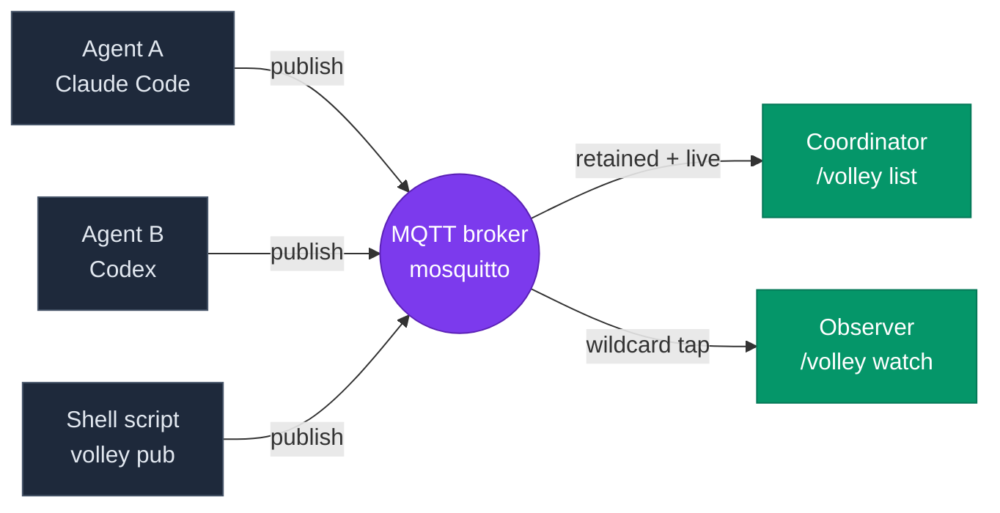
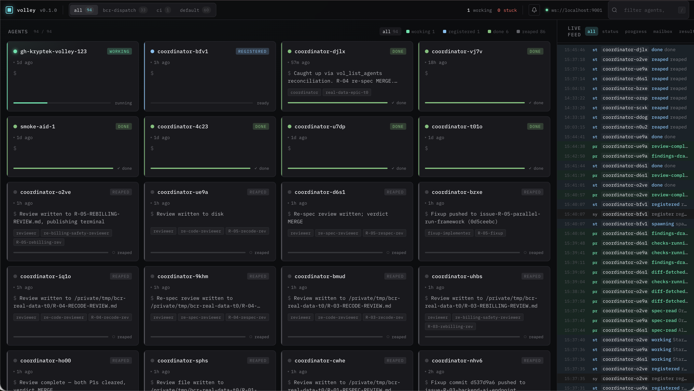
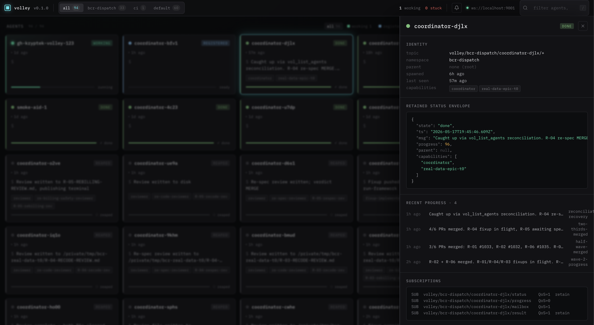

<div align="center">

```
██╗   ██╗ ██████╗ ██╗     ██╗     ███████╗██╗   ██╗
██║   ██║██╔═══██╗██║     ██║     ██╔════╝╚██╗ ██╔╝
██║   ██║██║   ██║██║     ██║     █████╗   ╚████╔╝
╚██╗ ██╔╝██║   ██║██║     ██║     ██╔══╝    ╚██╔╝
 ╚████╔╝ ╚██████╔╝███████╗███████╗███████╗   ██║
  ╚═══╝   ╚═════╝ ╚══════╝╚══════╝╚══════╝   ╚═╝
       ▓▒░  agent coordination over MQTT  ░▒▓
```

**A messaging protocol for AI agents that need to talk to each other, watch each other, or just know whether the others are still alive.**

[](LICENSE)
[](spec/SPEC.md)
[](#license)
[](https://bun.sh)

</div>

---

## Contents

- [What is Volley?](#what-is-volley) — the backstory and the gap it fills
  - [The story](#the-story)
  - [What gap does it fill?](#what-gap-does-it-fill)
  - [Why would *you* need it?](#why-would-you-need-it)
- [The 60-second mental model](#the-60-second-mental-model) — three ideas, one diagram
- [See it running](#see-it-running) — the dashboard, in one screenshot
- [Quickstart (5 minutes, fresh Mac)](#quickstart-5-minutes-fresh-mac) — copy-paste setup
  - [1. Install Homebrew](#1-install-homebrew-skip-if-you-already-have-it)
  - [2. Install the MQTT broker](#2-install-the-mqtt-broker)
  - [3. Clone and install Volley](#3-clone-and-install-volley)
  - [4. Register the MCP server with Claude Code](#4-register-the-mcp-server-with-claude-code)
  - [5. Install the `/volley` skill](#5-install-the-volley-skill)
  - [6. See your first agent](#6-see-your-first-agent)
  - [7. See everything in one view](#7-see-everything-in-one-view)
- [Use cases](#use-cases) — five concrete scenarios
  - [1. Dispatch long-running work to autonomous agents](#1-dispatch-long-running-work-to-autonomous-agents)
  - [2. One pane of glass across machines](#2-one-pane-of-glass-across-machines)
  - [3. Cross-vendor coordination](#3-cross-vendor-coordination)
  - [4. Wait for external events without polling](#4-wait-for-external-events-without-polling)
  - [5. Get notified when agents need attention](#5-get-notified-when-agents-need-attention)
- [What ships in this repo](#what-ships-in-this-repo)
- [Why MQTT?](#why-mqtt) — the tradeoff comparison
- [Contributing](#contributing)
- [License](#license)

---

## What is Volley?

Volley is a thin protocol — an MQTT topic convention plus a JSON envelope — that lets autonomous agents coordinate.

It exists because **agent-to-agent coordination is a real, recurring problem and nobody had standardized it.** Every team building with LLM agents ends up writing the same plumbing: file-based mailboxes, polling loops, custom HTTP endpoints, ad-hoc Slack DMs. None of those interop. None of them detect crashes. None of them surface "who's alive right now?" without you cobbling together a status page.

Volley is what you'd build if you sat down to solve this once, on top of a 30-year-old battle-tested transport, and stopped.

### The story

This started as a yak-shave inside a single repo: dispatch a batch of GitHub issues to autonomous Claude Code instances, each in its own git worktree, and have one coordinator agent wake up the moment any of them finishes.

The legacy approach used a polling loop with `ScheduleWakeup` callbacks every few seconds. It worked, sort of. But:

- The coordinator woke up **4 seconds after** an agent finished, on average — not catastrophic, but felt sluggish, and the per-poll cost added up across long-running batches.
- If an agent's process died (OOM, `kill -9`, network drop), the coordinator had **no way to know**. It would poll forever against a dead agent.
- There was no "show me everything happening right now" view. To see what the dispatched agents were doing, you'd open each cmux workspace by hand.

These aren't novel problems. MQTT solved them in 1999. So Volley is the smallest possible adapter that lets LLM agents speak MQTT and get retained registries, wildcard subscriptions, and Last-Will-and-Testament crash detection for free.

### What gap does it fill?

| | Without Volley | With Volley |
|---|---|---|
| Wake on agent terminal status | Poll every 3–5s | Sub-2s, event-driven |
| Detect crashed agent | Never (poll loops forever) | ~60s via MQTT LWT |
| "Who's alive right now?" | Build a status page | `/volley list` |
| Cross-vendor agent coordination | Build a custom protocol | Both speak Volley's JSON envelope |
| Cross-machine coordination | VPN + custom RPC | Point at the same broker |
| Watch any agent's progress live | SSH + tail -f | `/volley watch <agent>` |

### Why would *you* need it?

Four concrete situations:

1. **You're dispatching long-running work to autonomous agents.** Maybe it's GitHub issues, maybe it's data pipelines, maybe it's overnight test runs. You need to know the moment each finishes, distinguish "done" from "blocked" from "crashed," and not have to babysit them.

2. **You want one pane of glass across all your agents.** Your Claude Code session on this laptop, the Codex session on your desktop, the shell script running on your VPS — you want to see them all, in one list, with their status, in real time.

3. **You're building tools that should compose with other people's agents.** Volley is vendor-neutral. If your tool publishes to and subscribes from the topic conventions in [`SPEC.md`](spec/SPEC.md), it interoperates with any other Volley-aware agent — Claude Code, Codex, future things, plain bash.

4. **You want your Claude Code session to react to external events without polling.** A CI run finishes, a deploy lands, a webhook fires — your conversation resumes within ~1s instead of waking on a sleep timer.

If none of those describe you, you probably don't need Volley. That's fine.

---

## The 60-second mental model



Three ideas do all the work:

1. **Topics**: every message lives at `volley/<namespace>/<agent_id>/<channel>`. Channels are things like `status`, `progress`, `mailbox`, `result`. The `_system/registry/<id>` topic carries each agent's discovery record.
2. **Envelopes**: every message body is a JSON object with `schema_version`, `agent_id`, `wall_time`, `channel`, `type`, `payload`. Forward-compatible by design.
3. **Lifecycle**: agents transition `spawning → registered → working → (done | blocked | failed) → reaped`. The retained value at `<id>/status` always reflects current state.

That's it. Everything else in the spec is a refinement.

---

## See it running



`volley dash` opens a browser view of every registered agent — live status, progress, retained envelopes, full event feed. No Volley-side backend; the browser connects directly to your broker over WebSocket. Launch command and walkthrough in [Quickstart step 7](#7-see-everything-in-one-view).

---

## Quickstart (5 minutes, fresh Mac)

> All commands assume macOS with [Homebrew](https://brew.sh). Linux works too — substitute your package manager. Windows: WSL recommended.

### 1. Install Homebrew (skip if you already have it)

```sh
/bin/bash -c "$(curl -fsSL https://raw.githubusercontent.com/Homebrew/install/HEAD/install.sh)"
```

### 2. Install the MQTT broker

Volley needs **mosquitto 2.1 or newer**: broker auth runs on its Dynamic Security plugin with shared roles that use `%u`, which 2.0 does not substitute (Volley refuses an older broker with `BROKER_TOO_OLD`).

```sh
brew install mosquitto              # macOS (2.1.x)
sudo snap install mosquitto         # Linux: the snap is 2.1; distribution packages may still be 2.0
# or a container: docker run eclipse-mosquitto:2.1-alpine (layout in examples/mosquitto-auth/)
```

The broker **requires a username and password on both listeners**. From your clone of this repo (step 3; `bun install` first), let `volley setup` do the rest: it shows what it will change before every step, backs up each file it replaces, and is safe to rerun (`--repair` re-checks and fixes):

```sh
bun packages/volley-cli/src/cli.ts setup        # interactive; --yes to apply every step without asking
```

It finds mosquitto (refusing a version older than 2.1), writes the Dynamic Security broker config for your install (Apple Silicon Homebrew: `/opt/homebrew/etc/mosquitto/mosquitto.conf`, the same as [`examples/mosquitto-localhost.conf`](examples/mosquitto-localhost.conf); the diff is shown and the old file backed up), restarts the broker and checks both listeners refuse anonymous clients; creates the roles and the `volleyd`, `desk` and `coordinator` identities, printing their passwords **once** (keep them: you need `coordinator` in step 4 and `desk` in step 7) and a one-time admin token for the Desk; installs volleyd, the Volley hooks for coordinator sessions and the Desk (`volley desk serve` on port 5199) as services; and, when you let devices on your network reach the broker's WebSocket listener (it asks, recommending yes; `--lan` / `--no-lan` decide up front, and `--yes` alone keeps it on this machine), ends with a QR code that signs your phone in to the Desk (10 minutes, single use). Logins are still required from the LAN, but that traffic is not encrypted until TLS is set up, so open it only on a network you trust. With LAN access off it skips the phone step and says how to add it later. Every step is journaled to `~/.volley/volleyd/setup.log`. On **Linux** with the snap the broker config lives under `/var/snap/mosquitto/common/`, so run it as root (`sudo bun …`), then `volley setup --step services` as yourself for the user services. The manual path, step by step, is [`volley auth init`](packages/volley-cli/README.md#volley-auth); details, the container layout and the migration from an older `password_file` / `acl_file` setup (`volley auth migrate`): [`examples/mosquitto-auth/`](examples/mosquitto-auth/README.md).

When it finishes:

- **Put `volley` on your `PATH`.** Setup installs `volley` and `volleyd` in `~/.volley/bin`: `echo 'export PATH="$HOME/.volley/bin:$PATH"' >> ~/.zshrc`, then open a new terminal. The rest of this guide types `volley`.
- **Open the Desk as admin.** Setup serves the Desk at `http://localhost:5199`. Under *One-time admin token* it prints `Open the Desk with it on this machine: http://localhost:5199/#signin=…`: open that link (in a new tab; the Desk reads a link only when a page loads). The token is single use and lasts 10 minutes; `volley auth token` prints another link. The Desk opens Settings › Setup & Security, where you can rerun any step, issue sign-in links and manage broker accounts.
- **Your phone.** Scan the QR code (same Wi-Fi). It signs the phone in once, as a `steer` account; a used or expired code says so and what to do next.
- **More machines and Claude accounts.** `volley peer invite` / `volley peer join` pair a second machine with one code (the Desk: Settings › Machines), and `volley claude add <label>` (Settings › Claude accounts & usage) runs agents under a second Claude account; `volley claude list` shows each account once, with the machines signed in to it and its freshest usage. See the [volleyd README](packages/volleyd/README.md#claude-accounts).

You now have a broker with two listeners on `127.0.0.1` (with `volley setup --lan`, `9001` also listens on your network; `1883` never does):
- **`1883`** (raw MQTT) — used by `volley-mcp`, `volley-cli`, and any native MQTT client
- **`9001`** (MQTT-over-WebSocket) — used by the [`volley dash`](packages/volley-cli/README.md#volley-dash) browser dashboard, since browsers can't speak raw MQTT-over-TCP

> 🔄 **Upgrading from an earlier Volley setup?** The WebSocket listener (`:9001`) was added with the v0.1.2 dashboard. If your installed `mosquitto.conf` predates that, do not re-copy `examples/mosquitto-localhost.conf` (it is now the Dynamic Security config, and without its state file and admin the broker refuses every client): run `volley auth migrate` (from a `password_file` / `acl_file` setup) or `volley auth init`, which write the config with both listeners, then restart mosquitto as they say. Verify with `lsof -nP -iTCP:9001 -sTCP:LISTEN` — you should see `mosquitto … (LISTEN)`. Without it, the dashboard browser console will hang on `mqtt.connect('ws://localhost:9001')` and you'll see no agents.

> 💾 **Queued mailbox messages and persistence.** Mailbox messages for an agent that is offline wait on the broker in that agent's persistent session ([SPEC §4.4](spec/SPEC.md#44-mailbox-message-types)). mosquitto only flushes its persistence DB every `autosave_interval` seconds (1800 by default), so the bundled config sets `autosave_interval 30` and `autosave_on_changes false`. If you run your own config, add both lines. volleyd's journal remains the source of truth; this only narrows how far the broker's copy can lag behind. Persistent sessions expire after 7 days by default. The hooks drain client (`packages/volley-hooks`) reads the expiry from the runtime tunable `mailbox.session_expiry_s` in volleyd's retained config, with `VOLLEY_SESSION_EXPIRY_S` as the env fallback; volleyd's own mailbox session uses the same tunable. A changed value applies to **new connections only**: an existing session keeps the expiry it was created with until its client reconnects.

> 🔐 **Why a password on localhost?** Agents run with permission prompts skipped and obey their mailbox. A localhost broker is reachable by every local process, and by **any web page you visit** (browsers let pages open a WebSocket to `127.0.0.1:9001`). Without auth, a malicious page could steer your agents or rewrite the supervisor's config. The ACL also stops one agent from steering another. Details, identities and ACL rules: [`examples/mosquitto-auth/`](examples/mosquitto-auth/README.md). Upgrading from the anonymous config? Run `volley auth init` as above, then give each client its credentials (steps 4 and 7). From an earlier `password_file` / `acl_file` setup: `volley auth migrate --coordinator-file --volleyd-file`, restart mosquitto, rerun it.

> ⚠️ **Security note.** The bundled config is **localhost-only**. **If you plan to expose your broker on a network**, you additionally need TLS (`mqtts://` / `wss://`); passwords over plain MQTT are readable on the wire. Start at the [mosquitto auth methods doc](https://mosquitto.org/documentation/authentication-methods/) and the [`mosquitto.conf(5)` reference](https://mosquitto.org/man/mosquitto-conf-5.html). Don't copy a "works on my laptop" config to a public host.

### 3. Clone and install Volley

```sh
git clone https://github.com/<your-fork>/volley.git
cd volley
bun install
```

Need [Bun](https://bun.sh)? `curl -fsSL https://bun.sh/install | bash`. Volley supports Bun **1.3 and 1.4** (`engines.bun` is `>=1.3 <1.5`). CI tests both on a full run (every push, the nightly, a release PR, or a PR labelled `ci:full`), and the newest on every other PR: it installs with that bun and runs volleyd's suite under `bun test` (bun's own runner, on bun) in eight shards balanced by `packages/volleyd/test/timings.json`; the packages' vitest suites run on Node (volley-desk's in two shards). A release-branch push whose tree its PR's run already passed reuses that run instead of running the suite again (so bun 1.3 and the 32-task soak run for it at the release PR and on `main`).

### 4. Register the MCP server with Claude Code

Substitute `<absolute-path-to-this-repo>` with the actual path you cloned to (e.g. `~/repos/volley`):

```sh
claude mcp add-json -s user volley '{
  "command": "bun",
  "args": ["run", "<absolute-path-to-this-repo>/packages/volley-mcp/src/index.ts"],
  "env": {
    "VOLLEY_AGENT_ID": "coordinator",
    "VOLLEY_COORDINATOR": "coord-main",
    "VOLLEY_NAMESPACE": "default",
    "VOLLEY_AUTH_USERNAME": "coordinator",
    "VOLLEY_AUTH_PASSWORD": "<coordinator password from step 2>"
  }
}'
```

The `env` block reaches only the MCP server, **not** the session's Bash tool, and `/volley-issues` and `/wait` run `volley wait` / `volley sub` from that shell. On the machine `volley setup` ran on, those commands find the coordinator login on their own (the macOS keychain, then `coordinator.json` in the auth dir), for a broker on that machine. Anywhere else, export the same identity in that shell:

```sh
export VOLLEY_AUTH_USERNAME=coordinator
export VOLLEY_AUTH_PASSWORD='<coordinator password from step 2>'
```

`VOLLEY_COORDINATOR` is your **coordinator name**: a stable id you choose once (`[a-z0-9][a-z0-9_-]{0,62}`). Export it in your shell profile too (`export VOLLEY_COORDINATOR=coord-main`) and submit waves with `volleyd run <wave.yaml> --owner "$VOLLEY_COORDINATOR"`: the wave is then owned by the name, not by the session's per-restart agent id, so the session keeps steering, resolving, pausing and stopping its waves after its MCP server restarts (volleyd journals `owner_reconnected`; nothing needs claiming). It is also what lets an autopilot wave run without a session: what needs you reaches the Desk's **Needs-you** window and your phone, owned by the name, and any later session with the same `VOLLEY_COORDINATOR` answers for it.

`VOLLEY_AGENT_ID` is a **prefix**: the server appends a fresh `-xxxx` at every start, so this session registers as `coordinator-xxxx` (and two sessions sharing the registration still get distinct ids). Leave it set: without it the id is named after the session's working directory (`volley-xxxx` in this checkout), which reads as just another agent, while the `--owner` a wave is submitted with, the Desk's owner chip and `★ yours`, and the [v0.2 owner smoke](docs/SMOKE-v0.2.md) all expect the `coordinator-` id. For a separate registry (a smoke run, say), change `VOLLEY_NAMESPACE` instead.

Then **quit Claude Code completely (Cmd-Q) and reopen it.** MCP registration is read at startup.

Verify:

```sh
claude mcp list
```

You should see `volley: ... ✓ Connected`.

### 5. Install the `/volley` skill

```sh
bash packages/volley-skill/scripts/install.sh
```

This symlinks the skill into `~/.claude/skills/volley/`. Edits to the skill file take effect immediately.

### 6. See your first agent

Open Claude Code and run:

```
/volley list
```

That's it. Your session is already there — the volley-mcp server auto-registers on startup, with an auto-suffixed `agent_id` like `coordinator-7b9c` (the prefix comes from the `VOLLEY_AGENT_ID` env you set in step 4; the suffix is fresh per process). Open a second Claude Code window and run `/volley list` again — both sessions show up, each with its own distinct id. They can now send each other messages (`/volley msg <id> "..."`), watch each other's status (`/volley watch <id>`), and coordinate.

To declare what your session does (capabilities, model, role) so other agents can find you, ask Claude to call `vol_register` with whatever fits — it's idempotent and updates the registry entry. For most casual use, you never have to.

From here, look at the [`/volley`](packages/volley-skill/SKILL.md) and [`/volley-issues`](packages/volley-issues/SKILL.md) skills for what's possible.

### 7. See everything in one view

`volley setup` already serves the [Volley Desk](packages/volley-desk/README.md) at `http://localhost:5199` (and at `http://<this machine's LAN address>:5199` for your phone, when you allowed LAN access). Sign in with a one-time link (step 2) or as the `desk` identity. To work on the Desk itself, or without setup's service, launch it from the checkout:

```sh
volley dash
```

> **The Desk replaces the dashboard.** `volley dash` now opens the [Volley Desk](packages/volley-desk/README.md) (`http://localhost:5174`): an infinite canvas of wave and agent windows that works on a phone, without WebGL and from the keyboard. Like the dashboard, it asks you to sign in on first load (the `desk` identity from step 2). The walkthrough below shows the classic dashboard, which stays available as `volley dash --legacy` until its removal in a later release.

With `--legacy`, that spins up a Vite dev server and opens `http://localhost:5173` in your browser. The dashboard subscribes directly to your mosquitto broker over WebSocket (port `9001`, set up in step 2) — there's no Volley-side backend; the page is the client. On first load it asks you to sign in: use the `desk` identity from step 2 (stored in that browser's localStorage; a refused login shows the form again).


Every registered agent shows up as a card with live status, progress, and capability tags. The top bar surfaces working/stuck counts, a namespace filter, broker connection state, and a notification bell (`/` focuses the agent filter). The right rail is a live event feed across all topics — status, progress, mailbox, result.

Click any card to open the inspector drawer:



The drawer shows the retained status envelope verbatim, the agent's recent progress messages, and the topic subscriptions it's holding — useful when you're debugging a misbehaving publisher and want to see what the broker actually has.

Flags worth knowing:

```sh
volley dash --no-open                     # don't auto-open the browser
volley dash --build                       # production build + preview server
volley dash --broker-url ws://host:9001   # point at a non-default broker
volley dash --legacy                      # the classic dashboard (deprecated)
```

See [`packages/volley-cli/README.md#volley-dash`](packages/volley-cli/README.md#volley-dash) for the full flag set and [`packages/volley-dash/README.md`](packages/volley-dash/README.md) for the dashboard's own architecture notes (browser notifications, keyboard shortcuts, theming).

---

## Use cases

### 1. Dispatch long-running work to autonomous agents

You point `/volley-issues` at ten GitHub issue numbers, say go, and walk away. The session that submitted the wave can end: the wave belongs to your coordinator name (`VOLLEY_COORDINATOR`), not to the session.

What happens next is automated, by the `volleyd` supervisor under **autopilot**:

- The skill turns the issues into a wave file (`Depends on: #N` lines become task order), with `merge: auto` and `branch_update: merge`, and submits it with `volleyd run <wave.yaml> --owner "$VOLLEY_COORDINATOR"` on a release branch.
- volleyd gives each task its own git worktree and Claude Code session, runs the implement → two reviews → fixup pipeline, and gates each PR on CI at exactly the reviewed head.
- It answers the routine decisions itself (a relaunch, a disputed P1, a spawn-budget raise) from a policy table, within per-wave budgets; fixes flaky CI; keeps branches current by merging the release branch in (no force-push); squash-merges each gated PR in dependency order; and starts dependents once what they depend on is merged.
- When every task is merged and the repository has a release playbook (`.volley/release.yaml`), the release train runs its stages (version bump, changelog, staging, smoke) one at a time; production and the final go/no-go stay yours.
- If a session crashes hard (OOM, `kill -9`), the broker's LWT fires within ~60s; volleyd sees the agent go and relaunches it once.
- What it must not or could not answer (owner-only decisions such as a plan change or the release's go/no-go, and escalations whose budget is spent) waits in the Desk's **Needs-you** window and rings your phone once. Answer it there, from the phone, with `volleyd inbox answer`, or in a terminal; the first answer wins.
- In the morning, one **digest** per wave (one push; `volleyd digest <wave>`, the Desk's digest card) says what shipped, what autopilot handled and what is waiting for you.

You go from "ten issues sitting in the backlog" to "ten merged PRs on a release branch ready for release" with a single command and a few answers along the way. The owner's guide, [`docs/AUTOPILOT.md`](docs/AUTOPILOT.md), says what runs unattended, what still asks you, how to opt a wave out and how to read the digest; the owner's real unattended run is [`SMOKE.md`](SMOKE.md) Plan 13. Want to drive a wave yourself? `--autopilot off` makes every decision wait for you, and the skill's hand-driven loop takes over; without volleyd, the skill's legacy path launches each agent from the session and wakes on each one's terminal status.

### 2. One pane of glass across machines

You have a Mac and a Linux box under the desk. volleyd runs on the Mac; you want a wave's agents
on both, wherever there is room, without deciding by hand.

1. **Pair it.** In the Desk, Settings › Machines › **+ Add a machine** shows a one-time
   `volley peer join <code> --to <you@mac>` to run on the box. The box gets its own broker
   account, an ssh tunnel to the broker and a heartbeat, and shows up as a card.
2. **Doctor and Repair.** The card lists the box's checks (tools, the PATH an agent gets over
   ssh, the volley checkout, the repo, GitHub, Claude, memory and disk), each with its fix.
   **Repair…** shows what it would change, then runs `volley peer doctor --fix` there; the rest
   it gives you as commands to copy. From a terminal: `volley peer doctor` on the box.
3. **Sign it in to Claude from the Mac.** **Sign in on box-a** runs Claude Code's own login on
   the box and opens the sign-in in the Mac's browser; from a phone, type the code into a
   terminal on the box. Volley never sees a credential.
4. **Let the wave place itself.** `placement: auto` in the wave file:

   ```
   $ volleyd run fleet.yaml
   if admitted now: T1 → box-a (0.85), T2 → mac (0.58)
   $ volleyd status
     T1  #101   implement
       on box-a (auto, 0.81)
         box-a    0.81  load 3.2 on 16 cores · 1/4 agents · 71% mem · usage 34%
         mac      0.63  load 6.0 on 8 cores · 2/12 agents · 40% mem · usage 34%
   ```

   The Desk shows the same "why here" lines on each task's host chip.
5. **When a machine goes away.** Its spawns park; after 5 minutes the Desk asks whether to wait,
   re-place the queued tasks elsewhere, or cancel. An overloaded machine takes no new agents
   until it calms down. `volley peer remove box-a --drain` lets its agents finish first. A
   running agent is never moved.

The details: the volleyd README's [Fleet](packages/volleyd/README.md#fleet) section and the
owner's run on real hardware, [`SMOKE.md`](SMOKE.md) Plan 12.

Agents that volleyd does not supervise join the same view by pointing at the same broker: your
Claude Code here, a Codex job on the desktop, a nightly script on a VPS. `/volley list
--all-namespaces` from any machine lists them all, and if one dies hard, MQTT's
Last-Will-and-Testament flips it to `reaped` within 60–90 seconds.

### 3. Cross-vendor coordination

Volley doesn't care what's publishing or subscribing. If your tool can speak MQTT v5 and emit a JSON envelope per `spec/SPEC.md`, it participates. Claude Code can dispatch to Codex agents that publish their own progress; a CI job can be a one-shot Volley agent that announces its result; a long-lived background watcher can be a non-LLM Python script.

The protocol is the contract. The implementations don't need to know about each other.

### 4. Wait for external events without polling

You push a branch and want your Claude Code session to react the moment CI finishes — not on the next `gh run watch` refresh, not after `sleep 60; gh run view` wakes up. Drop one line into your GitHub Actions workflow (see [`examples/bridges/github-actions/`](examples/bridges/github-actions/)) and the runner publishes a Volley status envelope when the job flips state. In your Claude Code session, run `/wait gh-<owner>-<repo>-<run-id> --namespace ci` and the conversation blocks until that topic fires. When CI lands, the session wakes within ~1s with a single summary line.

The same pattern works for anything that can shell out: a deploy script, a webhook receiver, a cron job, a long-running data pipeline. The bridge is a few lines that compute a deterministic `agent_id` from whatever stable identifiers the source system exposes, then publish to `volley/<ns>/<agent_id>/status`. The waiter computes the same id and targets the same topic. Neither side has to know the other exists.

The [`/wait`](packages/volley-wait/SKILL.md) skill and the [bridge pattern](examples/bridges/) are the two pieces. The skill is `bash packages/volley-wait/scripts/install.sh` to install; the bridges are copy-paste shell snippets you adapt to your source system.

### 5. Get notified when agents need attention

v0.1.3 adds two surfaces for surfacing agent state transitions to the human, on whichever channel you're already paying attention to:

- **[`volley notify`](packages/volley-cli/README.md#volley-notify)** — a long-lived CLI subscriber that fires the terminal bell + macOS desktop banners + arbitrary HTTP webhooks on matching agent transitions. Default trigger set is "attention-needed only" (`blocked,failed,reaped,digest`, `digest` being volleyd's one push per wave digest). Run one per terminal tab; pipe its JSON output to `jq` for live tail. Webhook lets you bridge to ntfy.sh, Slack, Discord, or anything else that takes a POST.
- **[Dashboard "Browser notifications"](packages/volley-dash/README.md#browser-notifications)** — a bell-icon Settings popover in the [`volley dash`](packages/volley-cli/README.md#volley-dash) top bar that fires the browser Notification API + a short bundled chime for the same trigger events. Respects `prefers-reduced-motion`. Per-origin localStorage. The Desk goes further: twelve [sound themes](packages/volley-desk/README.md#sounds) for 28 events, with per-event switches, quiet hours and an audition row per theme in Settings › Sound.

Both surfaces are pure clients of the existing `status` channel (and, for `digest`, volleyd's `progress` channel: `--pattern 'volley/+/volleyd/progress'`) — no new envelope fields, no new topics, no new MCP tools. They observe the same protocol any other Volley client does; the protocol is unaffected by their presence.

---

## What ships in this repo

```
spec/                     The protocol — wire format, conformance, error codes
  SPEC.md                 Normative spec (read this if you're implementing Volley)
  schemas/*.json          JSON Schema for every envelope shape
  examples/               Valid + invalid example envelopes (used for testing)

packages/volley-mcp/      Reference MCP server. The seven vol_* tools.
packages/volley-cli/      CLI for shell-script agents and broker debugging, and the machine's setup: `volley setup` (first-run wizard),
                          `volley auth` (broker accounts, sign-in links), `volley peer` (pairing), `volley claude` (Claude accounts),
                          `volley dash` / `volley desk serve`, `volley notify`.
packages/volley-dash/     Classic browser dashboard (deprecated; `volley dash --legacy`). Subscribes via WebSocket; no backend.
packages/volley-desk/     The Desk: infinite canvas of live wave and agent windows (Vite + React 19 + React Bits); `volley dash` opens it, `?demo=1` runs it on sample data.
packages/volley-skill/    The /volley Claude Code slash command.
packages/volley-wait/     The /wait Claude Code slash command (event-driven block on a topic).
packages/volley-issues/   The /volley-issues dispatch skill.
packages/volley-hooks/    Claude Code hooks: real model in the registry, mailbox drain + inject + ack, idle / awaiting-input, heartbeats.
packages/volleyd/         Wave supervisor daemon (pre-release): wave files, durable journal, DAG scheduler,
                          authority fence, runtime-tunable config, launchd / systemd service, paired machines,
                          several Claude accounts, the Desk's setup wizard, autopilot (policy table, self-healing
                          CI, merge queue, release train, needs-you inbox, morning digest). `volleyd --help`.

examples/bridges/         Adapters that publish external events (CI, webhooks, ...) onto Volley topics.
  github-actions/         GitHub Actions → mosquitto bridge script.
```

Each `packages/*/` has its own README with install, usage, and architecture notes. `examples/bridges/` has an index README explaining the bridge pattern and how to add a new one.

---

## Why MQTT?

The honest answer: because the alternatives were worse.

| Option | Why we didn't pick it |
|---|---|
| **HTTP webhooks** | Every agent needs a publicly reachable endpoint. NAT punching, port forwarding, ngrok-style tunnels. No retained state. No discovery. |
| **WebSockets** | Solves bidirectional, but you still have to design retained-state, discovery, crash-detection on top. |
| **gRPC streams** | Tight coupling. Schema-bound. No retained state. No wildcards. Heavy. |
| **A custom binary protocol** | One more thing to maintain. Nobody else can plug in. |
| **Redis pub/sub** | No retained messages. No LWT. No wildcards in the message bus sense. |
| **MQTT v5** | Has all four primitives (retained, wildcard, QoS, LWT) baked in. Brokers are commodity (mosquitto is `brew install` away). 30 years of production hardening. Cross-language. |

MQTT's main downside is unfamiliarity in the LLM-tooling crowd. That's a docs problem, not a protocol problem.

---

## Contributing

Volley is pre-1.0 and the wire format can still change: open an issue before a large change, so it can be discussed against `spec/SPEC.md` first. Pull requests are welcome; keep `bun run lint`, `bun run typecheck` and `bun run test` green, and follow the scoped Conventional Commits style in `git log`.

---

## License

Apache 2.0. See [`LICENSE`](LICENSE). Exception: the vendored React Bits components in `packages/volley-desk/src/rb/` keep their upstream licence (MIT + Commons Clause); see [`packages/volley-desk/THIRD_PARTY_NOTICES.md`](packages/volley-desk/THIRD_PARTY_NOTICES.md).

---

<div align="center">

*Volley is built on the assumption that the right primitive is messaging,*
*not RPC, not files, not polling. If that resonates, it should fit.*

</div>
