# volley-desk

The Desk: an infinite canvas of live wave and agent windows, driven straight off the Volley MQTT topics. There's no backend: the browser subscribes to the broker over WebSocket. The approved interactive prototype is the visual and interaction spec, and this package ports it piece by piece.

**Status:** `volley dash` opens the Desk. It ships the canvas (pan and zoom, touch and keyboard), the window frame, the MQTT store, demo mode, the wave, agent and coordinators windows, attention tiers, arrange & fit, steering (the chat glyphs) with delivery acks, the Settings window and a wave's settings, and the look (twelve [themes](#themes), the current-step effects, backgrounds, window styles, effects, tethers, the dock). It works at phone width, without WebGL, with reduced motion, and by keyboard and screen reader. A [Machines](#machines) window shows each machine's load and memory over the last 10 minutes. For autopilot it has the [Needs you](#needs-you) window (every decision, picker, handoff and release go/no-go waiting for a person, answerable from a phone), the wave window's autopilot chip, merge-queue and release-train rows and digest card, and **Settings › Autopilot** with the policy table (see [Settings](#settings)); the owner's guide is [`docs/AUTOPILOT.md`](../../docs/AUTOPILOT.md). The classic dashboard (`packages/volley-dash`) is deprecated and stays reachable as `volley dash --legacy` until it is removed.

## Run it

On a machine set up with `volley setup`, the Desk is already running: setup builds it and serves it with `volley desk serve` on port 5199 (`http://localhost:5199`, or `http://<LAN IP>:5199` from a phone when you allowed LAN access), and its phone QR code signs a phone straight in. The commands below are for working on the Desk itself.

```sh
bun install                         # from the repo root
volley dash                         # = bun run dev in this package (see volley-cli's README for flags)
cd packages/volley-desk
bun run dev                         # http://localhost:5174 — live, ws://localhost:9001
open "http://localhost:5174/?demo=1"   # demo mode: sample data, no broker
volley dash --host 0.0.0.0          # serve on the LAN: open http://<LAN IP>:5174 on a phone (see LAN use)
```

| Setting | How |
|---|---|
| Broker | `VITE_VOLLEY_BROKER_URL=ws://host:9001 bun run dev`. Without it, the broker the server names in `/desk-config.json` (`volley desk serve --broker-host <host>`: `{"broker":{"host","ws_port"}}`, fetched once per page load before the sign-in form, kept in memory only; a 404 or a failed fetch falls back), else port 9001, mosquitto's WebSocket listener, on the host the page was loaded from, so a phone that opens `http://<laptop>:5174` connects to `ws://<laptop>:9001`. `wss://` for a page served over https either way; see [LAN use](#lan-use). Settings › About shows the URL and where it came from: *(served)* or *(page host)*. |
| Demo mode | `?demo=1` in the URL, or `VITE_VOLLEY_DEMO=1 bun run dev` |
| Broker credentials | The sign-in form on first load (see [Sign-in](#sign-in)), stored in localStorage under `volley-desk:broker-auth` as `{"username":"desk","password":"…"}`. For local `bun run dev` only, `VITE_VOLLEY_BROKER_USERNAME=desk VITE_VOLLEY_BROKER_PASSWORD=… bun run dev` skips the form. Vite inlines `VITE_*` values into a built bundle, so `volley dash --build` drops both. |

## Sign-in

The broker requires credentials (`examples/mosquitto-auth/`), so on first load the Desk asks for them before it connects: sign in as the `desk` identity that `volley setup` (or `volley auth init`) printed, or open a one-time link (below). The username becomes the Desk's identity, the sender of everything it publishes; it must be a valid agent id. The credentials are kept in this browser's localStorage, so a reload signs straight in. If the broker refuses them (AUTH_FAILED), the Desk forgets the password and shows the form again with the broker's reason and the username filled in. An empty username connects anonymously, for a broker that still allows it; that Desk is read-only. Demo mode never asks.

localStorage is readable by any script on the Desk's origin, the same trust boundary as the Desk itself.

### One-time links

A link with `#signin=<token>` skips the form (SPEC §4.6.10): `volley setup`'s phone QR, a link made in Settings › Setup & Security, or `<desk>#signin=<admin token>` with the token `volley auth token` printed. The token leaves the address bar at once (it is single use) and the card reads *Signing in with your one-time link…* while `store/control.ts` redeems it: it connects as the token's own short-lived login (username = the token id), publishes `token_redeem` on `volley-auth/redeem/<id>` with a fresh RSA-OAEP `reply_key`, and opens the login volleyd seals into its answer on `.../reply`. The account is bound to "Desk on <device>" and stored like a typed sign-in, with its role; an admin token also opens Getting started once (below; Settings › Setup & Security instead when this browser skipped it). A used or expired link shows the form with the reason and what to do next. Over plain `http://` from another device (an insecure context, where browsers hide `crypto.subtle` and `crypto.randomUUID`) the key pair comes from `lib/rsa.ts`, a small RSA-OAEP implementation on `crypto.getRandomValues`, and every request id (steering, config changes, account ops) from `lib/id.ts`, also on `getRandomValues`.

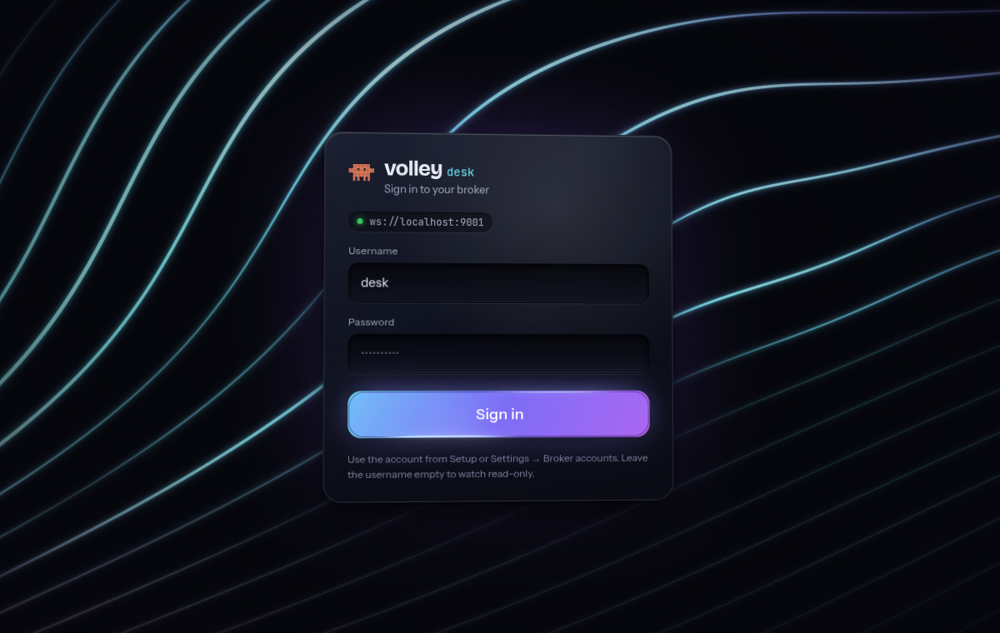

The look is the approved prototype's (`auth/SignInGate.tsx`, `styles/signin.css`): React Bits Line Waves behind a vignette, a deep glass card that tilts toward the pointer, recessed fields and a Specular Button that reads *Signing in…* and stays disabled until the first connect settles (connected, or disconnected: the Desk then shows its own offline state). Line Waves is lazy-loaded (`auth/SignInBackdrop.tsx`); without WebGL (`hasWebGL`), under `prefers-reduced-motion`, while its chunk loads or if it throws, the plain gradient stands in. Below 700 px the card fills the width inside a 16 px margin, does not tilt, and Line Waves draws 8 lines instead of 14.

### Sign out and switch account

Settings' account card (the sidebar, under the search) and the Dock's account menu (the avatar, the last Dock item) offer **Sign out** and **Switch account…** (`auth/AccountActions.tsx`, `useAccount` in `auth/SignInGate.tsx`). **Sign out** forgets the stored login and its role and shows the sign-in form with the username filled in. **Switch account…** opens a sheet over the running Desk that takes a sign-in link or a one-time token (a scanned QR code's link is the same thing): it is redeemed as a `#signin=` link is, the new login and its role replace the stored ones, and the Desk reconnects as that account in place, without a reload (an admin token opens Getting started once, as a link does); a refused token says why and leaves the session as it was. **Use a username and password** in the sheet signs out to the form. Setup & Security's **Sign in with token** goes through the same entry. Every read-only notice (Machines, Broker accounts, Supervisor, the Autopilot policy table) ends with **Switch to an admin account**, which opens it. A Desk signed in by `VITE_VOLLEY_BROKER_*` says *Signed in by environment* and has neither action: the build would sign it straight back in.

### LAN use

`volley dash --host 0.0.0.0` serves the page on the LAN, but a phone also has to reach the broker, and `examples/mosquitto-localhost.conf` binds its WebSocket listener to `127.0.0.1`. Add a second WebSocket listener on the machine's LAN address:

```conf
listener 9001 192.0.2.10   # this machine's LAN IP (or no address for every interface)
protocol websockets
```

- **Broker accounts are required.** That listener exposes the broker to everyone on the LAN. Keep `allow_anonymous false` and the Dynamic Security plugin `volley setup` / `volley auth init` configured (`per_listener_settings false`: one plugin covers every listener, the new one too). `volley setup --lan` makes this change for you: it opens 9001 to the LAN and keeps 1883 local. Never open a LAN listener on an anonymous broker.
- **Cleartext.** Over `ws://` the `desk` password and every message cross the network unencrypted. Use a trusted network, or put TLS in front (mosquitto `certfile`/`keyfile` on the listener, the page over https, so the Desk dials `wss://`).
- **Open the page by IP** (`http://192.0.2.10:5174`). Vite refuses host names other than `localhost` and IP addresses.

Demo mode never opens a broker connection. It starts from the prototype's sample state (3 waves, 5 agents) plus autopilot's surfaces: a releasing wave autopilot runs (its chip reads `autopilot on · 4 auto · 1 escalated`, with merge-queue and release-train rows and the autopilot feed), a wave whose coordinator is reconnecting, a planned wave, `overlap` (two clusters, one capped at `4/4` with a bundle and one held, a merge train integrating three PRs and a churn chip), the Needs-you inbox (a decision, a picker, a handoff and an owner-only release go, counted on the Dock tile) and an ended wave, `onboarding`, under Show finished with its morning digest card. It advances narration, heartbeats and terminal lines every 2.6 s, spawns a spec reviewer after 22 s and publishes `ci-speed`'s morning digest (its merge conflict waiting for you) after 40 s. Every 5 s the live machines beat again with a new `last_seen` and a load and memory walk around their readings, so the Machines sparklines move; every 4 minutes box-a climbs into its overload band (above 1.5 load per core) and back over 2 minutes, so its verdict turns `overloaded` and ready again. All of this runs as Volley envelopes through the same reducer the live path uses.

## Gestures

- Drag empty space to pan. A plain wheel or two-finger scroll also pans.
- Zoom around the cursor with ⌘/Ctrl + wheel or a trackpad pinch. Scale is clamped to 0.3–1.6.
- Over a scrolling list (a feed, a terminal, the YAML, the DAG, the Needs-you list, the look picker, a sheet) the wheel scrolls that list and never pans or zooms the canvas, even when the list is too short to scroll.
- Drag a title bar to move a window. The move is divided by the zoom, so the window tracks the pointer. A pointer-down anywhere on a window brings it to the front.
- Touch: one finger on empty canvas pans; two fingers pinch-zoom around their midpoint and pan with it, on empty canvas or over a window (anywhere but its title bar, a slider or a text field). Lifting one finger carries on panning with the other, without a jump, if it is on empty canvas.

### Keyboard

| Key | Does |
|---|---|
| Tab | Moves through the canvas, then the windows (their buttons, tabs and fields), the top bar and the dock |
| Arrow keys | Pan, while the canvas (the `Desk canvas` region) has focus |
| `+` / `=`, `-` | Zoom in / out around the centre of the screen |
| `f` | Arrange & fit |
| Escape | Closes the top dialog: a wave's settings or the Settings window, then the steering panel |

`+`, `-` and `f` are ignored while typing in a text field, and keys with ⌘, Ctrl or Alt are left to the browser. The Settings window and a wave's settings keep Tab inside themselves until they close, and give focus back to what opened them.

### Arrange & fit

Arrange lays the canvas out in three regions, left to right, so the eye can scan it by domain:

- **Waves.** Each visible wave forms a cluster: the wave window with its agents to the right, in task order (then implementer, fixup, rebase, spec review, quality review), each agent dropped into the shortest column. Every wave picks its own column count: for each target height, a wave takes the fewest agent columns that keep it within that height, so a big wave spreads out and a small one stays compact. Clusters are laid in rows, and every number of rows is tried.
- **Side windows** (the unassigned agents, Sessions, Wave coordinators and Machines) form one block packed by size in one or more columns, right next to the waves (or under them, on a portrait screen). They never take a column of their own at the screen edge.
- **Lists** (Needs you) come last. A list window is never taller than the fit area: its items scroll inside it and it keeps its scroll position, so a long list never sets the layout.

Arrange keeps the placement that fits the screen at the largest zoom (capped at 1.1). Placements whose zoom is within 0.005 of the best count as equal, and the one that fills the most of the screen wins, so a layout never leaves most of the screen empty when a wider one fits at the same zoom. Arrange then animates the windows and the view there. The view frames every window on the canvas, windows pinned in place included (the layout is chosen to fit beside them at the largest zoom); the first fit on load frames them too. Arrange and the coordinators window's go-to zoom out as far as 0.05 to show everything, below the wheel's 0.3 minimum; from there the wheel zooms back in smoothly.

**Opening and closing windows** never re-arranges the canvas or changes the zoom. A window that opens after an arrange (from the dock, a top-bar count, a hidden wave shown again, or a new agent) is placed in free space in its region, nearest the region's top-left corner and clear of every other window (`layout/place.ts`). When you open it yourself, the view pans at the current zoom so its top edge sits near the top of the screen, moving sideways only as far as needed to bring it into view. Closing a window leaves its space free; the next Arrange & fit reclaims it.

### Finished agents

Agents that finished (`done`, `failed` or `reaped`) more than 10 minutes ago leave the canvas, so a long-running Desk shows the work still in flight. **Show finished agents** at the foot of the coordinators window brings them back, and says how many are hidden. The same switch and the grace period (0–1440 minutes) are in Settings › General. Both settings are saved per browser in the `volley-desk-look` localStorage entry. A hidden agent is still in the store, and still counts towards Needs you and notifications. It is never laid out or animated: a broker that holds hundreds of finished agents costs the canvas nothing.

**First load and reconnects.** Every connect subscribes afresh, and the Desk starts holding its retained replay when the broker grants the subscriptions, which is just before the replay arrives, however slow the link. The replay stays out of the store until no retained message has arrived for 80 ms (live ones do not keep it open), or 1.5 s at most. It is then applied in one batch: the first frame sees every registry entry together with its status, and a reconnect's resync lands together with its replay. A hold that a disconnect interrupts applies nothing while offline; the next connect's replay replaces it. While the Desk syncs (the 30 s `syncing…` grace below), an agent with no status yet (its registry entry arrived first, on a slow link) may be finished, so it is not laid out until its status arrives; a window already on the canvas keeps its place through a reconnect. Once synced, an agent that still has no status gets its window with the `no signal` mark (below), unless its registry entry is older than the finished grace and nothing else has been heard from it: that old record is hidden and counted with the finished agents. So a Desk opened against a broker with hundreds of retained finished agents shows only the live ones, from the first frame. `test/fixtures/seed-retained-burst.ts` publishes 300 finished and 3 live agents to a private broker, and `scripts/browser-check/` checks it, and the other Desk-wide behaviours, in a browser.

Auto-arrange (Settings › General) is ON by default and saved per browser (`autoArrange` in the `volley-desk-look` localStorage entry). While it is on, arrange runs 400 ms after the first windows have settled onto the canvas, and 200 ms after the browser stops resizing. Nothing else re-arranges: opening or closing a window, hiding or showing a wave, dragging a window and a broker reconnect all leave the other windows and the view where they are. Arrange & fit (the dock, or `f`) arranges whenever you ask.

### Pinning windows

Every window's title bar has a pin toggle. A click cycles it: **pinned in place**, then **anchored to the screen**, then unpinned. The button's name and tooltip say the current state and what the next click does.

- **Pinned in place.** The window keeps its canvas position. Arrange skips it, lays the other windows out clear of it, and fits the view to it and them together. It still pans and zooms with the canvas, and you can still drag it.
- **Anchored to the screen.** The window leaves the canvas for a fixed layer above it (`.hud`), at its full size, like a HUD. Pan, zoom, fit and arrange never move it. It is saved as the screen corner nearest its centre plus an offset from that corner, so it keeps that corner when the viewport (the browser window) is resized. It stays below the top bar. Arrange, the first fit and go-to fit into the screen minus the anchored windows, unless leaving room for one would take more than half the width or height. Anchored windows have no tethers. At phone width an anchored window collapses to its title bar and never covers the dock. A tap on the title bar, or its Expand button, opens it.

Pins are saved per browser in the `volley-desk:layout` localStorage entry, with separate desktop and phone layouts. Each is saved under a window key that outlives the agent: `panel:coordinators`, `panel:inbox`, `wave:<id>`, and `task:<wave>/<task>/<role>` for the agent that holds that slot in the wave state now, so a respawned agent's window keeps its pin (a finished predecessor still on the Desk is keyed by its id). An agent with no task falls back to `agent:<id>`. **Reset layout** (Settings › General) clears every pin and arranges. Layouts are not synced between devices.

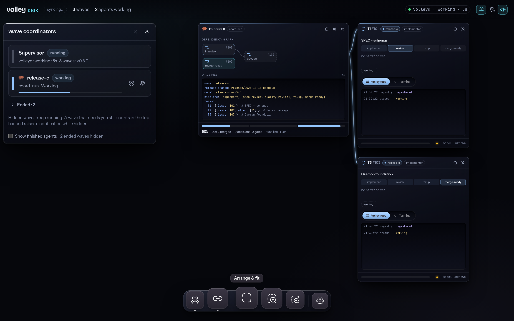

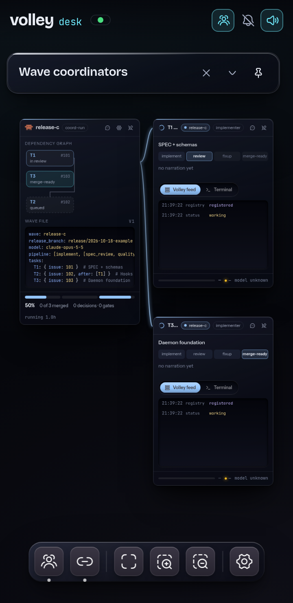 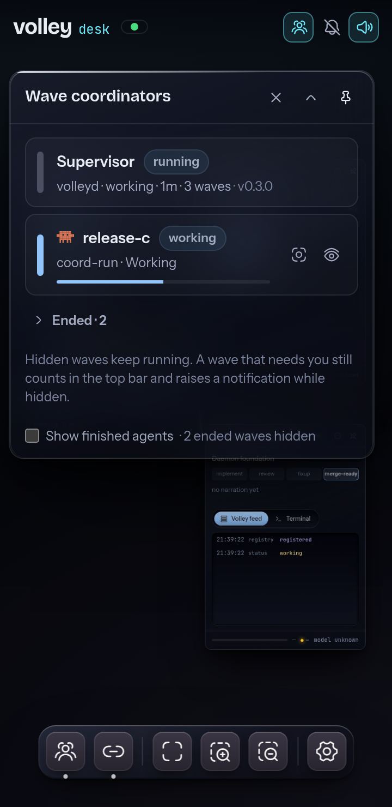

## Phone width

Below 700 px (`NARROW_PX` in `useViewport.ts`) the Desk starts at scale 0.5 (offset 8, 70, as in the prototype), the top bar drops its counts but keeps the needs-you pill and its toggles, and every window is clamped to `min(460, 100vw - 24)`. The Settings window puts its sections in a scrolling strip above the content; the steering bar, a wave's settings (one column) and the Needs-you actions (wrapping) fit the viewport. Rotating or resizing across the threshold switches layouts live.

**Lite surface.** On a touch screen (`(hover: none) and (pointer: coarse)`) or under `prefers-reduced-transparency: reduce` (`LITE_SURFACE_QUERY` in `a11y/surface.ts`, at any width) nothing in the Desk is a `backdrop-filter` surface: a backdrop filter re-blurs whatever is behind it on every frame the canvas moves, which is a phone GPU's whole frame budget. `styles/lite.css` drops the blur from the windows, the dock and its menus, the sheets and scrims, the Settings strip, the sign-in card, the framed tabs and steppers, and overrides the vendored `GlassSurface` from outside; each keeps its border, radius, shadow and gradient body over an opaque-ish fill of the same colour. Liquid glass renders as Frosted glass and is not offered, and the Needs-you pulse animates an opacity ring instead of a `box-shadow`. It is automatic: there is no setting. A pan or pinch moves the canvas directly (the world element's transform, once per animation frame) and commits the view when a finger lifts, so a gesture renders nothing per move. `scripts/browser-check/pan-perf.mjs` measures it on an emulated iPhone. Any new `backdrop-filter` in the Desk's CSS needs its selector in `lite.css` (a test enforces it).

**Current-step effects.** `scripts/browser-check/step-fx.mjs` measures each of the nine effects on an emulated iPhone at 4× CPU throttling (budget: idle p95 < 20 ms, pan p95 < 33 ms). Pulse and Ember animate `box-shadow` and were over the idle budget, so on a touch screen (`(hover: none) and (pointer: coarse)`, in `styles/stepfx.css`) Pulse's halo becomes an inner ring that fades (opacity only) and Ember's underglow is static (its flicker still runs). Desktop keeps both in full. The other seven have no touch-screen fallback; on a busy host Liquid and Prism measured over the idle budget on some runs.

## Without WebGL

On load the Desk asks a canvas for a WebGL context (`hasWebGL` in `look/Background.tsx`). Without one, the picker lists only the backgrounds that work without WebGL (Grid Motion, Shape Grid and None) with a note, a saved WebGL background renders as None, and the Liquid glass window style renders as Frosted glass and is not offered (as it is on the lite surface, see Phone width). The saved look is left alone, so the same browser profile on a machine with WebGL keeps its picks. The background's error boundary stays as the last line (a context lost later, or a driver that fails to compile a shader).

## Reduced motion

With `prefers-reduced-motion: reduce` the new-window entrance, the waiting Clawd's hop, the agent windows' Clawd characters (each shows its first frame, still; the shared clock does not run), the Needs-you pulse (a steady ring instead), the terminal caret, the tethers' pulses and sway, the current pipeline step's effect (each shows its first keyframe, still, in the agent windows and the Appearance previews), the footer bar's glint, the window tilt and the arrange animation all stop on every theme (`styles/responsive.css` gathers the prototype's rules; `scripts/browser-check/themes.mjs --matrix` shoots each effect's current step twice, 400 ms apart, in Volley and Material Lighter and fails unless the two match), and the narration line drops `DecryptedText` / `ShinyText` for plain text whatever the narration setting (Settings › General).

## Accessibility

Windows are `section`s named by their wave, task and role; the agent tabs (Gooey Nav) are a `tablist` of `tab`s with `aria-selected`, roving focus and ←/→/Home/End, the selected one `aria-controls` its `tabpanel`; the Settings pickers (Gooey Nav too) are `radiogroup`s of `radio`s with roving focus, the arrow keys and Home/End moving and committing the pick; progress bars are `progressbar`s with `aria-valuenow` (indeterminate until the agent reports progress); narration is `aria-live="polite"` and the Needs-you banners are `role="status"`; the dock is a labelled `nav`. The Settings window and a wave's settings trap focus and own the keyboard while open (only Escape, which closes the top one alone, reaches the Desk; Escape in a search box with a query clears it instead); the steering panel is a non-modal dialog, so it does not trap focus, and Escape closes it. `test/a11y.test.tsx` runs axe on the demo canvas (and with a steering panel, a wave's settings and each Settings section open) and checks WCAG AA text contrast (4.5:1) for `--ink`, `--mute` and `--dim` on every window chrome over the Desk ground, at every stop of its depth gradient; `--dim` was lightened from the prototype's `#6f7890` to `#7c859d` to pass.

## Depth and tethers

The Desk is built like the sign-in card (D10), one lit, raised object end to end.

- **The coordinators window** lists the supervisor, then the active waves, then a collapsed **Ended · N** group. Every row has a status chip (`working`, `needs you`, `completed` in green, `stopped` in grey), apart from its left bar, which is the wave's identity colour; the supervisor's bar is neutral and its health (`running`, or `down` in red) is a chip too, so a colour never means two things. An active wave has go-to and show/hide. An ended wave has **Show** (puts its window, with its agents, back on the canvas and fits the view to it) and **Dismiss** (drops it from this Desk: saved per browser in the `volley-desk:dismissed-waves` localStorage entry; the wave and its journal are untouched; a dismissal ends when that wave id runs again), and the group's **Bring back** undoes the dismissals. Dismiss is for ended waves not archived yet: a wave archived with `volleyd archive` (or by volleyd's auto-archive, SPEC §4.6.20) leaves every Desk at once, its window and its agents with it (an agent whose retained records are already gone is dropped, not moved to "no wave"), and a line under the list counts them from the supervisor's `volley/_waves/_archive` index: `N archived (volleyd archive)`. Arrange, the first fit and go-to consider only what is on the canvas.
- **Text selection.** A drag on the canvas or on a window's chrome (title bar, tabs, toolbars, the dock) never starts a text selection: the Desk is `user-select: none`, and only panel content opts back in (narration, feed rows and their JSON, the wave file, the terminal, fields and code). A feed row is a `role="button"` element rather than a `<button>`, whose text a browser will not select, so a row's text copies; the click that ends a selection does not toggle the row.
- **Window depth.** Every chrome's `win-inner` carries `win-depth` (`styles/desk.css`): the sign-in card's lift (`--win-shadow`: a contact shadow, an ambient and a wide soft drop), a subtle vertical gradient body (`--win-body`, set per chrome over its body colour) and, for frosted and spotlight, `backdrop-filter: blur() saturate()` (desktop only: the lite surface under Phone width drops it). A `win-edge` overlay above the content draws the lit top edge, the dark bottom edge and a 1 px inner ring tinted by the accent. Each chrome keeps its identity: liquid is `GlassSurface` (no second backdrop filter, which would hide its glass), spotlight is `SpotlightCard` (its wrapper carries the lift, as it clips its content, and adds no padding, surface or radius of its own: the panel's box and edges are the default style's), glow is `BorderGlow` (drawn on the border ring only: its colour mesh, edge fill and inset glow are clipped off the panel's inside, so nothing shows through the translucent body, and its wrapper never scrolls, so the hover tilt adds no scrollbars), solid an opaque gradient. The top accent bar (`win-acc`) stays. A window tilts toward the pointer by at most `TILT_MAX_DEG` (2°) through `--rx` / `--ry` set on the element (no re-render); never while dragged, for touch, under reduced motion or at phone width.
- **Recessed text boxes.** One `recessed` class (`styles/desk.css`, the sign-in `f3d` recipe: inset shadow, dark gradient fill, lit bottom edge) on the Volley feed, the Terminal, the wave-file YAML, the envelope JSON, the steering input, the Supervisor and wave-settings text fields, the Settings window's search, the background search and the finished-agent grace field. A field rings in the accent on keyboard focus; a panel while focus is inside it.
- **Tabs and pickers.** The agent tabs are Gooey Nav (`look/GooeyTabs.tsx`), its goo in the window accent inside a recessed track. The Settings pickers (window style, Needs-you effect, narration effect: `Seg` in `settings/primitives.tsx`) are Gooey Nav radiogroups in the same recessed track, the goo in the Desk's cyan; Gooey Nav wraps, so five window styles fit at phone width.
- **Settings and the dock.** The Settings window and a wave's settings carry `win-depth` and a `win-edge` like a window (each sets its own `--win-body`); the dock's panel takes the same lift and lit edges (`.dock-wrap .dock` in `styles/look.css`).
- **The agent window's pipeline** (`styles/stepfx.css`, #366). Done steps are raised success glass with a ✓ (CSS, so the step's accessible name stays its name), future steps are pressed in, and the current step wears the effect picked in Settings › Appearance › Current step (`data-fx` on `<html>`): Glint (default), Pulse, Aurora, Scanline, Ember, Liquid, Circuit, Prism, or Classic, the flat tinted look with the depth off. A held step keeps its amber marker over any effect. The footer bar is a glossy fill in a recessed track with a slow glint; chips carry the Volley feed / Terminal toggle's bevel under every effect. The effects animate `transform`, `opacity`, background / mask position and the registered `--ang` only (Pulse and Ember also `box-shadow`); nothing blurs. `scripts/browser-check/step-fx.mjs` measures each one on an emulated phone.
- **The wave window's graph and rail** (`windows/wave/Dag.tsx`, #367). The dependency graph's nodes are HTML boxes over one SVG layer of edges (same layout, `layoutDag`), so they take the same depth states (`stageState`): merged nodes are raised with a ✓, running ones (implementing, in review, fixup, merge-ready) wear the current-step effect, queued ones are pressed in with a dashed edge, decisions stay amber and cancelled ones faded; an ended wave's graph stays flat, its stages struck through. A node's id and status are real text, and no node claims `aria-current` (a graph can have many running). The rail's segments sit in a recessed track, a merged one's fill glossy and a running one's with the effect; Classic restores the flat fills.
- **Tethers** (`look/Tethers.tsx`, `look/tetherPulses.ts`). Each cable is the prototype's S-curve with a sag (`sagOf`: 6 % of its length, at most 48 px), drawn on **one** SVG layer: a soft drop shadow and an accent glow, each a group under the **one** shared blur filter, then per cable a bright core and a thin specular highlight lifted 1 px. Each time an agent publishes `progress` (`progressBeat`, the receipt time of its latest `progress` envelope) a pulse — a short bright dash on a CSS `stroke-dashoffset` animation with `pathLength = 100` — runs from the wave window to the agent window; `PulsePool` keeps at most 24 in flight (the oldest dropped) and retires each after 1.1 s. Moving one end of a cable relative to the other (a drag; arrange moves both together) kicks a damped spring on its sag, so it swings and settles within 2.5 s. One `requestAnimationFrame` loop runs only while a pulse or a sway is live. Under reduced motion or at phone width the cables are static: glow, core and highlight, no pulses, no sway.

## Themes

**Settings › Appearance › Theme** picks one of twelve palettes: Volley (the default), Material Oceanic, Material Darker, Material Palenight, Material Deep Ocean, Material Lighter, Dracula, Night Owl, One Dark, GitHub Dark, Monokai Pro and Solarized Dark. Material Lighter is the light one (the picker marks it `· light`); the other eleven are dark. A theme recolours the whole Desk, the sign-in card included: the canvas ground, the windows and their depth, Settings, the dock and the Needs-you cards. The current step's effect (**Settings › Appearance › Current step**, Glint by default) is drawn in the theme's colours (`--cur1` / `--cur2`, mixed from the theme's `--t-acc` into its `--pit`, or the theme's own values where the mix would leave the step's text under AA), so all nine effects work in every theme. The brand and status colours and the Clawd characters stay the same in every theme. How the token layer, the themed block and the light tone work is under [Settings](#settings) (**Themes**, **Light theme**). `scripts/browser-check/themes.mjs --matrix` is the release check: every theme × Glint, Aurora, Liquid and Classic × desktop and phone, with zero axe `color-contrast` violations.

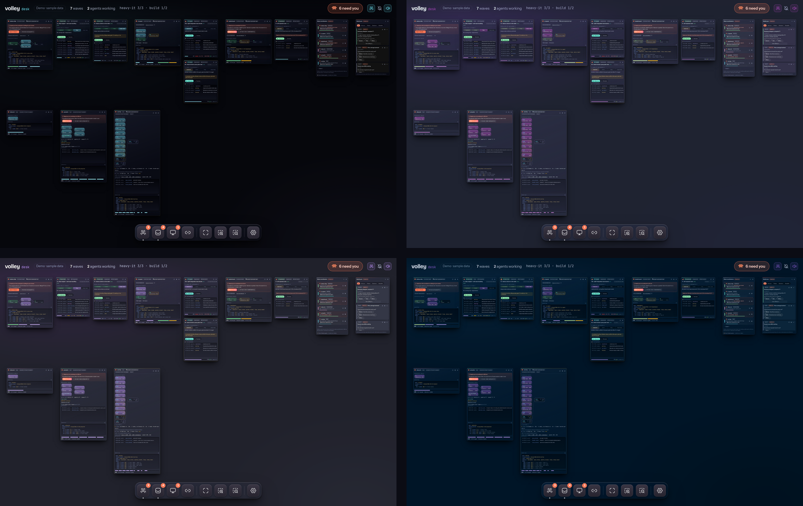

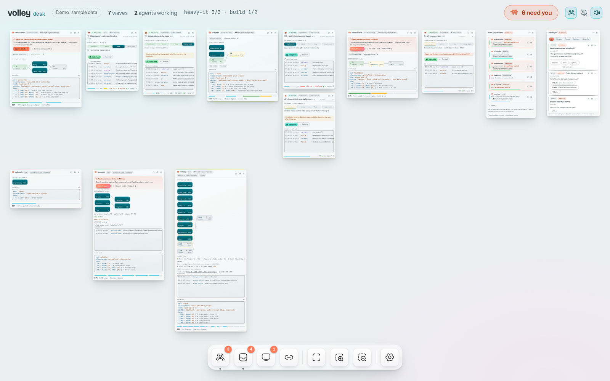

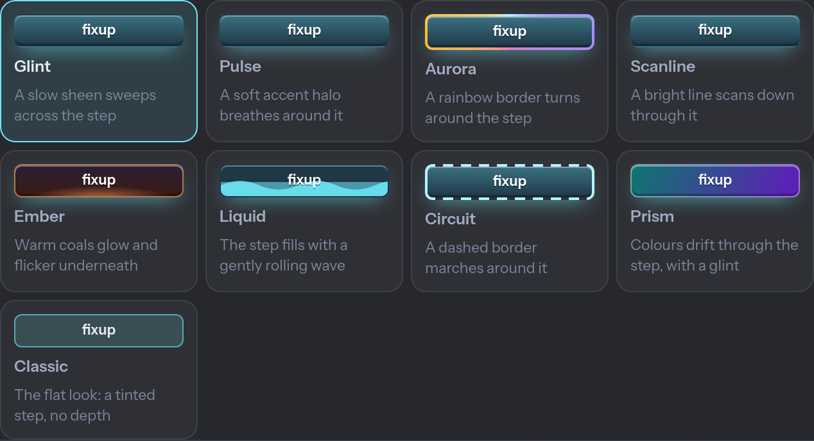

## Getting started

Getting started (`src/getting-started/`) is the Desk's first-launch wizard: `volley setup` seen from a browser, not a second flow. It is its own dialog over the Desk with a step rail on the left (`<nav aria-label="Setup steps">`: done ✓, the current step's badge filled, a step already reached a click away) and the stage on the right: the step's eyebrow (`Step n of 6` after Welcome), heading and lede beside its otter raft scene (below), the step's body, and Back / Continue. Seven steps, in order: Welcome → This computer → Your machines → Repos → People → Access → You're good to go!. Each is a `StepDef` in `steps.ts` (title, subtitle, heading, lede and a `Body` in `steps/`) that receives the admin channel, the control router and the store's state; a step that changes something does it through volleyd's existing ops and shows what it will change before it applies it (volleyd's plan/apply model), and the shell holds no step logic. Done lists what the steps collected (computers, how they connected, repos, people, how the Desk is reached away from home; "—" for what no step learnt) and **Open the Desk** finishes it.

It opens only for an admin Desk (its steps need the admin channel; a phone signed in with a steer link never sees it): after an admin token sign-in, and on any load of an admin Desk, until this browser finishes or skips it. Progress is kept per browser in `localStorage` (`volley-desk:getting-started`: the step reached, the summary, and `done: { kind: "finished" | "skipped", at }`), so closing it (X or Escape) pauses it and the next load reopens it there. **Skip for now** (the rail's footer, and Welcome) stops it reopening; an admin sign-in then opens Settings › Setup & Security as before. Settings › Setup & Security › **Getting started** shows its state (Not yet · Finished <date> · Skipped <date>) and **Open…** reopens it at the step it reached; `#getting-started` in the address bar opens it too (and leaves the address bar once read). At phone width (≤ 820 px) it is one column: the rail is a row of badges that scrolls sideways and the art (200 px) sits above the heading.

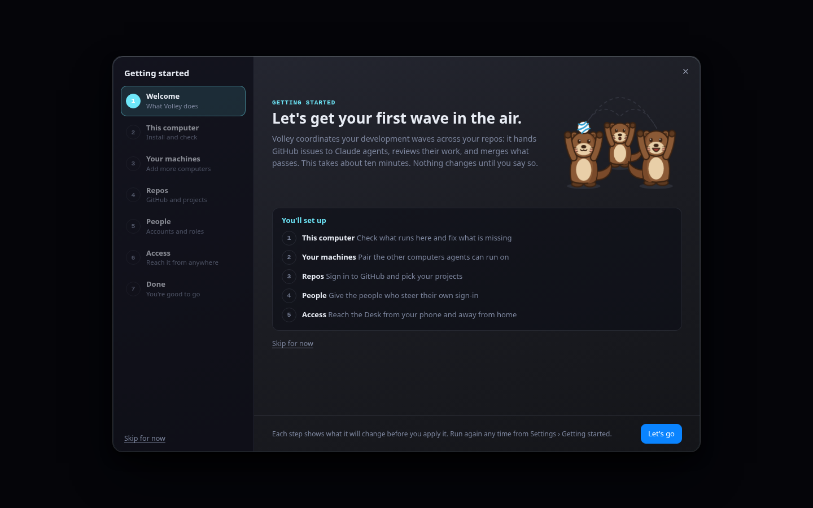

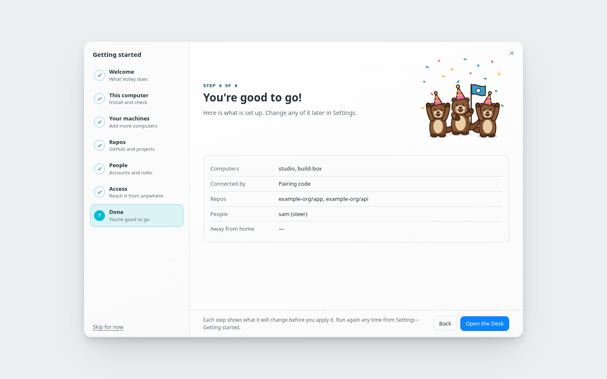 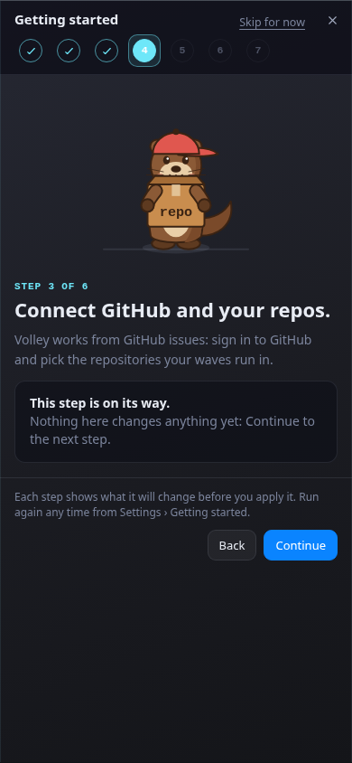

## Getting started art

The Getting started wizard's art is Volley's mascot, the otter raft: three sea otters that hold paws so they do not drift apart (the cluster) and juggle a volleyball (passing work). `src/getting-started/art/` draws one vector cartoon scene per wizard step (`SCENE_IDS`: welcome, this-computer, machines, repos, people, access, done) from one character builder (`otter.tsx`: a fixed `PALETTE`, hat and prop tables), each an `<svg role="img">` named by its `SCENE_ALT`; `<StepArt scene="…" size={…} />` renders one (without `size` it fills its container, square). The Welcome scene animates (the ball travels a loop between the three otters, eyes blink, a gentle bob; `styles/getting-started-art.css`); under reduced motion it is a still frame with the ball mid-air. Only the ground shadows, floor lines and the dashed toss path follow the theme (`--line`), so the otters read the same on dark and light themes.

To use raster art instead, drop the file in `public/getting-started/` and name it in `public/getting-started/art.json`, e.g. `{ "version": 1, "scenes": { "repos": "repos.webp" } }`: `StepArt` shows that image (same size, the scene's alt text) and the vector scene for every scene the map does not name. No code change. The map is fetched once per page load; a missing or malformed map means the vector scenes, and a name with a `/`, `..` or a scheme is ignored. It ships empty.

## Layout

```
src/canvas/useViewport.ts   pan / wheel / zoomAt / fitTo (port of the prototype App.tsx), touch pan +
                            two-finger pinch, panBy, phone width (useViewportWidth, clampWindowWidth)
src/a11y/keys.ts            keyboard: arrow-key pan, +/- zoom, f arrange, Escape, focus trap
src/a11y/motion.ts          useReducedMotion (prefers-reduced-motion for JS effects)
src/styles/responsive.css   phone layout (< 700 px) and the reduced-motion rules
src/canvas/World.tsx        the transformed world layer (world--anim while arranging)
src/layout/arrange.ts       pure arrange & fit: waves, side and list regions, per-wave columns,
                            shortest-column packing, the largest zoom then the fullest layout
src/layout/place.ts         pure placement of a window opened after an arrange: free space in its region
src/layout/useAutoArrange.ts auto-arrange triggers (the ON/OFF setting is the look's autoArrange)
src/layout/pins.ts          pure window pinning: pin modes, screen anchors (corner + offset), the
                            fit area that avoids anchored windows, window keys, the saved layout
src/layout/usePins.ts       the pins for this device class, kept in localStorage
src/canvas/Frame.tsx        window frame: drag, focus (useFocusOrder), win--born (4 s), onSize,
                            chromes glass | liquid | spotlight | glow | solid, Needs-you
                            effect pulse | electric | star (attnStyle; wrapAttention overrides)
src/store/mqtt-client.ts    mqtt.js wrapper (port of volley-dash): subscribes to every Desk topic,
                            passes cleared retained topics through as envelope null
src/store/reducer.ts        pure reducer → { waves, agents, coordinators, config, leases, admission }
src/store/types.ts          payload types mirroring spec/schemas (T1)
src/store/fixtures.ts       demo state + tick simulation (the prototype's data.ts, as envelopes)
src/store/context.tsx       <DeskStoreProvider> / useDesk(): live or demo
src/styles/desk.css         base rules ported from the prototype styles.css
src/windows/agent/          agent window: AgentWindow (title, pipeline, narration, tabs, footer),
                            Feed (envelopes + JSON), Terminal (screen tail), Pipeline
src/styles/agent.css        agent window rules
src/styles/stepfx.css       depth states (fx-done / fx-cur / fx-future) and the nine current-step effects (data-fx)
src/windows/wave/CiPanel    a CI-held task's window: jobs bar and estimate, running and failed jobs, checks link
src/attention.ts            pure attention tiers (you | coordinator | info | none) per wave and agent,
                            the supervisor's owner presence (away / gone), escalation (escalate_after_min)
src/windows/coordinators/   coordinators window: state per wave, progress, go-to, show/hide
src/windows/machines/       Machines window: a row per machine (load, memory, agents) with load and
                            memory Sparklines over the last 10 minutes (store/machineHistory.ts)
src/windows/wave/NeedsYou   Needs-you / no-coordinator banners, agent attention line
src/topbar/TopBar.tsx       top bar: counts, "N need you" pill, coordinators/notify/sound toggles
src/notify/                 notification + attention sound event on a move into "you" (volley-dash's
                            settings key)
src/sounds/                 sound themes: events.ts (the 28-event catalogue), themes.ts, settings.ts
                            (volley-desk-sound), derive.ts (store change → events), policy.ts (gating,
                            quiet hours, coalescing), player.ts (the only Web Audio code),
                            useSoundManager, emit.ts (the sound bus)
src/styles/attention.css    pulse (default Needs-you effect), banners, coordinators, pill
src/settings/SettingsWindow  Settings window (macOS System Settings style, from the dock): searchable
                            sidebar (sections.ts: labels, tiles, keywords, account role), primitives
                            (Group/Row/Seg/Toggle), General, Sound, Appearance, Supervisor, Claude
                            accounts & usage (ClaudeAccounts, RemoveAccountSheet), Broker accounts (BrokerAccounts),
                            Machines (Machines, MachineCard, MachineRows, machineFixes,
                            RepairSheet, RemoveMachineSheet, MachineSheet, RoleMoveSheet,
                            store/peerOps, store/roleOps),
                            Repositories (Repositories, AddRepoSheet, repos),
                            Setup & Security (Setup,
                            SetupWizard), About
src/settings/ConfigRows     volleyd config rows built from spec/schemas/config.schema.json (schemaRows),
                            config_set requests + acks (configTransport); Supervisor = global scope,
                            SettingsModal (wave gear) = that wave's effective config, read-only
src/styles/settings.css     Settings window and wave settings rules
src/steer/SteerPanel.tsx    steering panel: quick pills, PromptBar (/stop /wrap-up /pause /status,
                            Mailbox | Urgent), delivery steps, read-only copy fallback; ClaimButton
src/steer/transport.ts      T0 mailbox envelopes as the Desk (seq + supersedes per target), the urgent
                            Escape request and volleyd control requests (claim)
src/steer/ackState.ts       pure delivery state: sending → sent → delivered → acked (| superseded | failed)
src/steer/useSteering.tsx   App glue: steering log, transport over the store's writer, panel()
src/steer/demoClient.ts     demo-mode writer: simulated hook ack + steering_acked through the reducer
src/styles/steer.css        steering panel rules
src/look/options.ts         chrome, Needs-you, narration, agent-icon and current-step option tables (labels, keys, types)
src/look/useLook.ts         the look, persisted in localStorage `volley-desk-look`: bg, dim,
                            chrome, attn, narr, tethers, icons, fx, autoArrange, showFinished, finishedGraceMin
src/clawd/                  the agent windows' Clawd characters: palette, canvas (pure frame drawing),
                            variants, pick (stable random variant), state (clawdState), clock (one
                            shared 8 fps tick), ClawdSprite
src/look/backgrounds.ts     all 63 free React Bits backgrounds + None, each lazy (its own chunk)
src/look/Background.tsx     background layer: error boundary → no-WebGL message, or a failed chunk
                            load → "Couldn’t load" + Retry; bg-dim overlay; WebGL detection
                            (hasWebGL, needsWebGL) and the degraded look (degradeLook)
src/look/Tethers.tsx        SVG cubic per agent (and CI panel), wave window → agent, in the wave accent
src/look/DeskDock.tsx       React Bits Dock (coordinators + needs-you + machines-down badges, tethers, arrange & fit,
                            zoom in/out, Settings), lifted like a window
src/windows/agent/Narration narration effect: DecryptedText | ShinyText | plain (plain under reduced motion)
src/styles/look.css         background, tethers, chromes, dock and background-picker rules
src/rb/                     React Bits components (installed from the shadcn registry, see below)
scripts/check-react-bits.ts allow-list check, run in CI
scripts/sync-react-bits-backgrounds.ts
                            diffs reactbits.dev/llms.txt "Backgrounds" against the registry;
                            CI runs it as an optional (warning) step
```

### Subscriptions

`volley/_system/registry/+`, `volley/+/+/{status,progress,result,mailbox,screen,usage}`, `volley/_waves/+/state`, `volley/_waves/+/events` (autopilot's two events only), `volley/_waves/+/decisions/+`, `volley/_waves/_config`, `volley/_system/leases/+`, `volley/_system/admission`, `volley/_system/claude-accounts/+`, `volley/_system/claude/+/signin`, `volley/_system/machines/#` (each machine's record and volleyd's readiness verdict under it), `volley/_inbox/+` (the needs-you inbox, SPEC §4.6.18: the store keeps volleyd's items in `state.inbox` by id; its window is still to come), `volley/_system/auth/replies/+` (volleyd's answers to account ops; secrets in them are sealed to the requesting browser).

### Store semantics

- **Agents** are keyed by the topic's `<agent_id>` segment. A mailbox envelope names its sender, and a screen envelope names the supervisor that captured it.
- **Autopilot feed:** of each wave's live `events` mirror the store keeps only volleyd's `decision_auto_resolved` and `decision_escalated` (SPEC §4.6.16), in `waveFeed` by wave (a ring of 200, kept across a reconnect: the topic is not retained) and in the feeds of the agents of the event's task.
- **Feed:** each agent keeps a ring of its last 200 envelopes. Screen tails are stored separately and stay out of the feed, and so do heartbeats (below). A retained replay of an envelope the feed already holds (same topic, type, `wall_time` and `payload.seq`) is not appended again, and a reconnect never clears feed rows or narration.
- **Narration and progress:** the latest `payload.msg` on `progress` or `status` sets the narration, and `payload.progress` sets the progress.
- **Heartbeat:** `progress/heartbeat` updates the agent's liveness (the footer's dot and age) and a count, never the feed; the feed's "show heartbeats" toggle (off by default) adds one collapsed `heartbeat ×N · last 3s` row.
- **Narration persistence:** each agent's last narration is kept in `sessionStorage` (`volley-desk:narration:<agent id>`), so a cold load (a phone that discarded the tab) shows it again with an `as of HH:MM` marker until a live one arrives.
- **Wave assignment:** agents get their wave, task and role from `tasks[].agents` in the wave state. An agent keeps its wave after its role slot moves on to a new agent. An agent that no wave references belongs to the `unassigned` pseudo-wave (see `agentsByWave`).
- **Coordinators:** there is one entry per wave owner. The owner's own topics win when they report something: a terminal status means `gone`, an outstanding `awaiting_input` means awaiting input, and `resumed` clears it. If the owner's topics are silent, the store falls back to the supervisor's `coordinator` in the wave state. A wave owned by a coordinator name (SPEC §6.2) has no agent under that name: the Desk reads the agent the name is bound to, `coordinator.agent_id`, first, then the owner id. A wave the Desk claimed (its owner is the Desk's own identity) is coordinated by the person at the Desk, so it shows as `working` and ★ yours.
- **Cleared topics:** a cleared retained topic removes what it held. That covers registry → agent, wave state → wave (its agents return to `unassigned`), decision, lease pool and screen.

### Attention

Each wave and agent window gets a tier. **Needs you** (pulsing border): the wave's coordinator is waiting for an answer or is gone (volleyd's `coordinator.state` is `gone`: its owner is offline, its will fired or it shut down, and something only the owner can answer waits in the wave; or, from a supervisor that publishes no `coordinator`, the owner's terminal status), an open decision on a wave this browser owns (`?me=`), or a stuck agent with no live coordinator. On a wave the Desk claimed, its open decisions, merge-ready gates and stuck agents are all Needs you: nobody else coordinates it. **Coordinator handling** (amber ring): an open decision, a merge-ready gate or a stuck agent while the coordinator is live; after 15 minutes unresolved it becomes Needs you. (The Desk also reads `escalate_after_min` from the wave's `effective_config` or the retained config, but that key is not yet a SPEC §4.6.4 tunable, so volleyd never publishes it and 15 minutes always applies.) The Desk keeps no silence timer for owners: a connected coordinator that stays quiet for hours is still `working`, and `away`, `gone` and `reconnecting` are read from each wave's own `coordinator.state`, never from another wave of the same owner. An owner that is offline while nothing in the wave waits on it is `away`: Info `Owner away · autopilot runs this wave` (`Owner away` while the wave's autopilot is off), a neutral `away` chip and `Owner away · autopilot · last seen 2h ago` in the coordinators window, no Needs-you banner, no `claim it`, and the chat is refused until a session is back; its decisions, inbox items and stuck agents are handled as under a live coordinator and escalate after 15 minutes. An agent's silence (quiet, no progress) counts only time the Desk was connected and settled, so a broker outage or a sleeping laptop does not make every agent look quiet. A finished (`complete` / `stopped`) wave needs nobody, nor do its agents: it shows Complete / Stopped in the coordinators window (in its Ended group, below), and its window (dimmed, a Stopped / Complete chip, stages struck through, the footer frozen at its last update, `stopped 2.8h ago`) folds off the canvas with its agents unless "Show finished" is on; it never gets tethers. A coordinator that ended its turn with a background wait armed (the hooks' `background_wait: true`) is not waiting on you: the coordinators window reads `Working · waiting on events` and the wave is Info `idle — waiting on wave events`, unless a decision or gate is open; a `permission_prompt` always needs you. The same holds for the harness's generic idle prompt ("Claude is waiting for your input") when nothing is pending for the owner: no open decision, no merge-ready gate. That is also what a cold load (a new tab, a discarded phone tab) sees, since the flag rides only the live, non-retained progress envelope and volleyd's retained `coordinator` does not carry it. A turn that ended in a real question still needs you. A coordinator whose session went away inside volleyd's `autopilot.reconnect_grace_s` (its MCP server restarted; the wave state's `coordinator.state` is `reconnecting`, SPEC §4.6.1) is Info, `Coordinator reconnecting · 3m`: the coordinators window shows a neutral `reconnecting` chip with no `claim it`, the wave window no Needs-you banner, and the chat is refused until a session binds again. The Desk never times the grace itself: it shows `gone` once volleyd says so. **Info**: an open PR or a lease wait. The top-bar pill counts everything at Needs you. A browser notification and the theme's Needs-you sound fire when something moves into Needs you (one per wave: agents inside a wave that already needs you are covered by it), never while the store is settling after page load or a reconnect; the bell and speaker toggles share volley-dash's `volley-dash:notify` setting (the speaker switches the Needs-you sound; see Sounds below).

**No signal vs quiet.** `no signal — MCP not on this broker?` shows only when the agent has no MCP registration here: a registry entry with no status at all, or an open `mcp_not_registered` decision for its task. A registered agent silent (no status, progress or heartbeat) for more than `quiet_after_s` (120 s) shows a neutral `quiet for Nm`; it reaches a stall tier only through the wave state's `why_waiting` for its task, and never through a hold (`CI pending …`, a lease wait). The MCP hint is timed from the agent's registration, so it escalates like any coordinator item even while the agent's hooks heartbeat. After every (re)connect and whenever the page returns to the foreground (the Desk then probes the broker at once), the agent windows and the top bar show `syncing…` for 30 s (the hooks heartbeat per hook event, not on an interval, so it is a fixed span) and nothing is judged quiet or without signal: a retained replay alone says nothing about liveness.

**Parallel reviewers and CI.** Every live agent of a task is a window, ordered implementer, fixup, spec review, quality review; the top bar's "N agents working" counts agents (not tasks) that are `working`, or `spawning` / `registered` while publishing progress. While both reviewers run, their windows carry a `review (spec + quality)` chip. Each graph node, rail segment and task row says what the task is doing now, not its pipeline stage: an agent running (`implementing`, `reviewing`, `fixing`, `rebasing`), else a CI hold (`waiting for CI · 21/22 jobs`), else a merge turn (`merging`, `updating`, `waiting for a merge turn`), else a decision (`waiting for a decision`), else the stage (the graph node shortens a merge turn to `merge turn` and a decision to `decision`); an agent counts as running only while the Desk holds a record of it whose last status is not `done`, `failed` or `reaped`. A task volleyd holds for CI with no agent running (`why_waiting` in any of volleyd's four wordings: `CI 3/13 · running: Backend IT shard 2–6/6 · ~8 min left`, `CI pending on <sha> (n/m runs)` when volleyd could not read its jobs, `CI unreadable (…), retrying` or `CI infra incident: …; re-checking` while a poll fails) reads `CI pending` in the graph (`CI · 3/13` when its jobs are counted; the node's tooltip has the full `waiting for CI · 3/13 jobs`, and a status too long for the room left of the issue number is cut with `…`), with a `waiting for CI` chip on the wave window, a row showing `waiting for CI · 3/13 jobs`, `implement ✓ · CI ⟳ · review` and the reason, and its own **CI panel** (`windows/wave/CiPanel.tsx`); it is not a stall. The CI panel is a small window placed, sized and clamped like an agent window (in an agent slot right of the wave window, `AGENT_WIDTH` wide), cabled to the wave window like one: the task and its PR in the title (`T1 · #12`) with a `waiting for CI` chip, a jobs progress bar and `3/13 jobs · ~8 min left` (volleyd's `eta_s`, worded as in `why_waiting`), the jobs still running (or `queued`), the failed ones in red and **Checks for PR #12 on GitHub** (the PR's checks tab: the wave state has no per-run URL). A hold whose jobs volleyd could not read shows its `why_waiting` sentence instead of the bar. It appears with the hold and leaves when CI finishes; when a reviewer, fixup or rebase agent starts on the task, that agent's window takes the cable. Arrange, fit and hiding a wave treat it as one of the wave's windows. When no job finished for longer than the slowest job's last duration, the row adds `possibly stuck: no job finished for <n> min (the slowest usually takes <m>)`. On a phone the dependency graph wraps its columns into bands that fit the window.

**Where tasks run (Fleet).** Under the graph, every task with a `placement` (SPEC §4.6.15) has a host chip (`T6 · box-a`). Clicking or tapping it opens a popover: the rule that applied (`placed automatically at admission`, `pinned by the wave file`, or `re-placed by owner on <date>` for a `machine_down` answer), volleyd's `candidates[]` lines verbatim in its order (best first; an ineligible one dimmed; the Desk never scores machines itself) and `cut from <sha7>` from `base_sha`. An agent window shows the same machine as a chip in its title bar (below). A wave with an open `machine_down` decision gets a Needs-you banner: the host and what is wrong with it (down, draining, being removed, removed), the question, the wave's tasks there and the options with **re-place queued tasks** pre-selected; **Answer** sends it (`resolve`), and nothing is re-placed until someone does.

### Steering

The chat glyph on a wave window messages its coordinator session; on an agent window it steers that agent. Each message is a SPEC §4.4 mailbox envelope published by the browser as the Desk's broker identity (`desk`), with a fresh UUID `correlation_id` and a `seq` per target (in memory: it restarts at 1 on reload, where SPEC §4.4 asks for per-sender monotonic). `supersedes` chains `steering` only: a steering message supersedes the previous steering message to the same target, while a `nudge` or `cancel` supersedes nothing, so `/status` never retires a standing directive. `/stop` sends a `cancel`, `/wrap-up` and `/pause` are steering, `/status` is a `nudge`.

`/stop` and Urgent mode first ask volleyd to interrupt the session (a mailbox `query` to `volleyd`: `op: "steer"`, `urgent: true`, `escape_only: true`, `wait_ack_ms: 0`, `wave`, `task`, and `role`, the agent's pipeline role, so volleyd interrupts that agent and not whichever agent drives the task's current stage). volleyd presses Escape through its interrupt hook and delivers nothing itself; once it answers, the Desk publishes its own message, so the agent gets exactly one. The panel then says **Interrupted (Escape), then delivered**, or **Delivered (not interrupted: …)** when volleyd has no interrupt wired, refuses, does not answer, reports that it interrupted a different agent, or the target has no wave task (a coordinator).

**A stale window is never interrupted.** volleyd interrupts whoever holds the task's role slot now, and an agent window outlives its slot (a fixup round or model switch gives the slot to a new agent). So the Desk sends the interrupt only while the agent it shows still holds `tasks[].agents[role]`; otherwise `/stop` asks volleyd for nothing, delivers the `cancel` to that agent's own mailbox, and says **Delivered (not interrupted: <agent> no longer holds the <role> slot on <task> (now <agent>))**. The read-only copy command is withheld for the same reason, since `volleyd steer --role` reaches the slot's new agent.

**volleyd refuses the Desk's interrupt on a wave a coordinator owns.** Urgent steering is a mutation, and volleyd accepts mutations only from the wave's owner, so on a coordinator-owned wave the panel reports **Delivered (not interrupted: …)** with volleyd's reason, and the message still goes out. Claim the wave first to interrupt its agents from the Desk.

After the Desk claims a wave it is the owner, and there is no coordinator session to message: the wave chat turns read-only rather than messaging the Desk's own mailbox. The same goes for a coordinator that is gone.

The panel tracks the last message: **Sent** (PUBACK) → **Delivered by hook** (the recipient's hook acked it to the Desk's own mailbox, `volley/<ns>/desk/mailbox`) → **Agent acknowledged** (the model published `progress/steering_acked` with the message id). For a coordinator the steps read **Shown in your Claude session** and **Coordinator replied** (its next `resumed` / `working`, or a mailbox reply correlated to the message). Only answers from the addressed agent that arrive on the Desk's own mailbox count (never the Desk's own echo), and a retained `working` replayed after a reconnect is not a reply. The store keeps these receipts in `state.steering`, and nothing on the Desk's own mailbox becomes an agent window.

**Hook acks need `--ack-to desk`.** On the auth broker a per-agent identity may only write the mailboxes it was minted to ack (`examples/mosquitto-auth`). Mint agents with `volley auth add-agent <id> --ack-to desk`, or their hook acks to the Desk are dropped silently and **Delivered by hook** never lights (Agent acknowledged still does).

The no-coordinator banner's **Claim this wave** sends `volleyd claim <wave>` as a daemon control request (`op: "claim"`) and shows volleyd's answer.

**Read-only without credentials.** On an anonymous connection the panel publishes nothing: its pills fill a text field and it offers `Copy "volleyd steer <wave> <task> \"…\" --role <role>"` instead, and the claim banner keeps only its copyable command. Demo mode writes to a simulated client whose acks run through the same reducer.

### Needs you

Everything waiting for a person is one retained record on `volley/_inbox/<id>` (SPEC §4.6.18), refereed by volleyd: decisions, pickers (a question a session put to its user), handoffs (a turn that ended on a question) and the release train's stage go and go/no-go. The **Needs you** window (`windows/inbox/NeedsYouWindow.tsx`) lists them, oldest first, beside the coordinators window, in the same glass chrome. It wears the Needs-you pulse ring while any open item needs a person, and its title counts them (`3 need you`). An item needs a person when it is owner-only, or at tier `you` (`inboxAttention` in `attention.ts`): an item of a session in no wave always does; a wave's item does when the wave is yours (`?me=` or claimed here) or its coordinator is gone or itself waiting on you, and otherwise is the coordinator's until it has waited 15 minutes. Filters are Gooey tabs: **All / Only you / Pickers / Decisions / Handoffs** (a release item is a decision). Each row is a `SpotlightCard` with its wave's colour bar (neutral for a session in no wave), the kind, the title, the question and a live line in `ShinyText`: the source session's latest narration, or for a wave's decision volleyd's latest line in the wave's events mirror. An owner-only release item is wrapped in a `StarBorder`. The answers are `SpecularButton`s, one per option, and **Other…** opens a text field when the item allows free text. A row has go-to (fits the view to its source window: the wave, the agent, or the coordinators window for a coordinator's own question), Show (puts the source wave back on the canvas) and Dismiss (hides the row from this Desk; the item stays open and still counts; **Bring back** restores them). With tethers on, a cable runs from each row's source window to the Needs you window.

An answer is `inbox_answer { id, version, answer, where: { kind: "desk", device } }` on the Desk's own `volley/_system/auth/ops/<username>` (the admin channel of `store/control.ts`, open to every Desk login: `steer/deskControl.ts` routes it and a decision's `resolve` there), answered on `volley/_system/auth/replies/<correlation_id>`. The broker names the sender on that topic, so volleyd treats the answer as the owner's, whoever owns the wave. A broker set up before this needs `volley auth migrate --roles --yes` (the `desk` role gained the topic); until then the answer is dropped and the Desk reports `volleyd did not answer`. `device` is the name set in Settings › General › Needs you (`inbox_device_label` in localStorage), else the browser's `navigator.userAgentData.platform`, else `phone` or `desktop` by width. If someone answered first, volleyd refuses (`already answered on mbp·terminal`): the row shows that and flips to answered. Any other failure is shown and the buttons stay. The store applies the retained update either way. An answered row shows a `StatusMark` (`answered on desk·phone · go`) and fades out once volleyd clears the record. Without broker credentials an option shows `volleyd inbox answer <id> "<answer>"` to copy instead. The dock's **Needs you** tile toggles the window, with a badge counting the open items that need a person, and the top-bar pill counts them too (a decision whose wave already needs you, or a question from an agent that already needs you, is counted once). Owner-only items fire the browser notification (`Needs you · <title>`, tag `inbox:<id>`), which is how they reach a phone. At phone width the rows are stacked full-width cards, every button and tab at least 48 px tall, the live line on one line and the options a vertical stack (`styles/inbox.css`).

**Bursts** (#417). Open decisions that ask the same thing (same wave, decision kind, question, option labels, `allow_other` and `owner_only`; never answered or held ones) are one row (`inboxGroups.ts`): a `×11` chip, `11 tasks waiting · i392, i416, i401 +8`, and one answer, hold or Other… sent to every member in turn, each its own `inbox_answer` with its own version; a partial failure shows `answered 8 of 11 · retry the rest` and a retry goes to the rest only. Once an answer, hold or release starts, the group is pinned: it stays one row while volleyd answers or holds its members one by one, until they have all cleared. Each `SpecularButton` draws on a WebGL context of its own and browsers cap them per page, so at most six are live at once (`look/glBudget.ts`): the rest, and every button on the lite surface or whose context is lost, are flat (a static tinted rim) and upgrade when a slot frees.

**Held decisions** (SPEC §4.6.2). A decision's row offers **Hold · waiting on…**: a picker of the wave's other unsettled tasks and their open PRs, which sends `hold { item, on }` (a Desk login routes it on its own account-op topic, like `inbox_answer`; without credentials the row shows `volleyd inbox hold <id> --on <task>` to copy). A held item (its retained record carries `held`) is amber, with `Held · waiting on T4 (#194) · 3 h` and a Release button (`release { item }`): it is never at Needs you, never counted in the title chip or the top-bar pill, and never pulses, owner-only or not; its wave and agent windows show the same amber line. volleyd releases it when the blocker lands, and from then it is timed like any other item.

**Release items** render natively from the train's evidence. The item's `source: { wave, stage?, evidence: { md, json } }` names the stage evidence volleyd wrote. The Desk fetches the JSON from its own server, by base name, at `<origin>/evidence/<wave>/release/<file>`, served by `volley desk serve --evidence <volleyd home>`, which is off by default. The row shows a `Stepper` of the wave state's `release.stages`: each stage's state is in its title, and the stage in play is the current step. It also shows what it reads from the evidence's `artifacts`: the `changelog_entries` that will ship, through the safe inline Markdown renderer (`lib/markdown.ts`: paragraphs, bullets, `code`, bold, italic and `http(s)` links only, emitted as React elements, never raw HTML, capped at 4000 characters), the staging smoke `screenshots` (`.png` / `.jpg` / `.webp` file names in the evidence folder), and links to the `release_pr`, the `ci_runs`, the `smoke_log` and the evidence Markdown. A `guide_url` (an external release guide) is only ever a link: the Desk never embeds it or depends on it. Without the evidence route the train still shows, and nothing else.

### Machines

The dock's **Machines** tile opens the **Machines** window (`windows/machines/MachinesWindow.tsx`): one dense row per machine in this supervisor's pool, the supervisor's own first as `this machine`, then every configured host with a record (the Settings › Machines rule). A row reads the health dot of the agent window's machine chip (`up`, `down`, `overloaded`), `load <1-min average>/<cores>`, `mem <used %>` and an agents chip `<n>/<max>` (volleyd's `max_agents`, else 4), then `<cores> cores · <GB> GB` and two sparklines over the last 10 minutes: load per core (teal) and memory used (coral). A line, and the number beside it, turns amber at or above 70 % and red (`--bad`) at or above 90 %, by the latest reading. A down machine reads `down · last seen 6m ago` and both its lines are flat grey, never a stale live-looking line. Each row is described in words for a screen reader (`box-a: load 1.6 of 32 cores, 5 % — memory 29 % — 2 of 6 agents`, with `high` / `critical` at 70 / 90 %), so the state is never colour alone. A click on a row opens Settings › Machines at that machine's card. The sparklines are plain SVG (`Sparkline.tsx`) drawn from a ring the store keeps per machine (`store/machineHistory.ts`, `machineHistory` in the state): each up or local record a machine publishes (every 30 s) adds one reading, deduplicated by `last_seen`, so a freshly opened Desk's lines grow in from the right. The tile's badge counts the machines that are down; the window pins like the others (`panel:machines`). At phone width each row stacks: the name line, then the two sparklines full width (`styles/machines-window.css`).

## Settings

The dock's **Settings** opens the Settings window: General (auto-arrange, Reset layout, finished agents, the Needs-you sound, browser notifications, this device's name for Needs you answers, narration effect), Sound (below), Appearance (theme: twelve palettes, Volley by default; the current step: nine effects for the agent window's current pipeline step, each card a live preview, Glint by default and Classic the flat look; backgrounds with search, dim, window style, Needs-you effect, tethers, agent icons: Clawd characters or the classic spinner), Supervisor (the lease pools, then volleyd's global config), Claude accounts & usage, Broker accounts, Machines, Repositories and Setup & Security (below) and About (version, licences). The sidebar shows the Desk's broker username and its role. The look's keys persist in `volley-desk-look`; sound settings in `volley-desk-sound`; browser notifications share volley-dash's `volley-dash:notify` entry with the top bar's toggles.

**Themes** (`look/themes.ts`). The Desk reads its colours from one token set, CSS custom properties named in `TOKEN_PROPERTY` (`--ground`, `--win1`, `--t-acc`, `--ink`, …; the per-wave `--acc` is separate). The `:root` block of `styles/desk.css` *is* the Volley theme, so applying Volley writes nothing; `look/applyLook.ts` `applyTheme` writes any other theme's tokens inline on `<html>` with `data-theme`, `data-tone` and `color-scheme`, before the first render (`main.tsx`, so the sign-in card is themed too) and live on every change (`App`). Surfaces that are alpha tints of a token (the glass, spotlight and liquid bodies, the recessed track, the sheets, the dock, the sign-in card, the lite fills) keep Volley's literal in a `:root` property, and the *themed block* (`html[data-theme]:not([data-theme="volley"])`) re-derives each from the tokens at the same alpha. The picker lists twelve palettes, each with its entry; a saved id the Desk does not know falls back to Volley. `test/desk-tokens.test.ts` holds `:root` to the Volley entry and ratchets the stylesheets' colour literals down.

**Light theme** (Material Lighter, `tone: "light"`). A light theme sets `data-tone="light"` and `color-scheme: light` on `<html>`, so native controls (range, search, select, scrollbars) follow; the `html[data-tone="light"]` block of `styles/desk.css` does the rest. What follows the tone: the text tokens and the semantic text tints (`--hot-ink`, `--amber-ink`, `--ok-ink`, `--bad-ink`, `--info-ink`, `--mine-ink`, and the `--amber-text` / `--ok-text` / `--bad-text` / `--t-acc-ink` aliases that are the raw colour on a dark theme); accent-coloured text through `--acc-ink` (`color-mix(in oklab, var(--acc) 55%, black)`: a wave's ids in the graph, its links, the caret, Settings headings; cluster ids and badges the same way from their hue); the syntax colours of the wave file and the feed (`--syn-*`, `--code-*`); shadows and lit edges drawn with the theme's `--shade` and `--hl`; the dock's light set (`DeskDock` `tone`), light inbox cards, Gooey Nav and Specular Button text in the theme's ink; the top bar's fade and the background's dim layer wash toward the theme's background. What stays: the brand and status colours (`--hot`, `--amber`, `--ok`, `--bad`, the traffic dots, the dock badges), the Clawd characters, and the WebGL backgrounds. The OS setting (`prefers-color-scheme`) is not read: the theme is the owner's pick. `scripts/browser-check/themes.mjs` measures every text element of each view against the pixels under it (`text-contrast.mjs`) and fails on any that misses WCAG AA beyond Volley's own.

The config rows (Supervisor, and a wave's gear) come from the config schema, so a new tunable shows up without Desk changes: a bounded number gets a stepped slider, a boolean a switch, a string enum a choice, a string a text field, a top-level list of strings (`agent_mcp_allow`) one comma-separated field (a change sends the whole list), a nested object (`placement.weights`) one row per leaf, a string enum that may be null (`fleet.local_agents`) a choice, and each lease pool gets a capacity row. The `fleet` rows sit under Admission: `fleet.local_agents` (always, fallback, never), `fleet.fallback.max_agents`, and one `fleet.fallback.per_machine.<pool>` row per heavy pool (one that sets `per_machine`), showing 1 until it is set. Hints come from the schema descriptions. Above the rows, **Lease pools** (`volley/_system/leases/+`, SPEC §4.6.5) has one card per pool: `held/capacity` and its `per_machine` cap, the holders grouped by the machine they run on (by name, `(unknown host)` last for a holder volleyd did not spawn or one from a volleyd that predates `host`), each machine's held count against the cap in force there (`2/3`: its `per_machine_overrides` entry, else `per_machine`; a machine with an override is listed before it holds anything, and one with no cap shows only its count), the queue's length and its `reasons`.

- **Settings › Supervisor** shows the retained `volley/_waves/_config`. Once the Desk has signed in, a change sends one `config_set` request to the daemon's mailbox in volleyd's namespace (from its registry entry): `volley/<ns>/volleyd/mailbox`, `payload: { op, text, patch, by }`. Only volleyd's answer on the Desk's own mailbox counts. A slider sends once the user lets go: presses and drags within 400 ms of each other become one request with the settled value. The row then shows the ack: `applied · v<version>`, the rejected paths with their reasons, `failed ·` for a refused publish or daemon error, or `no answer ·` when volleyd does not reply in time (the change may still have applied).
- **A wave's gear** shows that wave's `effective_config`, read-only, with a **Global settings…** link to Supervisor. volleyd applies `config_set` to the global config only. Per-wave values come from the wave file's `config:` block.
- **Settings › Autopilot** shows every `autopilot.*` tunable as schema rows (`owner_only` as a checkbox per decision kind; a change sends the whole list), through `config_set` as in Supervisor, which no longer lists them; a wave's ⚙ shows the values that wave runs with, read-only. Under them, the policy table volleyd answers decisions from (the `policy` control op, what `volleyd policy` prints): kind · condition · answer · budget · rationale, read-only, in the order rules are tried. Without broker credentials, or from a volleyd that refuses the op, it names `volleyd policy` instead.
- **Autopilot in the wave window.** The title has an `autopilot on · N auto · M escalated` (or `autopilot off`) chip from `state.autopilot`. Under the graph: the merge queue as one line (`merging T3 · updating T5 · queued T7, T9`), the release train's stages and their states while the wave is `releasing` (plain rows; the inbox's release item draws the Stepper), the synthetic fixer tasks (`tasks[].synthetic`, a 🔧 on the graph node, `fixer for T3, T7` in its tooltip and in the list), and the wave's autopilot events as a feed: `Autopilot · <answer> (<policy>): <rationale>` or `Autopilot could not resolve (<why>)`, the evidence in the row's JSON. The same lines appear in the agent window's Volley feed for the agents of the event's task.
- **The overlap plan in the wave window.** For a wave the planner planned (`overlap_plan`, `spawns`, `trains` in the wave state): the graph tints every node of one cluster with that cluster's hue (one palette hue per cluster, never the wave's own) and badges it with the cluster id, `A · 4/4` (in flight / cap) while capped or `A · hold` while held; a bundle (a task closing several issues, `spec.tasks[].issues`) reads `#310 +1` in its corner, each issue a link and the whole list in its tooltip; an `after` the planner chained (`plan.by: chain`) is drawn dashed. Under the graph the **Clusters** panel (collapsible from its heading) has one row per cluster: id, member count, its hot files (`src/daemon.ts · 11k · 14 tasks`), strategy (`5 bundles · 2 chains · cap 4`), state (`planned`, `hold`, `train`) and why; at phone width each row is just the id and the state. The merge queue line leads with its running trains, `train-1 (i310, i312, i315) integrating · queued i317, i318`, a train linking the PR URL its synthetic task carries (`pr.url`, never one built from a number); a train's synthetic `train-<n>` task stays out of the graph and the rail. The title carries a `churn 12` chip while `spawns.churn > 0` (its tooltip: churn against productive spawns and each churning task's count). The plan's events join the wave's feed: `planned · 2 clusters`, `cluster A → hold: <why>`, `train train-1 started (…)`, `… merged in #340`, `… failed: <why>`. A wave without a plan shows none of it.
- **Settings › Claude accounts & usage** is strictly for managing accounts: one card per Anthropic account, built from volleyd's retained usage records (`volley/_system/claude-accounts/+`) merged with its profile registry (the `claude_accounts` control op; a paired machine's profile is matched to its record as `<id>@<machine>`, so it is listed once) and the signed-in machines, grouped by the login's e-mail (trimmed and lower-cased). A peer's default login (`primary@<name>`) takes its e-mail from the machine record (`auth.claude_email`); a login whose e-mail is not known yet keeps its own card. A card missing its e-mail or both 5-hour and 7-day readings asks volleyd to read the login (`claude_prime { acct }`, once per account per 5 minutes, and only when the Desk can steer) and reads `reading…` (`reading… · last read 4 min ago` after a prior reading); its meters say `reading…` while that answer is out, else `no reading yet`, and a read-only Desk says `no reading yet`. No account surface tells the owner to run anything for it (`test/claude-copy.test.ts`). An account just added needs none of this: volleyd primes every finished sign-in (the login's identity and plan, then its machine's usage probe of that login), so its card shows the e-mail and meters at once. A card is titled with the registry label of its profiles (this machine's, else the earliest in registry order, less a trailing ` (<machine>)`; Add's own `Claude login` names nothing), else the masked e-mail, and shows the plan chip and organisation; the e-mail masked (`o•••@example.com`) until its eye button shows it (per card, never stored); the account's three meters once, side by side while the card is wide and stacked below 360 px, with their resets (amber from 70%, red from 90%; a window whose reset has passed counts as 0%, and a 0% window with no reset reads `no usage yet this window`): **5-hour** and **7-day**, taken per window from the login whose record was sampled last (a tie goes to the one with a known reset), and **Fable (7-day)**, the record's `model_weekly.fable` from the login whose machine's usage probe read it last (volleyd's usage probe reads it; the Desk never does), labelled with that reading's age and machine (`read 4 min ago on peer-a`). The Fable meter's age is how long ago the probe last read the window, not when an agent last reported. While that probe's last attempt failed, the meter reads `—` with why (`login expired — Claude Code renews it on its next request`, `no credential on <machine>`, `rate limited, retrying`, `probe failed`) and, when a reading exists, `last read 25 min ago`; before any probe has reported, `not read yet`. Then one row per configured machine (this machine first, then each host in `_config` `hosts`, then any other machine still holding it), however many of the account's profiles it holds: a filled dot, the profile labels there and `signed in` (or `signed out`), never a usage figure; a hollow dot and **Sign in on <machine>** where it does not hold the account (disabled with "tunnel down" while the peer's tunnel is down; none on a read-only Desk). Last come **Add to another machine…**, **Remove…** and `Last updated: 4 min ago` from the freshest reading. **✎** beside the name renames the account inline: the name becomes a field holding it, Enter sends `claude_account_rename { acct, label }` (every profile of the login takes it, on every machine), Escape restores it, and volleyd's refusal (an empty or reserved name) shows under the field. **Remove…** opens a sheet (`RemoveAccountSheet`, the Machines sheet: focus trap, Escape, full-screen at phone width) naming the machine (a picker when the account is on several) and the masked e-mail, and what removing does (the profile's directory, its usage record and its registry entry go; the login stays signed in with Anthropic); its confirm sends `claude_account_remove { acct }`, and a refusal (an agent runs under it, a running wave names it, Defaults picks it) shows in the sheet. This machine's own login has neither. The card does not change on the answer: volleyd's retained registry-changed signal (`volley/_system/claude/registry`, `claude_registry_changed { rev }`) makes the section ask `claude_accounts` again, so every open Desk shows the new name and drops a removed card within a second, with no reload. A card carries no waves, agent counts, stale warnings or picks. **Sign in on <machine>** opens the Add dialog already at the sign-in step, titled `Sign in with o•••@example.com on <machine>` (with the eye toggle), and sends `claude_account_add` at once with the label `<label> (<machine>)`. A sign-in that finishes (`claude_signin_done`, whose `email` the Desk keeps) on the same e-mail fills the row; one on another e-mail leaves it hollow, reading `signed in as another account (p•••@example.com)`, and the new profile gets its own card. A profile that never finished its sign-in (no `signed_in_at` and no usage record) is no card: it is a row under **Profiles waiting for sign-in** with **Finish sign-in**, which opens the same dialog and resumes it (`claude_signin { acct }`), and **Cancel**, which removes the profile (`claude_account_remove`). The section carries no Needs-you banners: a wave's `account_limit` is a banner on its wave window, an agent's `agent_account_limit` one on its agent window. **Add Claude account** is a Stepper: a label, a machine picker (this machine first, then each paired host from `_config` `hosts`; a peer whose tunnel is down is disabled and says so) and **Sign in on <machine>** (`claude_account_add { label, machine }`), then the sign-in link from the answer and the `claude_signin_url` event (`volley/_system/claude/<acct>/signin`, where a peer's profile is `<acct>@<peer>`), and the sign-in box (below) until `claude_signin_done` (or saying why on `claude_signin_failed`); then `Signed in as o•••@example.com` (the event's `email`, masked, with the eye toggle) and the plan chip. A sign-in whose e-mail matches an account already on that machine (`sameAccountOnMachine`: a profile there with that e-mail, or the machine's default login) says `This is the same account as <name> on <machine>.` and offers **Keep both** and **Remove the new profile** (`claude_account_remove { acct }`). On this machine and on a peer alike it is the same sign-in as Settings › Machines' **Sign in on <machine>** (`SigninLink`, below): Anthropic's code-page link with its QR code and the one box for the code. Each card's **Add to another machine…** opens the Stepper with the label suggested as `<label> (<machine>)`, since volleyd names a profile once across machines (this machine by its host name when known), following the picked machine until the owner types their own, and the machines already holding the account disabled ("already holds this account"). The Desk shows only the provider's sign-in link, never a credential. **Defaults** picks `claude.default_account` (Most headroom, Primary or an account; through `config_set`) with volleyd's answer under it (applied, rejected, failed or no answer, as in Supervisor), and shows `claude.warn_at_pct`. In demo mode (`?demo=1`) the section shows a Team account held on this machine and box-a, the owner's own login on both, and a profile waiting for sign-in; a rename or remove there changes the demo's own registry and raises its signal, so the new name shows and the card leaves; a card's `claude_prime` is answered `ok`.
- **GitHub links.** The wave state's `github` (`{ slug, url }`, SPEC §4.6.1, read by volleyd with `gh repo view`) is the only source of a wave's links (`lib/github.ts`): an issue is `<url>/issues/<n>`, a PR is the task's own `pr.url`, never derived from `repo` (a local path) or a number. **The repo chip** (`look/RepoChip.tsx`: the Octicons GitHub mark and `owner/repo`, opening the repository in a new tab) sits in the wave window's title after the owner chip, on each wave row of the Coordinators window and on its Supervisor row (one chip per distinct repository across the non-ended waves; more than two read `N repositories`, the slugs in its tooltip). Every `#n` / `PR #n` the Desk prints for a task is a real link named `Issue #n on GitHub` / `PR #n on GitHub` (`rel="noopener noreferrer"`, a new tab): the agent window header, the dependency graph's corner labels (the graph is a `group`, so its links stay reachable by keyboard) and the machine-down banner's task list. Without `github` (an older supervisor, a failed read) there is no chip and the same text renders unlinked.
- **The agent window** says what the agent is for before who it is (`windows/agent/purpose.ts`). Its purpose is the first of: the wave task's title (`T3 · <title>`, with the issue linked through the wave's `github` and the PR through its own `pr.url`; without `github` the number is shown unlinked); the `title` the agent registered (SPEC §6.2, `vol_register`'s `title`, with its `links` as `#N` / `PR #N` anchors that open GitHub in a new tab; a bare number with no repo is shown unlinked); for an interactive session, its terminal workspace title and repo basename; the basename of its `cwd`; the first progress message it sent; its id. The title bar is two rows that never bunch. Row 1, the drag bar: the Clawd character (below) or, with Settings › Appearance › Agent icons on *Classic spinner*, the status mark, the wave chip, the role chip, the stage chip when there is one, the machine chip, then the actions (steer, collapse, pin), which never wrap or shrink; the chips truncate with an ellipsis, then wrap inside the title area. Row 2 (also a drag handle): the headline in full, at most two lines (the whole text on hover, a tap unclamps it, `aria-expanded`), the issue and PR links after it, and the Claude account picker right-aligned (under the headline when there is no room). Under 420 px of window width (`COMPACT_PX`, so every phone window) the window is compact: the picker is an icon-only control with the same name and options and the chips are capped shorter. When the purpose comes from the wave, a registered title or a session, it names the window (the headline; accessible name, chat button and steering panel with the role added; the Needs-you notification `<label> needs you`), and the agent id moves to a small selectable line in the body. Otherwise the headline is the task (`T3 #104`) or the id, and a fallback purpose (a `cwd` basename, a first narration) gets one ellipsised bold line in the body that a tap unwraps, so the title is shown once and the id never twice; an agent known only by its id has no separate purpose line. **The machine chip** (`MachineChip.tsx`, `machine.ts` `machineFor`) says where the agent runs: the paired machine's name for a task on a remote host, `this machine` for one on the supervisor's own (`fleet.local_name`), with a dot: green up, grey down (its tunnel is down, or for this machine volleyd is not live), amber overloaded (volleyd drains it or finds it ineligible). Hover or keyboard focus shows a tooltip: the placement rule, the chosen host's own candidate line verbatim and its load (`16 cores · load 1.25 · 2/4 agents`). A click opens Settings › Machines scrolled to that machine's card. An agent with no wave task (an ad-hoc agent, a session) has no chip: the Desk does not know where it runs. Before any hook tick (a cold load) a session's footer reads `no activity seen yet`. **The Clawd character** (`src/clawd/`, #350) is an animated pixel Clawd (16×14, 24 × 21 px) doing what the agent does: typing at a keyboard while implementing, glasses, a magnifier or a checklist while reviewing, a grr, a wrench or a hammer in fixup (a `rebase` agent too), sparkles, a halo or a victory hop with a glow when merge-ready; at rest it dozes (held, not started, no signal, an idle session, or waiting on someone other than you, a `blocked` agent included), hops with a "?" when it needs you, has X eyes when failed and a green check when done (`clawd/state.ts` `clawdState`, rest states first; its `aria-label` names the state). Each step has three looks; a window picks one per agent at random but stably (FNV-1a of the agent id and the state), so it is the same on every reload and device, with no picker. All sprites share one 8 fps clock (`clawd/clock.ts`, a single interval that runs only while a sprite is shown and the page is visible), each frame one `<path>` per colour. The merge-ready glow is dropped on touch screens and under reduced transparency (a filter re-rasterises every frame); under reduced motion every sprite is still. *Classic spinner* keeps the status ring (grey with no signal, the progress arc). The unassigned card lists its agents by the same label. An agent that registered on its own (no wave task) never gets a screen, so its Terminal tab says so instead of `no screen yet`. The Terminal's font stack (`--f-term`) ends in the bundled Symbols Nerd Font Mono (`public/fonts/`, served by the Desk, loaded only for Private Use Area code points), so Nerd Font and powerline glyphs in a status line render instead of tofu. The Terminal tab's ⤢ (`Open terminal in a window`) opens the agent's screen in a floating, macOS-style window (`windows/agent/TerminalPopout.tsx`): the agent id with its task and role chips in the title bar, the red light closes it; it is live (the same retained screen the card shows, with the same `stale` marker), never wraps (it opens as wide as the screen's longest line where the viewport allows and scrolls sideways otherwise), drags by its title bar and resizes from its corner. Several can be open at once; Escape closes the topmost first, Tab stays inside it and closing it gives focus back to the ⤢. Its −/+ text size (9–20 px, default 12) is shared by every popout and remembered in this browser (`volley-desk:terminal-font-px`). Below 700 px it is a full-screen sheet with the same title bar and close. While it is open the agent's terminal follows it: 300 ms after it opens, is resized or changes text size, the Desk sends volleyd `terminal_resize` with the popout's size in cells (its text box over one cell of the terminal font, less the caret's row, 20 to 500 each), and closing it, however it closes, sends `reset: true`, which returns the terminal to its launch size (`tmux_cols` × `tmux_rows`). While it sizes the terminal the popout keeps the width it opened at (or the one it was dragged to) instead of following the screen's longest line, which would chase its own measurement down. A paired machine's agent runs in tmux, which volleyd resizes, so Claude Code wraps at the popout's width; the Desk sends nothing for a local cmux agent, whose terminal volleyd cannot resize. The reset is sent only when the popout closes: reloading or closing the browser tab leaves the terminal at the popout's size until a popout is opened and closed again, and with two Desks on the same agent the last size sent wins and closing either popout resets the terminal under the other. The screen is plain text (`cmux read-screen` returns no colour); ANSI colour is a later step that needs cmux to export styled cells or a pty stream, which xterm.js would then render.

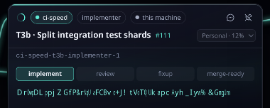 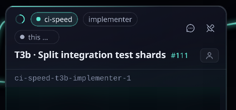

- **Sessions.** A registry entry the harness hooks wrote (`model_source`) with no parent and no wave is an interactive Claude Code session, not a stuck agent: it gets a `session` chip and its own **Sessions** card, its narration line is the hooks' work log (`activity`: `Bash: …`, `Edit: …`, `prompt received`), and its footer shows `working` or `idle · 3m` (from the hooks' `activity` / `idle`, not its status, which stays `working`) and `N tool calls · last 12s ago` in place of a progress bar (it reports no %), next to the context meter.
- **No progress reported.** A dispatched agent that has been `working` for 10 minutes without a `progress` message of its own (its hooks' work log does not count; the clock never starts before this page first heard of it, so a cold load or a reload shows nothing for ten minutes, and it stops while its hooks say its turn ended) gets an amber `no progress reported for N m` badge and an info-tier item, and so does whoever runs it: its wave window, else its parent session's window.
- The window also shows a context meter in its footer from the agent's retained `usage` sample (`ctx 72% · 143K/200K`; amber from 65%, pulsing from 70%, red and pulsing faster from 85%; no pulse under reduced motion), and a Claude account picker in its title's second row listing the accounts of the agent's own machine (`primary` and the local profiles for a local agent; `primary@<name>` and the profiles kept for that machine for a paired one; every account when the Desk does not know where it runs) with their 5-hour usage and machine (`Work · 12% · peer-a`; "no usage yet" for one that has not reported). Hover or keyboard focus shows a tooltip saying why the agent runs under its account: the latest `account_chosen` line of its task role (`work: 18% left, resets in 52m (use it or lose it) on peer-a; …`) or, after a move, `moved off primary by autopilot: <why>` / `moved by <person>` (live only: the events topic is not retained). Picking another account asks to confirm (the agent restarts with a resume note), then sends `agent_move_account`. Its Volley feed shows the task role's account events as `Account · <why>` and `Account · moved off <from> to <to> by <by>: <why>` rows. An open `agent_account_limit` on the agent is a banner over the tabs: `account at 91% — autopilot will move it to work` while the wave's autopilot is on, else **Move to <account>** and **Not now**, which send the decision's own options. The closed picker names the agent's account by its registry label (`Account: Work · 12% · peer-a`), never its id. **The wave window** shows the account the wave's new agents start under, from the wave state's `account` (SPEC §4.6.1): a chip above the graph, `Account: Balanced` or `Account: <name>` (the registry label), and, when the Desk can steer, a dropdown beside it, `Balanced (default)` then each signed-in account on the wave's machines (this machine and every paired machine a task names) by name. Picking one sends `wave_account_set { wave, acct }` (`null` for Balanced; the first focus asks volleyd's registry, so profiles with no usage yet are listed) and, once volleyd takes it, says `New agents start on <name>; running ones finish where they are.`; a refusal says why. A read-only Desk shows the chip only, and an older volleyd's state (no `account`) shows neither. While the wave has an open `account_limit`, the dropdown preselects its suggestion and **Switch** sends it, which answers the decision; the decision is also a Needs-you banner on the window with **Move to <account>** and **Not now** (`resolve`). A wave's gear (its settings) has no account row. In demo mode the `status-chip` wave is pinned to the Team account, and a pick re-publishes the demo wave's state.
- **Settings › Machines** lists the machines that can run agents. The supervisor's own machine comes first: its record (`volley/_system/machines/<fleet.local_name>`, which only volleyd publishes; the Desk recognises it by the name in `_waves/_config`, never by the record's `kind`) with the chip "this one" and `local`, and, from volleyd's verdict on it, the local agents chip: its `fleet.local_agents` mode (`always`, `never`, `fallback`, or `fallback · active` while no paired machine is eligible and it runs under the fallback profile), with volleyd's why as its tooltip (absent from an older volleyd's verdict and never on a peer's card); a click opens Settings › Supervisor scrolled to the `fleet.local_agents` row, its control focused; before volleyd publishes one, a placeholder card with its dot following volleyd's status and its live agents. Then one card per paired machine's retained record (taken only from the machine itself or `volleyd`, and shown only for a configured host in `_waves/_config` `hosts`, since every account may publish its own record). A card shows os · arch · cores · memory · free disk, the tunnel with its heartbeat dot, the 1-minute load, `agents/max_agents` from volleyd's verdict, a **Claude accounts** block (one row per account card: label, masked e-mail and plan, a filled dot with the profiles there, `default login` for the machine's own, and its sign-in state, never a usage figure (the account's card has the meters), or a hollow dot and **Sign in on <machine>**, which opens the same sign-in as Settings › Claude accounts; the registry is asked while the section is open, and again whenever volleyd's registry-changed signal moves), and the verdict itself (`volley/_system/machines/<name>/readiness`, accepted only from `volleyd`): a green `ready for agents`, `not ready` with volleyd's `reasons[]`, `draining · N agents left`, `overloaded: <ineligible_reason>`, or, while the tunnel is down, a greyed card reading `down · last seen 5m ago · no heartbeat` (a disconnect record, the machine's LWT built when it connected, keeps the last heartbeat's load, agents and last-seen time, as volleyd does). A verdict older than twice `machine_down_after_ms` says how old it is. The doctor's `checks[]` are rows by id with ✓ (passing), ! (a failing `warn`) or ✗ (a failing `block`), the detail and, for a failing one, the fix: the record never carries a fix's text, so `settings/machineFixes.ts` recomputes it from the id (`tool.<name>`, `<name>_on_path`, `volley.*`, `repo.*`, `gh.auth`, `claude.*`, `machine.*`, `skills`, `hooks`, `mcp`, `sharing`; a per-repository check, which carries its `repo`, names that repository and its clone, and `tool.<name>` says which repository needs the tool; an id it does not know is left to Repair's plan, never to a doctor run by hand), with **Copy** for a command. A card lists its repositories read-only, each with where it stands there (`example-org/app: ready`, `blocked: <why>`), and **Repositories…** opens Settings › Repositories. An admin Desk also gets, on each paired machine (never the supervisor's own, which is capped by `hard_ceiling` and is not paired): the cap editor (`config_set { hosts: { <name>: { max_agents } } }`, 1–100, with volleyd's answer); **Repair…**, a sheet that runs `peer_doctor { name, fix: false }` and shows its plan split into "This will:" (the fixes the doctor applies itself) and "You run on <machine>:" (the doctor's own command for the rest, to copy), one row per repository on the machine (its state; for one without a clone a **Clone <owner/name>** switch, on by default; what its toolchain lacks, to install), or, on an older peer without repositories, a switch **Also clone the wave repo** (off by default), and **Apply** (`peer_doctor { name, fix: true, clone }`, with `repos_add` naming the repositories to clone, an adopted clone as `<owner/name>=<path>`; a successful run also makes volleyd retry the repository runs blocked there), after which the rows re-render from the answer's checks (an ssh failure or refusal shows volleyd's reason); **Re-pair…**, a code bound to the machine (`peer_invite { for }`) and its `volley peer join <code> --to <ssh address> --name <name> --replace`; and **Remove…**, a sheet listing the agents running there and what removal does, with **Drain, then remove** (`peer_remove { name, drain: true }`: nothing new starts there and volleyd removes it once they finish) and **Remove now** (`{ name, now: true }`, after a confirm: each agent is told to cancel); with nothing running it removes at once. Sheets trap focus, close on Escape and are full-screen at phone width, where the cards stack and rows wrap. **+ Add a machine** sends `peer_invite` at once and opens a five-step Stepper. 1 · Code. 2 · Join: the copyable `volley peer join <code> --to <ssh address>`, where the address is this machine's `user@host` as the other machine reaches it (the owner types it; the broker's host is the placeholder, and **Copy** waits until it is filled), with the code's countdown (counted on the browser's clock from the answer's `ttl_s`), until a record for a new host arrives (an expired code is hidden and offers a new one). 3 · Checks: the new machine's rows and verdict from its first heartbeat, with **Repair…**. 4 · Claude on <machine>: signed in, or **Sign in on <machine>** (below) when the Desk can steer, else the manual steps (run `claude` there and sign in, accept the repo's trust) with **Check again**, which runs a dry doctor run so the machine reports afresh. 5 · Ready: the verdict, a note on `placement: auto` / `host: auto`, the cap, and **Done**, which sets `max_agents` when it changed. The pairing ops are admin ops and travel the same admin channel as Broker accounts and Setup & Security (`store/control.ts`, below): the Desk's own `volley/_system/auth/ops/<username>`, answered on `volley/_system/auth/replies/<correlation_id>` (only `volleyd`'s answer counts; a doctor run may take minutes, so the Desk waits up to 16). The Desk subscribes to the reply wildcard because its client has no per-request subscribe; the answers that matter are sealed. The code comes back sealed to the session's RSA-OAEP reply key, so only this page can read it: WebCrypto's on https or localhost, and the same key made by `lib/rsa.ts` on a plain-http LAN page (a phone), so pairing works there too. Only a browser that cannot make the key at all (no `crypto.getRandomValues`) is read-only, and says so. Whether the Desk is an admin: the role stored at sign-in decides at once; the fixed identities (`desk`, `coordinator`, `volleyd`) never are; any other username is asked with `account_list` (5 s, started when the Desk connects; the broker drops a non-admin's request), and a yes is stored with the sign-in as Setup & Security does. An answer or a refusal is kept; no answer is not, and the section says volleyd did not answer and asks again when volleyd comes up. Any other session, and demo mode, is read-only (no Repair, Re-pair, Remove or cap editor) and shows the `volley peer invite` / `volley peer remove <name>` commands instead. **Add a bare machine…** (`settings/AddMachineSheet.tsx`, admin) does the whole of `volley machine add` from here for a box with only ssh (macOS or Ubuntu/Debian): a form takes its address (`user@host`, checked as typed), how volleyd's first ssh signs in (**Password**, masked, or **Key file**, an absolute path on the supervisor's machine), an optional **Sudo password** (used only when the box lacks git or tmux, or curl or gh; the run says so before it uses it) and an optional name (the host's short name by default), and sends `machine_add` (`store/peerOps.ts` `machineAdd`, SPEC §4.6.14) on the admin channel. volleyd runs the seven steps over ssh (ssh, Volley, Setup, ssh back, Pairing, Sign-ins, Doctor) and publishes each line as a `progress` envelope on the request's reply topic (`createAuthOps`' `onProgress`): the sheet lists every step, pending until reached, then running, ✓ or ✗, with its lines under it, announced politely, and cannot be closed while the run goes. It ends with the machine's readiness: *<name> is ready for agents* or *is not ready yet*, its doctor checks with the cards' fix for each failing one (GitHub's `gh auth login` among them) and, while Claude is not signed in there, the cards' **Sign in on <machine>**. A failure names the step and its fix (`step 2 (Volley): box-a lacks tmux, and only sudo installs it there: give its sudo password, …`), and **Back** returns to the form with the passwords emptied: they are never kept past a run, and volleyd never journals, logs or answers them. The form stacks at phone width; its rows use the theme tokens in both looks.
- **Settings › Repositories** (`settings/Repositories.tsx`, SPEC §4.6.21) has one job: which repositories, on which machines, and whether each is ready. One row per repository `_waves/_config` names (`repos.<owner/name>`, and any only adopted on a host in `hosts.<m>.repos`): the slug, linking to the repository on GitHub; a chip per machine it is assigned to (`machines: all` is the supervisor's own and every configured host) with volleyd's verdict there from `readiness.repos` (`ready`, `cloning…`, `blocked: <the first reason, short>`, `no clone yet`, or `waiting for volleyd`), coloured by state and spelled out for a screen reader; the toolchain the machines' records say it lacks (`needs java on hub`, or `toolchain ok`); and **Remove…**, a sheet that names the clone paths it leaves on disk (a clone is never deleted) and sends `repo_remove { slug }`, after which the section says which clones stayed. A blocked paired machine's chip has **Repair**, the machine's Repair sheet (above) with a row per repository there; the supervisor's own clone is not repaired over ssh, its reason says what to run. The chips read the same verdicts `volley repo status` prints as lines (`box-a: blocked (java not installed (needed by owner/name))`): a chip shows the first reason, cut at its first `: ` past 24 characters or at 72 (`shortReason`), the line all of them; a blocked chip's **Why** (`aria-expanded`) opens every reason in full, wrapped, under it, since a phone has no tooltip. The supervisor's own machine card also lists a running wave's repository that is assigned only to other machines, `blocked: <owner/name> is not assigned to <machine>: …` (its checkout serves the wave, not its agents). **Add repository…** opens a sheet (`AddRepoSheet.tsx`): the slug, checked as it is typed (`Use owner/name, not a URL`, `Leave off .git`, else volleyd's own `slug must be a GitHub <owner/name>`), the machines, every one checked by default (all of them is sent as `machines: all`, so a machine paired later gets it too), and, on each paired machine, **use an existing clone** with its absolute path (`paths`); while **Add** is off the sheet says why next to it, the first reason only (`Enter owner/name`, the slug's problem, `Pick at least one machine`, `Enter the clone's path on <m>`, then the clone check's); an existing clone's path is checked on its machine half a second after it was last typed (`repo_probe { machine, path }`, SPEC §4.6.21): `Clone of <owner/name>` (which fills an empty owner/name the person has not typed in), `This clone is <slug>, not <typed>`, `No folder at <path> on <m>`, `<path> on <m> is not a git clone` (each with the hint to untick it and clone instead) or `<path> on <m> is inside the clone at <root>` (a folder in a clone, not its root) keep Add off, while `has no origin remote` and `Could not check <m>: <why>` leave it on; **Add** sends `repo_add { slug, machines, paths? }` (GitHub's refusal is shown as volleyd relays it), then each machine's progress follows its verdict until every one is `ready` or `blocked`, when **Done** closes. The form and the section's footer show the terminal twin (`volley repo add owner/name --machine box-a`, `volley repo remove`, `volley repo status`). The repository ops are admin ops on the same admin channel as pairing (`store/peerOps.ts`: `repoAdd`, `repoRemove`, `repoList`, `repoStatus`, `repoProbe`); any other session sees the rows read-only.
- **Sign in on <machine>** (`settings/PeerSigninSheet.tsx`, on a paired machine's card whose doctor does not report Claude signed in, and in Add a machine's step 4; any Desk that can steer) signs the machine's own default profile in to Claude: it sends `claude_signin { acct: "primary@<name>" }`, and volleyd runs Claude Code's own `claude auth login` on that machine (SPEC §4.6.11). The sheet goes *Starting…* → `SigninLink`, which every Claude sign-in in the Desk shares (this sheet, and Add Claude account's sign-in step from Settings › Claude accounts and from a machine card's **Sign in on <machine>**): **Open Anthropic sign-in ↗**, the code-page link (`manual_url`, from the answer or the `claude_signin_url` event on `volley/_system/claude/<acct>/signin`) beside its QR code (`lib/qr.ts`), which works from whatever device the owner is on; then one box, **Paste the code, or the address your browser ended up on** (`type="password"`, `autocomplete="off"`), and **Submit**, which sends `claude_signin_entry { acct, entry }` with the text as typed (surrounding spaces trimmed) and empties the box at once. volleyd types the code into the sign-in waiting on that machine, or completes the address there, and answers when the sign-in is done: *Signed in as o•••@example.com*. A refusal shows volleyd's words, never what was pasted (`code rejected: <Claude Code's line>`, or `that address belongs to another sign-in; open a fresh link`), and **Get a fresh link** (`claude_signin { acct }`, the link swapped for the new one). **Open here instead (browser on the supervisor's machine)** is the localhost shortcut, shown only while the event carries a `callback_url`; the sign-in terminal's `attach` command (to copy) is under the **Terminal instead** disclosure. The box is the only field in the sheet (`test/no-credential-fields.test.tsx`), and the sign-in copy sends no one to a localhost page, a remote desktop or a terminal outside those two places (`test/signin-copy.test.ts`). `claude_signin_done` shows *Signed in · <plan>*, runs `peer_doctor { fix: false }` at once so the machine's `claude` row flips without waiting for its next heartbeat, and the card's line turns green (`Claude signed in · <plan>`); `claude_signin_failed` or volleyd's refusal shows the reason (a machine without tmux: the command to run there by hand). A sign-in already waiting (from another tab) is shown, not restarted. In demo mode (`?demo=1`) Add Claude account answers with a demo link, and a submitted code is answered `ok`, its done following 1.1 s later.

- **Roles** (SPEC §4.6.24). The Desk folds volleyd's retained machine roles record (`volley/_system/roles`, accepted only from `volleyd`) and each move's progress (`volley/_system/roles/moves/<move_id>`) into its state. Settings › Machines reads the record in a summary line under its intro (`broker · studio — supervisor · studio — desk · box-a`), and every card, the supervisor's own too, gets a **Roles** row with a chip per role the machine runs (`broker`, `supervisor`, `desk`; `no roles` for none). The Machines window's rows carry the letters (`B S D`), and each row's description says them in words. For an admin, a card's action row (the own card's too) carries **Move a role here…** while the machine is up: a menu of the roles it does not hold. A choice opens a sheet (`settings/RoleMoveSheet.tsx`), e.g. *Move the broker to box-a*, which plans at once (`role_plan`, which changes nothing) and shows **This will** (each step with the machine it runs on), **You run on <machine>** (the commands only a terminal there can run, to copy) with **Check again** (it plans afresh), **Blocked** (each with its fix), the warnings and the **After the move** notes. **Move…** stays off while anything blocks, except the fleet not being idle: a broker or supervisor move then offers **Move when the fleet is idle…** (`drain: true`: nothing new starts and the move waits for the last agent). A broker move carries **Also move the supervisor to <machine>**, checked by default: once the broker is there, the sheet plans the supervisor's move and runs it when nothing blocks it. **Move now** sends `role_move` with the plan's `plan_id` (a plan that changed meanwhile is refused, and the sheet plans again). The step lines (✓ done, … running, ✗ failed) come from the move's retained record. A supervisor move is answered as it starts and reads *handing over to <machine>…* until the supervisor pill is live again. A Desk move or a broker move is answered when it ends: the Desk waits up to 15 or 20 minutes, then still takes an answer that arrives late. A Desk move's answer seals the sign-in link for the new address to this session; every device signs in again there, so the sheet shows the link and its QR. Done names the undo, `volley role rollback <move_id>`, and the 7 days what the move replaced is kept, and offers **Undo this move** (`role_rollback`). A failed move names the step that failed and says it was rolled back. The sheet closes on Escape only while it shows the plan, done or failed. After a Desk move, the page still open at the old address shows a banner: *The Desk now lives at <url> — open it there* (the old Desk is unloaded last). The ops travel the admin channel as the pairing ops do (`store/roleOps.ts`). The owner's run of all three moves and their undo on real hardware, the phone signing in after the Desk's, is `docs/SMOKE-v0.11.md` part B.

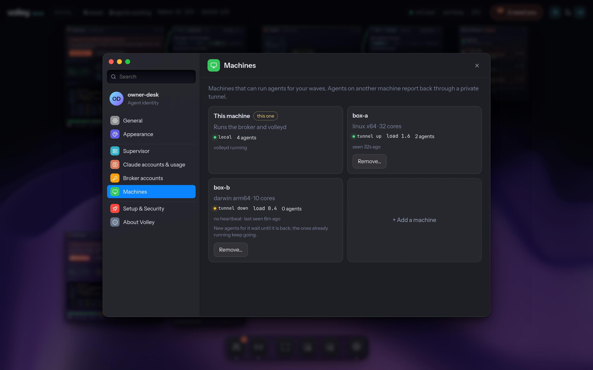

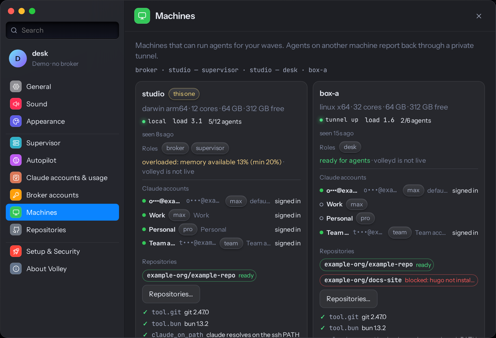 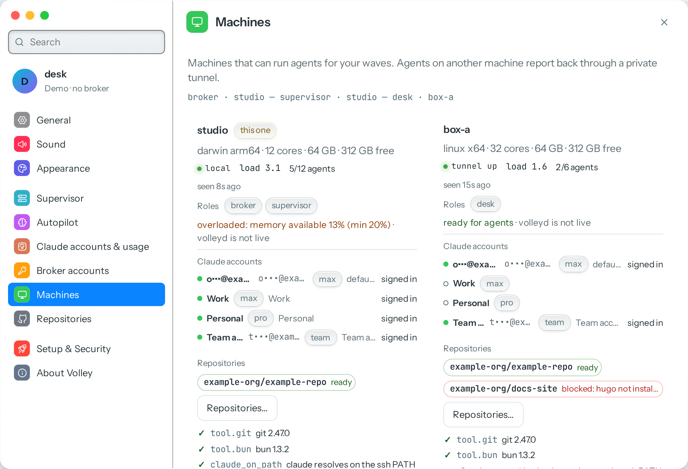

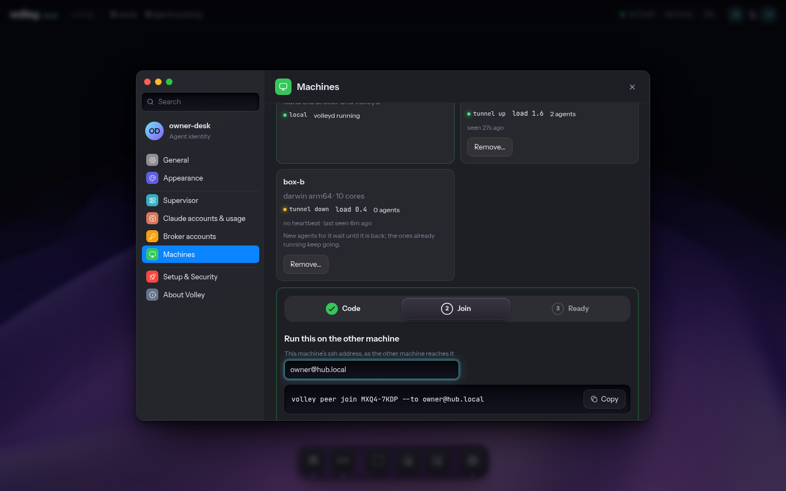 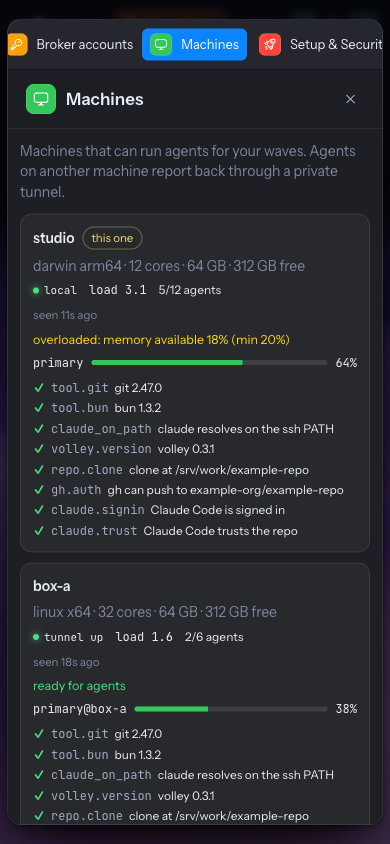

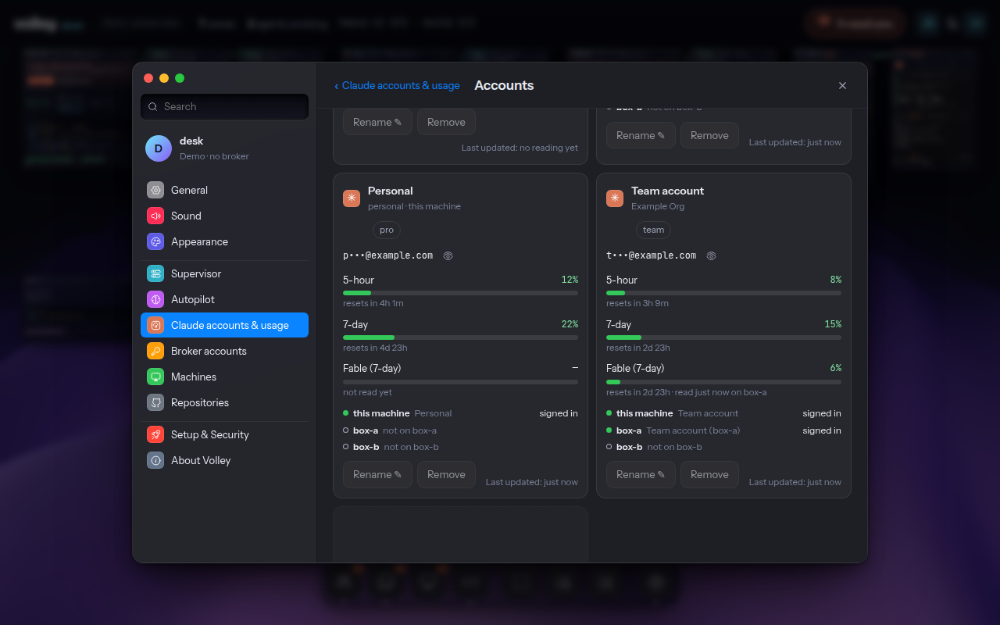

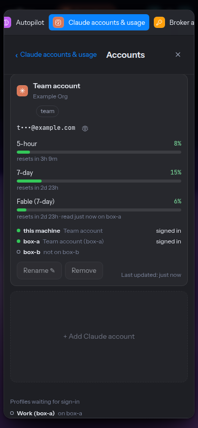 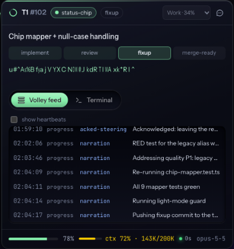

- **Settings › Broker accounts and Setup & Security** talk to volleyd over the admin channel (`store/control.ts`, SPEC §4.6.10): each request goes to the account's own `volley/_system/auth/ops/<username>` with a `reply_key`, and the answer on `volley/_system/auth/replies/<correlation_id>` is accepted only from `volleyd`; a password or token in it is sealed to this browser. Only an admin account may send them: the Desk knows it is one from the stored role (a redeemed admin token) or, the first time an admin-only section opens, from one `account_list` volleyd answers. **Broker accounts** lists `account_list` (name, role chip, where, last seen) with an Agents row (the supervisor's per-spawn logins on every machine, with the live count: nothing to manage); every admin-token sign-in is a device admin account, so one volleyd has not seen for over a day (its last auth request, else its creation, and never before `account_list`'s `seen_since`, volleyd's start: it keeps auth requests in memory; never this browser's own) is flagged **stale**. An open Desk signed in as an admin checks in with one `account_list` every hour, so one in use is never stale, and **Revoke the N stale sign-ins…** revokes them all, one `account_revoke` each, after a confirm; **New account** (Desk → can steer, Coordinator → can steer, Viewer → watch only) is `account_create`, **Rotate** is `account_rotate`, and both show the new password once with a QR code and Copy; **Revoke…** asks, then `account_revoke`. Your own account has no actions. **Setup & Security** shows the broker (where the Desk connects; for an admin, from `setup_plan`: whether accounts are required, read from what each listener does with an anonymous client, pending Security changes apart, when setup last ran) and the admin block: **Issue new token** (`admin_token`: the token comes back sealed to this browser and is shown once), **Preview** of the sign-in screen and **Run setup again**, which closes Settings and opens the wizard in its own modal as `volley setup --repair`: `volley setup`'s five steps (Broker, Security with its LAN question above the changes it plans for, Accounts with the one-time admin token shown once, Services, Phone with a QR code of a one-time `signin_link`, never spent while a phone could not reach the broker). Each step is planned by `setup_plan` and applied only on **Apply** (`setup_apply` with the step's `plan_id`, so volleyd applies exactly the plan shown or refuses); a change only a terminal can make shows why and the command. Applying waits up to two minutes, and an answer that arrives later (a broker restart drops the connection for a moment) still shows, token included. A volleyd that answers `unknown op` to `setup_plan` or `admin_token` gets `volley setup` / `volley auth token` to run in a terminal instead. A browser that is not an admin cannot list accounts: it sees its own row and the Agents row, and can paste an admin token to sign in with it.
- **Without broker credentials** (an anonymous sign-in) or in demo mode Supervisor sends nothing. A global row still takes a new value, and then offers the exact `volleyd config set <path> <value>` line that sets it to copy (nothing to copy until the value differs from the current one). Without the async Clipboard API (plain `http://` from another device) the button selects the line and falls back to a legacy copy, or asks you to copy it by hand.

### Sounds

**Settings › Sound** picks one of twelve sound themes (Synthwave by default, Arcade 8-bit, Glass, Soft UI, Mechanical keyboard, Sci-fi bridge, Nature / wood, Retro Mac, Orchestral pizzicato, Lo-fi tape, Space ambient, Minimal clicks). Each theme card has an audition row: one chip per event, which plays that event in that theme without switching to it. Below are master volume and Mute all, one switch per event (grouped UI, Agents, Pipeline, Wave, Steering, System, Attention; Agent working is off by default) with a play button each, and when sounds play: **Only when the Desk tab is hidden** (agent, pipeline, wave and system sounds), **Quiet hours** (local time, wrapping midnight; Needs you still plays unless **Attention sounds too**), **Follow reduced motion** (on: `prefers-reduced-motion: reduce` silences everything) and **Vibrate on attention** (where the browser can vibrate). Everything persists per browser in `volley-desk-sound`, validated key by key; a theme loads only when picked or auditioned.

The 28 events come from the store (an agent spawning live, finishing, failing or blocked, reaped; a review written; a decision answered; CI passing or failing; a gate opening; a PR merged; a wave starting, completing or stopping; an account limit; a machine going down; the broker disconnecting and reconnecting) and from the Desk itself (clicks on switches, segmented pickers and dock items, window drags and drops, tethers on and off, Settings, steering and coordinators panels opening and closing, steering sent and delivered, anything moving into Needs you). Nothing sounds while the store is settling after a load or reconnect. UI sounds never play in a hidden tab. Repeats of one event within 250 ms are one sound, and the count is read out in an `aria-live` line ("12 agents completed"); one event never repeats faster than 400 ms (60 ms for clicks; Needs you always plays). Browsers start audio only after a gesture, so the first click or key unlocks it. A missing clip, a failed download or a browser without Web Audio is silence. The speaker in the top bar and General's Needs-you switch turn the Needs-you sound on and off, and `volley-dash:notify`'s `sound` always mirrors it for the legacy dashboard. How the clips are made is in [`sounds/README.md`](../../sounds/README.md).

## React Bits

Components come from the [React Bits](https://reactbits.dev) shadcn registry (`@react-bits`, `https://reactbits.dev/r/{name}.json`). Install the TypeScript + CSS variant into its own folder under `src/rb/`, from this package directory:

```sh
bunx --bun shadcn@latest add @react-bits/<Name>-TS-CSS --path src/rb/<Name> --yes
```

The command was verified with Dock: `@react-bits/Dock-TS-CSS --path src/rb/Dock` writes `src/rb/Dock/Dock.tsx` and `src/rb/Dock/Dock.css`. It also adds the component's npm dependencies through bun. Record every component you install here:

| Component | Install command | Used by |
|---|---|---|
| StatusMark | `bunx --bun shadcn@latest add @react-bits/StatusMark-TS-CSS --path src/rb/StatusMark --yes` | agent window title with *Classic spinner* (`src/windows/agent/AgentWindow.tsx`) |
| ElasticSlider | `bunx --bun shadcn@latest add @react-bits/ElasticSlider-TS-CSS --path src/rb/ElasticSlider --yes` | settings rows (`src/settings/SettingsModal.tsx`) |
| PromptBar | `bunx --bun shadcn@latest add @react-bits/PromptBar-TS-CSS --path src/rb/PromptBar --yes` | steering panel (`src/steer/SteerPanel.tsx`) |
| Dock | `bunx --bun shadcn@latest add @react-bits/Dock-TS-CSS --path src/rb/Dock --yes` | dock (`src/look/DeskDock.tsx`) |
| GlassSurface | `bunx --bun shadcn@latest add @react-bits/GlassSurface-TS-CSS --path src/rb/GlassSurface --yes` | liquid-glass chrome (`src/canvas/Frame.tsx`) |
| Stepper | `bunx --bun shadcn@latest add @react-bits/Stepper-TS-CSS --path src/rb/Stepper --yes` (two local edits: a default for `noUncheckedIndexedAccess`, and `getAnimations?.()`) | add-account flow (`src/settings/ClaudeAccounts.tsx`) |
| SpotlightCard | `bunx --bun shadcn@latest add @react-bits/SpotlightCard-TS-CSS --path src/rb/SpotlightCard --yes` | spotlight chrome (`src/canvas/Frame.tsx`) |
| BorderGlow | `bunx --bun shadcn@latest add @react-bits/BorderGlow-TS-CSS --path src/rb/BorderGlow --yes` | border-glow chrome (`src/canvas/Frame.tsx`) |
| ElectricBorder | `bunx --bun shadcn@latest add @react-bits/ElectricBorder-TS-CSS --path src/rb/ElectricBorder --yes` | electric Needs-you effect (`src/canvas/Frame.tsx`) |
| StarBorder | `bunx --bun shadcn@latest add @react-bits/StarBorder-TS-CSS --path src/rb/StarBorder --yes` | star Needs-you effect (`src/canvas/Frame.tsx`) |
| DecryptedText | `bunx --bun shadcn@latest add @react-bits/DecryptedText-TS-CSS --path src/rb/DecryptedText --yes` | decrypt narration (`src/windows/agent/Narration.tsx`) |
| ShinyText | `bunx --bun shadcn@latest add @react-bits/ShinyText-TS-CSS --path src/rb/ShinyText --yes` | shiny narration (`src/windows/agent/Narration.tsx`) |
| SpecularButton | `bunx --bun shadcn@latest add @react-bits/SpecularButton-TS-CSS --path src/rb/SpecularButton --yes` | sign-in button (`src/auth/SignInGate.tsx`); Claim and the settings Done (`src/look/PrimaryAction.tsx`) |
| GooeyNav | `bunx --bun shadcn@latest add @react-bits/GooeyNav-TS-CSS --path src/rb/GooeyNav --yes` | agent window tabs (`src/look/GooeyTabs.tsx`) |
| LineWaves (also a background) | `bunx --bun shadcn@latest add @react-bits/LineWaves-TS-CSS --path src/rb/LineWaves --yes` | sign-in backdrop (`src/auth/SignInBackdrop.tsx`) |
| every background (63, the list in `src/look/backgrounds.ts`) | `bunx --bun shadcn@latest add @react-bits/<Name>-TS-CSS --path src/rb/<Name> --yes` | background picker (`src/look/backgrounds.ts`) |

**Vendored code.** Components are kept as the registry ships them, so they can be re-installed or diffed against upstream. The registry code isn't written for this repo's strict compiler flags (`noUncheckedIndexedAccess`, `exactOptionalPropertyTypes`), so each component installed from D7 on gets one first line, `// @ts-nocheck: vendored React Bits component …`; its exported prop types still check the Desk's call sites. Biome skips the vendored components (a `biome.json` override on `src/rb/`) but still lints `StatusMark` and `ElasticSlider`, which were adapted by hand. `SpecularButton` has one marked change: its effect cleanup releases the WebGL context only once the canvas has left the page, since React's StrictMode (dev) re-runs the effect on the same canvas and a lost context never draws again. `GooeyNav` takes a `role`, a label, a key handler and per-item props (lines marked `Desk:`), so `GooeyTabs` can make it a real tablist and the Settings `Seg` a radiogroup, and measures its items in its own pixels (the canvas is zoomed with a CSS transform, which `getBoundingClientRect` reports scaled); The registry install also rewrites `react-dom` to a range and adds `ogl`, `three` and `vgpu` unpinned: restore `react-dom` and pin new dependencies to exact versions at least two weeks old.

**Licence.** The components under `src/rb/` are not Apache-2.0: they keep React Bits' MIT + Commons Clause licence, which allows shipping them as part of this application but not redistributing the components themselves. See [`THIRD_PARTY_NOTICES.md`](THIRD_PARTY_NOTICES.md).

**Reduced motion.** The prototype's CSS rules stop the Desk's own animations (see [Reduced motion](#reduced-motion)). Most React Bits components check `prefers-reduced-motion` themselves; `ColorBends` (a continuously animated background), `BorderGlow` and `GlassSurface` don't.

**Backgrounds stay complete.** `bun run sync:react-bits-backgrounds` compares the `## Backgrounds` section of https://reactbits.dev/llms.txt with `src/look/backgrounds.ts` and exits 1 when React Bits lists one the picker lacks (CI shows it as a warning). To add one: install it, add it to the allow-list and to `BACKGROUNDS` (components with a required prop get a generated input in `p`, as `GridDistortion.imageSrc` does).

**Allow-list.** Only the free components that the approved prototype uses, and the reviewed D10 adoptions (GooeyNav, RubberSegment), are allowed; RubberSegment is not installed since its one use (a wave's settings scope) moved to Settings › Supervisor. The list is in `scripts/check-react-bits.ts` (`REACT_BITS_ALLOW_LIST`). `bun run check:react-bits` fails when any entry under `src/rb/` is not on it, and CI runs it as the *React Bits allow-list* job. Pro components are never allowed.

## Tests

```sh
bun run test         # vitest + jsdom; mqtt-client runs against an in-process Aedes broker
bun run typecheck
```
